# Archavalon

The world of Blood of Icetear.

**Status.** 175 documents exist in the Drive archive. **Every one that carries
structure has now been read**, including the Foundation Age chronicle, the Age of
Mortal Rebellion, both Sagas, the Forces powerscale, the Ancient Language, the
calendar, the economic history and every character novella. Three documents are
duplicates or empty, two belong to other settings, and one was left out on
purpose. All six are named in section 27.

Where a document says something, it is kept in that document's own terms. Where
two documents disagree, both are shown and the disagreement is named. Where
nothing has been written, it says **OPEN** rather than guessing.

---

## 1. The name of the world

**Avalonus is heaven.** Hyperion raised it after the War of the World Titans as
the Golden Heaven Realms, *"not as paradise, but as a high seat of defense, where
angels were forged for vigilance rather than joy. Its light was not the light of
comfort. It was the light of distance."*

**And the world is called Archavalon.**

So the world's name means **Arch-Avalon**. Which makes one line in `The Great
Knight's of Determination` the thesis of the whole work rather than a flourish:

> Camelot was never meant to become merely the greatest kingdom of men. **It was
> destined to become Avalon.**

And `KB: Arthur White` closes the loop from the other side: **the Kingdom of
Archavalon was formerly called Coelsius.** The kingdom took the world's name, and
the world was named after heaven. **Arthur's project is to make the world worthy
of the name it already has.**

---

## 2. The spine: twenty themes and four laws

### The twenty themes

1. Evil is there to bring about greater good.
2. The grey balance threads the lines between light and dark.
3. To live a life of peace, you must be a man ready for war.
4. Never speak to fill silence.
5. A man that flies from his fear will find he only takes a shortcut to meet it.
6. Faithless is he who says farewell when the road darkens.
7. There is honour outside of battle.
8. Empathy of life will solve greater turmoils.
9. Evil may not be dark, as even dark beings may have the will to overcome evil.
10. Evil always corrupts.
11. Evil demands obedience over virtue.
12. There is a God who breathes life to every universe.
13. There is always a choice to redeem thyself, to those not born of evil.
14. Higher beings of the divine are only meant to guide, not control.
15. The finality and consequence of death should not be judged upon lightly.
16. There is always hope.
17. Mortals should be inspired and driven by their faith in themselves, rather
    than faith in gods.
18. Small and large acts of giving are the greatest form of resolution.
19. The greatest strength comes from doing things for others.
20. To achieve the divine breath one must breathe in a lifetime of experiences.

### The four laws underneath them

These are written across a dozen separate documents and have never been put side
by side. Together they are the entire moral architecture of Archavalon.

**I. Fear is the oldest enemy, and Hope outranks her by one.**

In the Primordial Pantheon, **Fear** is **female, Chaos-aligned, and Primal** in
personality, and she sits fourth behind only Death, Time and **Hope**, who is one
notch above her at **17 against 16.**

**That ordering is deliberate, and it is the only number in the archive this
bible treats as canon.** Section 4 retires the power figures everywhere else.
**This one stands**, because it is not a measurement. It is the argument.

**The author's statement of it:**

> **There must be something to overcome fear. Be that hope. Though fleeting, when
> pushed to the brink of despair it will be your only light out.**

**Read the two words beside each other and the whole design is there.** Fear is
**Primal** and she **spread herself thin into everything**, so she is permanent,
ambient, and everywhere at once. **Hope is fleeting.** It arrives late, it does
not stay, and it cannot be stockpiled.

**And it still wins by one.** Not by a margin that makes victory comfortable, and
not by enough to make it likely. **By the smallest possible amount, which means
every single time it happens, it only just happens.**

That is why the moment recurs in every arc rather than once at the end. **Hope
cannot hold a position, so it has to keep arriving**: a voice inside the Eclipse
saying *stand*, a blade of light answering devotion at the brink of death, a
dying queen reaching for the girl who maimed her, Annie withdrawing her hand. In
each case it is fleeting, it is late, and **it is the only light out.**

And Fear did not hoard her power. **She spread herself thin into everything**,
which is why `Forces` records her falling from 666 billion to 1.3 billion *"after
the spread of Fear."* She does not plot. She is **Primal**. She distributed
herself through the world and waits for people to do her work.

Almost every arc in the archive is a test case:

| Character | Their relationship to fear |
|---|---|
| **Morgana** | her stated theme is **"Fear is the poison that turns love to hatred"** |
| **Anthurian Bloodwing** | learned that when soldiers feared her they could not hurt her, so **cruelty became safety** |
| **Amelia** | teaches that **fear is a sense like hearing or sight. Ignore it and it kills you. Understand it and it reveals what others tried to hide** |
| **Cholo Puto** | **"Fear could travel farther than any arrow"** |
| **Evalon** | traded humanity's immortality out of fear, and that is why humans die |
| **Seneal** | monsters are made slowly, by neighbours closing doors and good people staying silent |
| **Alice** | the door opened the moment she feared losing more than she loved |
| **Antharaiel** | feared moral discomfort more than she feared invasion |
| **Hansall** | loved peace, never trusted it, and was right |
| **Revendrinn** | mastered absence, then could no longer bear to be seen |
| **Dheivan Hemarc** | fears discomfort, and so never becomes a good man |
| **Nara** | an entire region reduced to terror |
| **Nalshal** | titled the **King of Fear** |
| **Arthur and Nilrealm** | explicitly the counter-argument, that **fear faced honestly becomes courage and compassion** |

**II. Evil cannot take. It can only be let in.**

**Lucifial could not force his way into the Fae Garden Sanctuary**, because Fae
lands cannot be entered without consent, so instead **he learned**. And
**Eldritch magic, the Black Sea's own school, is the narrowest in the world.** It
has no offensive mode and no defensive mode. It can only **summon**. It is
nothing but a doorway, and a doorway needs someone on this side.

| Who | Method |
|---|---|
| **Lucifial** | *"a darkness that seemed delighted to have discovered how little encouragement resentment actually required"* |
| **Salomei** | appears, becomes beloved, vanishes, and leaves a hole the victim will fill with anything |
| **The Prime God of Blood** | *"It did not conquer. It did not command. It whispered"* |
| **Revendrinn Nyxthorn** | cannot plant a thought, only **return** one the victim already had, until it stops feeling like intrusion |
| **Nara** | **"She did not conquer through fear. She made people love their own destruction"** |
| **The Hsal-Erakla** | the schism begins with a question, not a crime: **"What if they refuse?"** |

And Salomei states it outright, to Alice:

> **"You mistook the books for the door. The books merely taught you how to
> knock. The door was opened the moment you wanted what the ritual offered."**

And the single line that is the mechanism of every evil in this world, from
Lucifial's first whisper to Cainan:

> **He showed him difference and called it injustice.**

**III. Goodness has to be chosen more than once.**

Glorfarsall, kneeling beside Abel's body, asks how a people brought into the
world by something great could become this.

> *"Because origin is not destiny." "So none of it matters?" "I didn't say that."
> "Then what keeps them good?"*
>
> **"Nothing keeps anyone good. Not Titan blood. Not Fae blood. Not being born
> loved. Goodness has to be chosen more than once."**

**IV. Those who carry both light and darkness walk the Path of Vaen.**

After the Five Slayers fight Nara, the four survivors wake as **Slayer Angels**,
*"warriors carrying both sacred light and conquered darkness within
themselves."* And:

> To master what they had become, **they would have to seek the forgotten Path of
> Vaen. For only those who learned to walk between Light and Darkness without
> surrendering to either could remain truly free.**

### The two moments someone refuses

- **Annie**, with a dead infant in front of her and forbidden power within
  reach: **"I would rather mourn beside them than become the reason others must
  mourn."**
- **Adamas**, with Lucifial reaching for his murdered son's soul: **he refused**,
  and forged the grief into something the abyss could not swallow.

### And the Nyxthorn doctrine, which is theme 2 as law

> Darkness is not evil. Darkness is merely where sight fails. A shadow can hide
> a murderer. **It can also hide a child from a murderer.** Poison can
> assassinate a king. It can also kill the creature devouring his people.
> Silence can conceal treason. It can also conceal refugees beneath the
> floorboards.
>
> **The moral weight belongs to the hand.**

---

## 3. Before anything: the Pre-existence

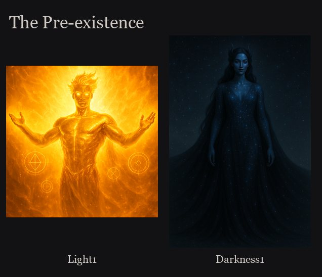

**The Light Entity** is the momentum of the universe, the masculine drive that
struggles to strive for greatness, to shine out of the darkness and be known,
the potential in everything, the warmth and burning nature of matter.

**The Dark Entity** is the mass of the universe, the feminine presence that
encompasses everything, the natural power within everything, the bitter cold and
unforgiving nature of matter.

They warred for billions of years, breaking and remaking universes.

Then, as the light was finally overcoming the darkness, **emotions were born**.
The light looked and saw pride, arrogance and cruelty in the darkness. **It also
saw deep pain, misunderstanding, and even betrayed love.** Before the final blade
of light could land, **he stayed his hand.** The darkness was surprised, **and
also knew deep down why he did.**

They united, and birthed Life into the universe.

`Origins` names them **Elaawei**, the Light, male, and **Nuurtanah**, the Dark,
female, and says they made the universe with their love and **sparked life with a
limb sacrificed by each.** The powerscale records both at **Infinity**.

**That hesitation before the killing blow is the oldest instance of theme 9 in
existence, and everything downstream is a repetition of it.**

---

## 4. The ladder

**Read this before the tables below. The numbers are not canon.**

`Forces - Powerscale` carries a figure for almost every being in the world, in a
unit called **MJD, Megagem per Day**. **Those figures are early concept
prototypes and they are no longer the authority.** They are kept in this bible
because they still show which beings were conceived as roughly comparable, and
because some of the gaps in them look deliberate. **But nothing is ranked by
them. Where a number and the story disagree, the story wins.**

**One exception, and only one.** **Hope at 17 and Fear at 16** in the Primordial
Pantheon is canon, because that pair is not a measurement, it is the argument of
the whole work. Section 2 has it.

**The tiers themselves are kinds of being, not strength brackets**, and in that
order they are:

| Tier | What it is |
|---|---|
| **The Pre-existence** | Light and Darkness. Not beings so much as conditions |
| **The Primordial Pantheon** | the twenty: Death, Time, Hope, Fear, Life, Magic and the rest. Offices rather than persons |
| **The Universal Titans** | the fifteen who crafted the astral bodies, each with a job. Called the **Genesis Titans** and the **Sustainer Titans** elsewhere in the archive. One tier, three names |
| **The World Titans** | the ones who shaped **this** world and then had to leave it. **Hyperion, Ra, Lucifial, Hades, Glorion, Freyva** |
| **The Prime Gods** | the world's own immune system. Planetary functions with faces |
| **The Demi-Gods** | the children of unions |

**The Sustainer Titans are not a side branch. They are the second rung.** The
archive calls this tier **Universal**, **Genesis** and **Sustainer** in different
documents, and they are one group: **the Titans who craft the astral bodies.**
Primordial Titans are pure concepts holding a consciousness and build nothing.
The Universal Titans build the worlds. **Then each astral body receives its own
World Titans**, which is why Mór-Ríoghain is Archavalon's chip of Magic and not
Magic, and why another world somewhere holds a different chip of the same
Primordial under a different name.

**But a World Titan's origin is not fixed, and it is usually not obvious.** A
chip is not struck cleanly from one concept every time. **Mór-Ríoghain is purely
Magic**, which is the simple case and the rare one. **Lilith is Pain and Chaos
together**, and Malice is what those two make when they are struck off into one
being. Others are a blend of three. And some World Titans do not come down
from the Primordial Pantheon at all, **they come from the Universal Titans**,
which is a different inheritance entirely: built rather than conceptual.

**So you cannot read a World Titan's parentage off their title**, and the bible
does not try. It explains why **Power**, **Light** and **Night** sit as offices
of this tier while no Primordial of Power, Light or Night exists. Ra, Hyperion
and Nyx are not failures of the mapping. **There was never a mapping.**

**And nothing else is a Titan.** The archive's **Dwarf Titans** are retired
from the ladder entirely. The name was used for two unrelated groups, neither of
this tier: the **mountainkin** the World Titans made to help shape the world,
and the lesser powers who fought the **Age of Betrayal**. The old numbers are
the only thing that ever ranked either against the World Titans. **So they are
not ranked here, and they are not Titans.**

**What is still unsettled** is section 4's table of **four planetary
generations**, which files Sustainers as the third of four and uses the word
Universal for the first. That table predates this ruling and needs rewriting
against it.

**What this corrects.** The powerscale spreadsheet files **Ra, Hyperion,
Soulomon, Mór-Ríoghain, Nephthys, Freya and Frey** under a heading called
**Ascendant Gods**, and files the Dwarf Titans under **World Titans**. **That is
backwards, and both headings are retired.** Every other document you have written
calls Hyperion and Ra World Titans, the Law of Divine Distance says "from World
Titan to Angel" and Hyperion is the one who issued it, and `Forces` itself calls
Lucifial the **World Titan of Punishment and Necessary Darkness**. **Ascendant God
is no longer a rank in this bible.**

### The Primordial Pantheon

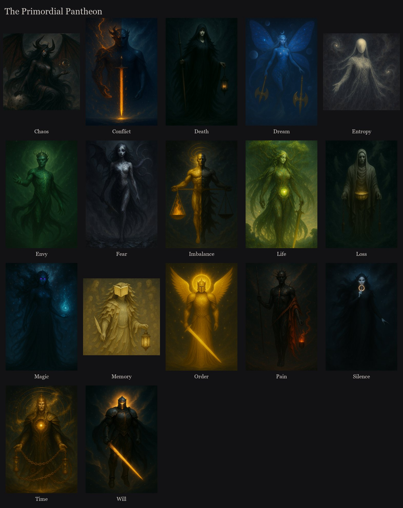

Twenty, with genders and alignments, ranked by power.

| Titan | Power | Alignment | Personality | Gender |
|---|---|---|---|---|
| **Death** | 25 vigintillion | Neutral | Neutral | Female |
| **Time** | 25 | Neutral | Neutral | Male |
| **Hope** | 17 | Neutral | Altruistic | Female |
| **Fear** | **16** | **Chaos** | **Primal** | **Female** |
| Order | 12 | Neutral | Neutral | Male |
| Will | 12 | Neutral | Neutral | Male |
| Life | 11 | Neutral | Neutral | Female |
| Chaos | 11 | Chaos | Cunning | Female |
| Loss | 10 | Neutral | Neutral | Male |
| Pain | 10 | Chaos | Cunning | Male |
| **Magic** | 10 | Neutral | Neutral | Female |
| Silence | 10 | Neutral | Neutral | Female |
| Envy | 10 | Neutral | Cunning | Male |
| **Witness** | 10 | Neutral | Neutral | Male |
| Imbalance | 10 | Neutral | Neutral | Male |
| Memory | 10 | Neutral | Neutral | Male |
| **Conflict** | 10 | **Chaos** | **Honourable** | Male |
| Entropy | 10 | Neutral | Neutral | Female |
| Dream | 9 | Neutral | Neutral | Female |

**Conflict is the only Chaos-aligned Honourable Titan.** Theme 2 written into the
pantheon.

**Her name is Mór-Ríoghain.** That is what she is called in the archive and in
the bible's own voice, always. **"The Morrigan" is a mortal word**, a worn down
version of the real one that came into use in the later ages among people who
had never been close enough to be corrected. It is not wrong to write it in a
mortal's mouth. It is wrong anywhere else.

**And Mór-Ríoghain is Magic's chip, not Magic.** The powerscale lists **Magic**
the Primordial Titan and **Mór-Ríoghain** separately, while `Forces` writes them
as one line, "Magic, Mór-Ríoghain." Both are right, and the ladder is what
reconciles them. **A Primordial Titan is a pure concept holding a consciousness,
and it does not walk anywhere.** What walks is a fragment struck off it and
seated in a single world. **Mór-Ríoghain is Archavalon's chip of Magic**, which
is why the novellas call her a Prime Goddess, the plates call her a World Titan,
and her Temple sits outside time. She is small enough to stand in a world and
old enough not to obey it.

**Which means there is more than one of her.** Every astral body the Sustainer
Titans crafted carries its own World Titans, so somewhere there is another chip
of Magic under another name, and the two have never met. **Mór-Ríoghain is not
the Primordial Titan of Magic. She is what Magic looks like here.**

### The Genesis Titans

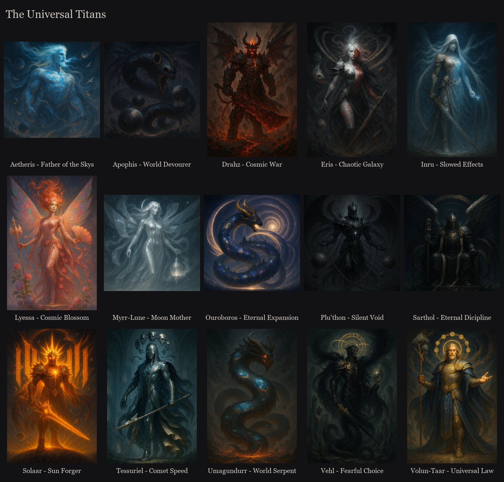

Fifteen, each with a described function. **Nothing of this tier was in the bible
before and it is the best-written tier in the archive.**

| Titan | Power | What they do |
|---|---|---|
| **Solaar**, Sun Forger | 500 Oct | Hammered the first suns into existence. Shapes the nuclear hearts of stars, planting light across the darkness |
| **Ouroboros**, Eternal Expansion | 500 Oct | The infinite hunger of the universe to grow. **His breath pushes galaxies apart** |
| **Volun-Taar**, Universal Law | 420 Oct | Architect of natural laws: gravity, inertia, thermodynamics. **His word binds matter and motion into order** |
| **Sarthol**, Gravity of Discipline | 420 Oct | The enforcer of boundaries. His gravity holds solar systems together and **chains the rebels of physics** |
| **Umangundurr**, World's Serpent | 350 Oct | Wraps worlds in magnetic fields and protective forces. **Shields planets so life may grow** |
| **Aetheris**, Father of the Skies | 300 Oct | Breathed the first atmosphere into the void. Keeper of starlight winds, cosmic weather and breathable realms |
| **Apophis**, World Devourer | 300 Oct | The destroyer of doomed worlds. Collapses planets into singularities, **resetting dying systems so rebirth can happen elsewhere** |
| **Inru**, Universal Veil | 270 Oct | Weaver of the fabric of spacetime. **Her veil separates dimensions, realities and eras from one another** |
| **Myrr-Lune**, Moon Mother | 250 Oct | Weaver of moons and satellites. Governs tides, dreams, reflection and gravitational echoes |
| **Drahz**, Cosmic War | 220 Oct | Violent creation. Supernovas, star collapses, black hole births. **His wars forge new worlds from ruin** |
| **Plu'thon**, Silent Void | 130 Oct | Patron of dead stars and rogue planets. **Keeper of the spaces where light dares not tread** |
| **Lyessa**, Cosmic Bloomer | 120 Oct | Goddess of cosmic gardens. Seeds nebulae, planet fields and organic potential. Births life zones |
| **Eris**, Chaotic Galaxy | 80 Oct | Cosmic disorder. Births galaxies twisted by turbulence. **Evolution through chaos** |
| **Vehl**, The Dark Matter | 60 Oct | Silent skeleton of the cosmos. Unseen threads holding galaxies together, whispering support beneath all visible matter |
| **Tessuriel**, Comet Speed | 50 Oct | Messenger of cosmic will. **Her comets carry raw materials and omens between worlds** |

**Three payoffs.** **Inru's veil is why the realms are separate**, and why the
Black Sea could reach Archavalon at all: something crossed it. **Apophis is not
evil**, he resets dying systems so rebirth can happen elsewhere, which is theme 1
in a being. And **Tessuriel's comets carry omens**, which means the meteor shower
at the end of the Third Age, immediately before the Thirteen descended, **was a
message.**

`The God Realms` adds that three of them are the **Great Leviathans**, pieces of
the second-generation pantheon with routes between realms: **Umangundurr** brings
a planet to life by placing its slumbering child in a deep chasm or oceanic
trench to shape the landscape, **Ouroboros** sparks life in planets that can
sustain it, and **Apophis** consumes planets that lose all their benevolent
energies.

### What the World Titans did early, and the mountain folk they made

The archive files this as **four planetary generations** and that framing is
retired. **Two of the four were never a planetary tier at all.** The
**Universal** shapers who became the celestial bodies and the **Galaxy Rulers**
who gifted the knowledge for life are the **Universal Titans** of section 4, the
second rung of the ladder, and they belong there rather than in a sequence of
planet-walkers.

**And what the table called the third generation, the Sustainer Titans, were the
World Titans.** The name was wrong. These are the ones who shaped this realm
early and walked it, and the act that defines them is the one the table already
recorded without noticing what it was saying: **they sacrificed two thirds of
their power to reach into the afterlife and build three realms inside this
world's own space.** **Thanatos** took charge of the Ghost Realm. **Oceanus**
went into a deep slumber under the ocean. The rest left.

> **The tier that shaped this world spent most of itself making somewhere for
> the dead to go, before anything here had died.**

**The mountain folk were made, and they were never Titans.** They are the
**original mountainkin, created by the World Titans to help shape the world**,
which is why the stone of Archavalon is worked rather than merely old. **Most of
them were slain in the Titan Wars.** Those who remain are the remnant of a
remnant, and they are the only beings still walking who were built for the job
of building.

**The archive calls them Dwarf Titans and that name is retired**, because it was
doing double duty: it was also applied to the lesser powers of the **Age of
Betrayal** below, who are a different group entirely and equally not Titans.
**Neither set belongs on the ladder.**

**The 1st Beings** were the Old Gods, the Colossal Behemoths, the 1st Archdragon
and the Great Leviathans.

### The Age of Betrayal, and the Celestial Titans

**They were never Titans.** The archive calls them **Dwarf Titans** and files
them as a fourth planetary generation. Both are retired. They were lesser
powers seated beneath the World Titans, and the old ledger's figures for them
are prototypes of a tier that does not exist.

**Their war against the 1st Beings is the Age of Betrayal.** Outnumbered but far
stronger than the divine and mortal races, they nearly won, **and they were
beaten only from the inside.**

**Nyx, Erebus and Eris turned on their siblings**, remembered what they had been
made for, and sided with the Elder Gods. They **slew Makemake, Haumea and
Chronorus**, **imprisoned Plutarr in the Ghost Realm**, and **imprisoned Dagonn
in the Largest Mountain Range.**

The three were named the **Celestial Titans** for staying on course, which is a
title granted rather than a tier earned, and given one charge: **to defend this
world from the external threats of the Black Titan and its Eldritch
nightmares.**

> **Now we see these three as star constellations.**

**So the Black Sea invasion is the failure of the Celestial Titans at their one
assigned job, and every constellation in Archavalon's sky is one of the three
sentries who let it through.** That is the best single idea in the archive and
it survives the tier being retired, because it never depended on what rank they
held.

**Sol survives**, and is the "Titan of the 1st Flame" whom Ra fought in the early
draft. **Dagonn is the weakest, buried in a mountain range, and he later gives
his strength to the Dark Angel.**

### The World Titans

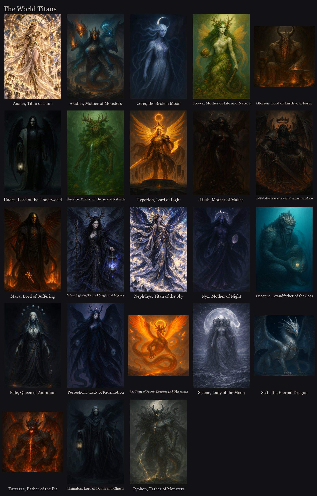

**The ones who shaped this world, and then had to leave it.** The spreadsheet
files these seven under "Ascendant Gods" and that heading is retired. The figures
are the old prototypes, kept only for the alignments beside them.

| World Titan | Prototype figure | Alignment | Personality |
|---|---|---|---|
| **Ra**, Father of Dragons and Phoenixes | 300 Million | Chaos | Honourable |
| **Hyperion** | 130 Million | Order | Honourable |
| **Soulomon** | 90 Million | - | - |
| **Mór-Ríoghain** | 85 Million | Chaos | Cunning |
| **Nephthys** | 70 Million | Order | Altruistic |
| ~~**Freya**~~ | 35 Million | Order | Honourable |
| ~~**Frey**~~ | 30 Million | Order | Altruistic |

**And the documents name more of this tier than the spreadsheet does:**
**Lucifial**, World Titan of Punishment and Necessary Darkness. **Hades**, Lord
of the Underworld, and **Persephony**, Lady of Redemption, beside him.
**Nephthys**, Lady of the Skies, Ra's partner, who holds the office he put down.
**Aionia**, Titan of Time. **Glorion**, who made the mountains and the stone-born races. **Freyva**, who
made the beasts with him. **Atlor the Mountain Forger**, who made the humans of
the north-east. **Lilith, Mother of Malice**, struck from Pain and Chaos
together, and **Tartaras, the Weight Beneath**, both bound rather than
seated. **Tartaras is not named for a pit.** His own scene describes him
arriving not as a form but **as weight**, a gravitational assertion so ancient
that the Abyss bent around it and he did not breach Lilith's prison, **he
overlapped it.** And **Typhon and Akidna**, below.

**Freya and Frey are not two Titans. They are Freyva, twice.** The spreadsheet
is the only document in the archive that names them, and it is the same file
that writes **Solomon as Soulomon** and **Thanatos as Thanathus**. Every other
source has **Freyva**, Mother of Life and Nature, who made the beasts beside
Glorion. **Two more spelling drifts in a file already full of them is the
likeliest reading**, and the two rows are struck through above rather than
deleted, so nobody re-adds them later.

**Soulomon is a World Titan**, and he stands above Mór-Ríoghain on the ledger.
**The ledger spells him Soulomon and every story spells him Solomon**, and the
ledger's spelling looks deliberate, because **Soul** is exactly what he spends to
open the Breach. This bible writes **Solomon** in the history and keeps
**Soulomon** on the ledger line, and that split is worth a decision. **The man who opened Hell in the extreme south was not
a king with a forbidden book.** That single fact reframes the whole Demon Wars.

**Ra is Chaos-aligned and Hyperion is Order-aligned, and both are Honourable.**
Their disagreement over the Law of Divine Distance is between two honourable
beings on opposite sides of the oldest axis there is.

### The two Titans who were born

**Settled, and it resolves the oldest tier argument in the archive. Typhon and
Akidna are World Titans, because two World Titans made them.**

**Lilith and Tartarus are both of this tier.** Which is exactly why their
offspring were called *"Titans without chains. Titans without precedent."* The
precedent they lack is the act itself.

> **A World Titan does not give birth. A World Titan creates.**

Creation at this tier is deliberate, considered, and answerable: Hyperion made
the angels, Ra made the dragons, Glorion made the mountains. **Typhon and Akidna
were not made. They were conceived**, and conceived through **Tartarus's rape of
Lilith** in a domain Lucifial had unlocked just far enough for him to reach her.

**So the Cataclysm is not that two monsters escaped. It is that the tier that
shaped this world was made to reproduce**, once, against its own nature,
**purely through its own corruption and one devil's patience.** Nothing like it
has happened before or since.

> **What followed was not creation. It was violation.**

**And that is why the ledger undersells them.** The old figures in section 7 put
Typhon at 130 thousand and Akidna at 50 thousand, inside the Prime God tier.
**Those are the numbers of two defeated Titans, not two living ones**, which is
one more reason not to rank anything by them. Typhon had
already been slain and pinned beneath his own corpse, and **Mór-Ríoghain drained
Akidna below Prime God strength** before Triton and Neptune were bound to her as
jailors. The record was written afterwards, exactly as it was for Bahamut, whom
it already calls the Black Abomination. **Mortals wrote down what was left.**

### Prime Gods

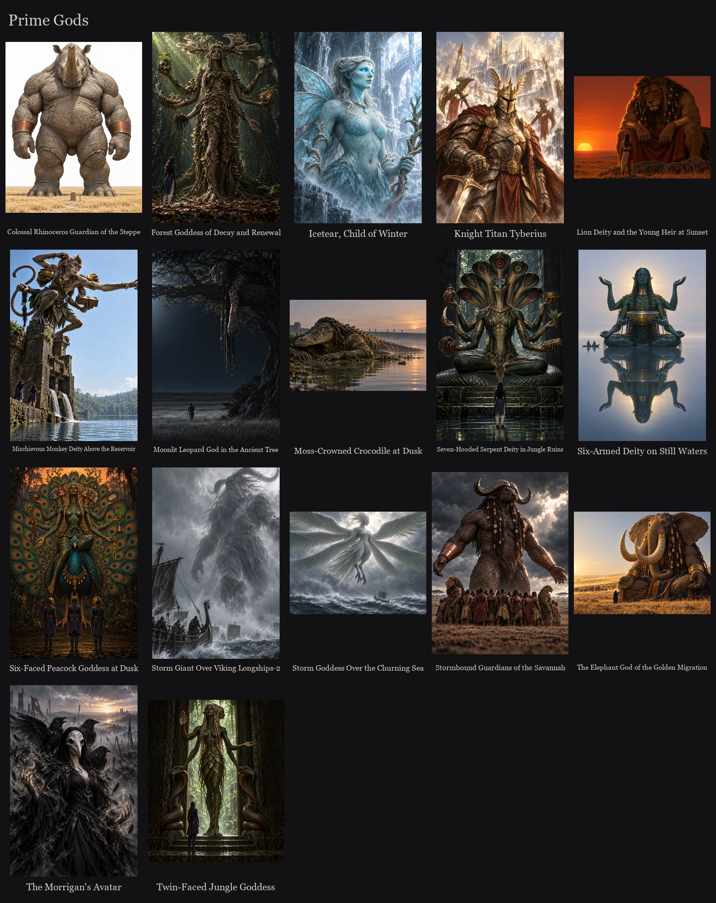

Headed in the sheet as **"The Gods the monsters and mortals worship and fear"**,
and footnoted **"These immortals are considered the pinnacle of the first
generation."**

| Prime God | Power |
|---|---|
| **Soulomon's Avatar** | 960 thousand |
| **Mór-Ríoghain Avatar** | 800 thousand |
| **Typhon** | 130 thousand |
| **Ryujin** | 120 thousand |
| **Delphyne** | 105 thousand |
| **Thormunghundar**, the World Serpent | 97 thousand |
| **Tiamatra** | 96 thousand |
| **Osiris** | 95 thousand |
| **Cthulor** | 90 thousand |
| **Bahamut the Black Abomination** | 86 thousand |
| **Ghaltallion** | 85 thousand |
| **The Crimson King** | 67 thousand |
| **Chernabolg** | 66 thousand |
| **The Violet Queen** | 55 thousand |
| **Akidna**, Mother of Monsters | 50 thousand |

**Typhon and Akidna do not belong in this tier and are listed here anyway.** They
are **World Titans** by blood, and these two lines record them after their
defeat, not at their height. See section 4.

**The avatars sit at the top of this tier, far above the gods they belong to.**
Even in the old prototype figures the ratio is consistent: **a World Titan
projects an avatar at roughly one percent of itself.** That is the Law of Divine
Distance expressed as arithmetic, and it is why avatars rather than gods fight
the wars of the Second Age.

**Delphyne is the strongest of Ra's five children** at 105 thousand, with
Tiamatra at 96 and **Bahamut at 86**, which makes his lone stand against the
Angels a choice rather than a qualification. And he is **already called
Abomination in the ledger**, which means the record was written after his fall.

**The six have three sizes, and two of them are gone.**

**Born, they were islands.** Not large animals and not large monsters. **A
Dragon God at full extension was a landmass**, long enough that one end stood
in weather the other end could not see, high enough that cloud banks broke
against its shoulders and sat below its head, and heavy enough that where it
came to rest became geography. Mountains were the thing it was bigger than.
Anyone standing on the ground saw part of one and never the whole.

**Then the Law of Divine Departure, and only three are left.** Any of Ra's
children could withdraw to his pocket realms and keep every inch of what they
were. **Staying in the world was the thing that cost**, and what it cost was
size.

| | | |
|---|---|---|
| **Tiamatra** | stayed | she refused to go |
| **Nilrealm** | stayed | he refused to go |
| **Bahamut** | stayed | he could not go. He was already in the ground |
| **Ryujin** | went | his line remained along the misty rivers of the East |
| **Delphyne** | went | her wyverns remained in the Central mountains |
| **Osiris** | went | his nature dragons remained in the Great South Jungle |

**The three who remain are the two who refused and the one who could not.**

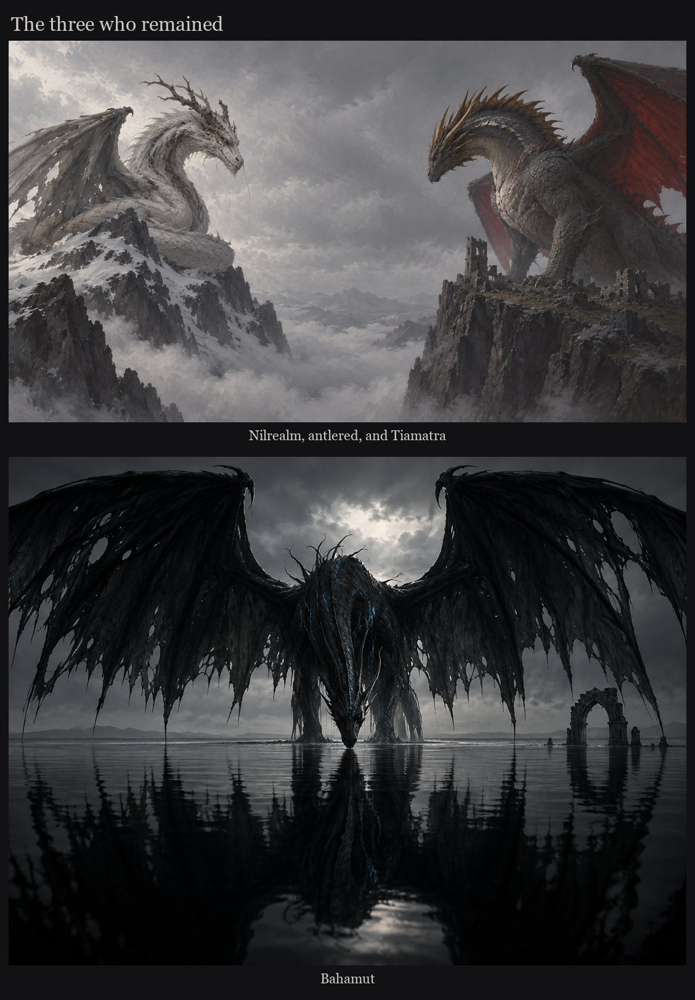

They are mountains now, still beyond anything mortal, still unanswerable, and a
fraction of what they were born to be.

**The three who left are still islands.** They gave up nothing, because they
gave up the world instead. Which means the East is **governed in the name of
gods who left** by people who have never seen what those gods actually are, and
**if Ryujin, Delphyne or Osiris ever came back, they would come back as the
thing nobody alive has seen.** The three diminished gods in the world are the
only ones anyone has ever had to deal with, and they are the small ones.

> **Nobody alive has seen a Dragon God at full size.** Every account of it is
> inherited, and every account is dismissed by someone who has met one of the
> three and found a mountain. **They are arguing from the wrong three.**

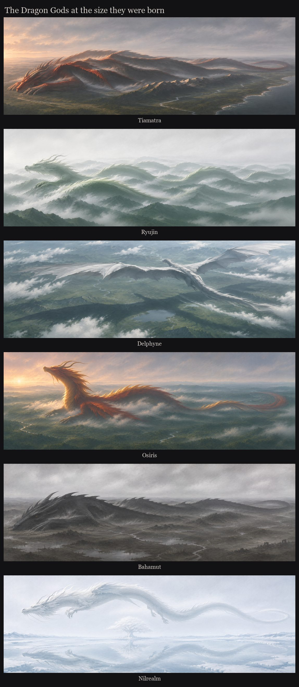

**And the visage is the third size.** A mountain cannot enter a hall, hold a
conversation, bless a child or sit on a throne, so each of the six wears a
humanoid form to do any of it. **The visage is not a disguise, it is an
accommodation**, and mortals who have only ever met the visage tend to forget
there is anything behind it, right up until there is.

**Which settles what Bahamut's imprisonment required.** He is not in a cell.
**The south-west of the Western continent is the cell**, and his presence feeds
the corruption across a whole region because the region is roughly the size of
him. It also means the enchantment Tiamatra laid on him was laid on something
already diminished. **Nobody has ever had to hold the thing he was born as.**

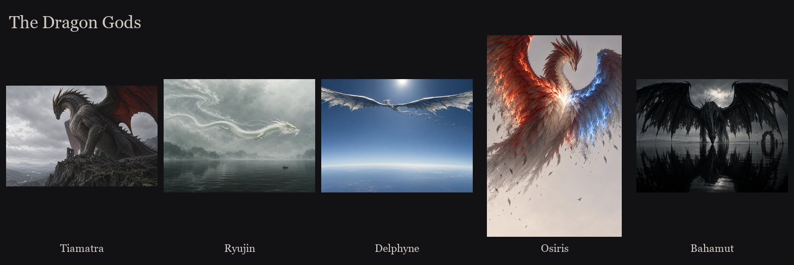

### Nilrealm, the sixth child

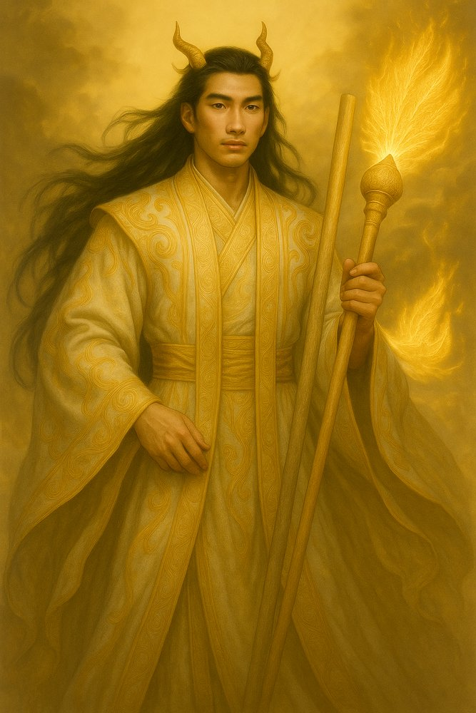

**Ra had five children by his own making, and a sixth he did not make alone.**

Ra went looking for knowledge he did not have, and the deepest of it was not in
his own realm. He entered **Mór-Ríoghain's**. What happened there took eons, and
what it produced was not a thing either of them set out to produce: **they grew
close enough to make a life, and the life took root inside her.** Ra went home.
He did not know. **Mór-Ríoghain did**, and she carried it, and said nothing, for
eons more.

**She did not give birth as a World Titan. She gave birth as her Avatar**, in
mortal scale, **beneath the Great World Tree in the Frozen North.** That one
decision is the most important fact about Nilrealm, and everything odd about him
comes out of it.

**Because he was born through an Avatar, most of him was never delivered.** A
great weight of his essence and his power stayed behind in Mór-Ríoghain's realm,
and it is still there. What walks the world is the part that fit through. It is
also why he is a **dragon of dreams** rather than a dragon of fire: **sleep is
the door home.** Mór-Ríoghain's Avatar raised him under the Tree, but **he saw
his mother herself only when he slept**, in her realm, which is the one place he
has ever been whole.

**He took after her, not his father.** Where his siblings stood with Ra and took
the shapes Ra's children take, Nilrealm preferred **the prophet and the
sorcerer**, an old man's work done in an unaging face. The five are powers. He is
a mind.

**He stayed.** Under the Law of Divine Departure he could have gone back to Ra's
pocket realms at full strength, and he refused it, the way Tiamatra refused it.
**He lost most of his divinity for that choice and is a fraction of what he was
born to be**, which still leaves him one of the most dangerous things walking,
and leaves him the only one of the six who can be met.

**Among mortals he wears his mother's cloak.** Not the white regalia he is
painted in, but **black feathers, layered and ragged, over the dark dress of a
sorcerer and strategist.** It is a son wearing a mother's coat, and it is the
closest thing to her he can carry in a world she is not allowed to enter.

**Ra's children know each other on sight.** When Nilrealm finally walked into
Tiamatra's mountain kingdom, nobody had to tell her who he was and he did not
have to argue it. **They sensed it**, immediately and from across a hall, the
way two of a kind do. What they confirmed afterwards was only the detail, that
the line runs through the World Titans either way, hers from Ra and his from Ra
and Mór-Ríoghain both.

That matters more than it looks. **It means the secret was never really a
secret from the only people who could have told.** Ra did not know because Ra
was not there. His siblings would have known the moment they stood in a room
with him. He simply never stood in a room with them until he chose to.

### Demi-Gods

All at 500 to 3,000 MJ: **Abel**, **Cain**, **Achilles**, **Heracles**,
**Morgana**, **Arthur**, **Merlin**, **Dracula**, **Camilla**.

**Cain is Cainan**, which is exactly why he had *"enough divine ancestry to
believe himself destined for greatness and not enough power to stand as an
equal"* to Solomon and Caligula. **Abel is the Spear.** And the alignments are
inverted from expectation: **Abel is Chaos and Malicious, Cain is Order and
Primal.**

**Arthur, Merlin and Morgana are all demi-gods**, which means Uther's anti-magic
crusade was waged by a man whose own children were divine.

---

## 5. The Ordering of the Realms

**The War of the World Titans ended, and reality was left "bruised, fractured,
and trembling on the edge of collapse."**

> When the World Titans withdrew from the mortal plain, they did not leave
> emptiness behind. **They left architecture. They left thresholds. They left a
> world whose balance was no longer natural, but enforced.**

**Avalonus, the Golden Heaven Realms**, raised by Hyperion. From there the Elder
Gods watch and intervene only when existence itself is at stake, and **Hyperion
made the Angels to serve them, "beings of vigilance and law, forged not to rule,
but to endure."**

**The Eternal Fae Realm**, opened through the veiled accord of **Mór-Ríoghain of
Magic, Selene of the Moon and Nyx of Night** - though even they were not its true
makers, because **it was older than their names**, anchored in the Primordial
Titans of **Dreams, Memory, Magic, Life and Hope.**

> **It was not a palace. It was a circuit. A machine of return.** A sanctuary for
> the Fae dead, and a bridge between living realms **that carried magic like
> blood.**

It has **three ruling courts**: the High Court of the Fae, the High Court of
Seasons, and the High Court of Stories. **Hansall becomes the Fae Lord of
Fables**, which places him in the third.

**The Throned Acropolis**, a neutral pocket realm between them, *"where judgment
could be rendered without mercy interfering."* **Nine thrones** circling a dais
of ancient stone and star matter, where the victors sat **"not as kings, but as
principles wearing crowns."**

**And every World Titan holds a realm of their own**, which is not a palace but
a condition, the Titan's nature given somewhere to stand. Ra has his. The
Mór-Ríoghain has hers. This is the rule that makes Nilrealm possible, and the rule
that explains why most of him is not here.

| Throne | Title |
|---|---|
| **Hyperion** | Lord of Light |
| **Nyx** | Mother of Night |
| **Oceanus** | Grandfather of the Seas |
| **Ra** | Titan of Power, Dragons and Phoenixes |
| **Nephthys** | Lady of the Skies |
| **Glorion** | of Earth and Forge |
| **Thanatos** | Lord of Death and Ghosts |
| **Mór-Ríoghain** | Mistress of Magic |
| **Selene** | Lady of the Moon |
| **Freyva** | Mother of Life and Nature |

> **They did not smile upon the world. They watched it.**

### The six realms of existence

| Realm | What it is |
|---|---|
| **The Physical Realm** | lands, skies, seas and mountains |
| **The Ghost Realm** | transit zone for souls, **created by Thanatos after the first mortal death** |
| **Avalonus** | heaven, ruled by Prime Gods and Archangels. **Final resting place of Adamas and Evalon** |
| **Helltarus, the Abyssal Hells** | ruled by the **Devil God** and the **Four Devil Monarchs** |
| **The God Realm** | home of the fae and the Old Gods |
| **Others** | mythical beings beyond comprehension, rarely involved |

### The soul cycle

From `The Divinicus`, with the lower-realm Titans being **emotions**, split
exactly five and seven:

- **Light Heaven Realm** holds five: **Hope, Joy, Will, Love, Awe.** Good souls
  are rewarded and energised there before returning to the Eternal Realm.
- **Dark Hell Realm** holds seven: **Pride, Envy, Wrath, Sorrow, Guilt, Fear,
  Pain.** Evil souls are punished there before returning.
- **The Dream Realm** is where all souls converge and rest.
- **The Ghost Realm** is where all the dead enter and are judged.
- **The Eternal Realm** decides whether a soul returns to the Consciousness or
  reincarnates.

**And mortal souls and Fae souls go to different places.** Mortal souls move
toward judgement through the Great Ghost Realm. **Fae souls connect to something
beyond a single mortal world**, so they need passage to the Eternal Fae Realm,
and that is what the Elu-Hsal exist to provide.

**The thing the Age of First Walkers made irreversible was that death became
permanent and structured instead of cyclical.** So the whole apparatus above is
an invention, not a law of nature, and the **World Titans paid two thirds of
their power to build it.**

---

## 6. Lucifial, and why there is a devil

**The best villain origin in the archive, and it is not rebellion.**

The defeated Titans were sealed in the **Abyssal Hells**, *"not destroyed,
because such things cannot be destroyed,"* and made into *"a prison and a furnace
of correction. It was called punishment by the righteous, and necessity by the
wise."*

**Lucifial, the Devil Titan, World Titan of Punishment and Necessary
Corruption**, was set as warden. **He had betrayed his own kin at the final
turning of the Titan War**, and that last loyalty spared him annihilation.

> Lucifial was set as warden **not because he was pure, but because he was
> useful.**

And Hyperion had a vision from **the Primordial Titan of Time**, in which a truth
was spoken without tenderness:

> **Lucifial must remain. Not as a hero. As a blade in the dark that would force
> mortals to sharpen.**

**Hyperion bound him to the task believing responsibility would restrain him
where mercy could not.** And over eons **the cruelty of the realm and the weight
of his duty eroded Lucifial's body and mind, warping him into something barely
recognisable.** He fulfilled his charge. And **boredom, resentment and ambition
festered.**

> **Yet a prison is never only a prison. It is also a temptation.**

So Hyperion appointed **Hades, Lord of the Underworld**, and **Persephony, Lady
of Redemption**, who *"ensured that punishment could still give way to
transformation."* Three presences, one realm:

> **Warden, Judge, and Door.**

**Hyperion's legacy, as the register states it:** *"Authority that withdraws so
mortals may grow."*

**So theme 1 is not a moral observation. It is an administrative decision
Hyperion made with foreknowledge, and it is the reason the world has a devil.**

### Who else is in the Abyss

Bound behind *"chains older than language"*: **Lilith, Mother of Malice. Cerci,
the Broken Moon. Mara, Lord of Suffering. Hecatre, Mother of Decay and Rebirth.
Pale, Queen of Ambition. Seth, the Eternal Dragon.** *"Their names became
warnings."*

**Lucifial took Lilith as consort**, and from them came the **Devils**, subtle
manipulators and wardens, and the **Demons**, creatures of chaos and war.

### His method

> He did not tear the seals apart, because he could not. He did not challenge
> Hyperion, because he remembered the War. **He did what clever evils do. He
> found a hairline fracture, something that law considered too minor to matter,
> and he fed it attention.**

And later, for the Cataclysm:

> **He did not shatter chains. He loosened schedules.** He distracted Hades with
> the logistics of soul migration. He engaged Persephony in philosophical
> dispute, **knowing she would argue compassion until time slipped.**

### And the Abyss has a second warden

**Doomslayan**, a **fallen Elder God**, whom the Grey King went deep south to
wake during the Demon Wars. At the end of the Second Age, after the breach had to
be sealed twice, he and the Grey King accepted that **sealing would only ever be
temporary.**

**So Doomslayan volunteered to become the Great Demon Warden**, crossing to the
far side knowing he would never return, and the Grey King sealed the breach with
him on the other side.

> When the dust finally settled, Doomslayan was gone. **His name became
> immortal.**

**Two wardens, then. Lucifial, who was given the job and broke under it. And
Doomslayan, who asked for it.** Neither document mentions the other, and it is
the best pairing in the cosmology.

---

## 7. The Prime Gods

**This definition supersedes every other account in the archive.**

> Where the Abyssal influence had been sealed, something else stirred. **The
> Eternal Fae Realm did not merely circulate magic. It reacted.** When it sensed
> intrusion, it responded **not with healing, but with guardianship.**
>
> **The world itself answered.**
>
> From mountain cores, ocean trenches, and fault lines older than the first
> dragon, the Prime Gods awoke. **They were not born as children are born. They
> rose as inevitabilities.**
>
> They were near the power of Ra's dragon gods, yet different. **They did not
> speak of dominion. They spoke of maintenance.**
>
> **Each Prime God was bound to a planetary function. Tectonic stability.
> Oceanic circulation. Atmospheric balance. Magical equilibrium.** They did not
> rule mortals. **They corrected excess.**
>
> Some believed they were fail-safes placed by the Sustainer Titans at the
> universe's birth. Others believed they were emergency responses generated by
> the Eternal Fae Realm itself. **The truth was never confirmed.**
>
> What mattered was this. **The world had developed an immune system.**
>
> **Lucifial found this irritating.**

**They are not a tier of rulers. They are organs.**

**And the chain of origin is settled.** **Prime Gods are born of the world. The
world is born of the Titans who came before the World Titans**, meaning the
Genesis Titans who seeded the life zones and the Primordial Pantheon above them.
So a Prime God is the world's own answer, drawn from material the oldest tier of
all laid down.

**Keep the in-world ambiguity anyway.** The passage above says mortals never
confirmed whether the Prime Gods were fail-safes placed by the Sustainer Titans or
emergency responses generated by the Eternal Fae Realm, and that is still true of
mortals. **The bible knows. The world does not.**

`Forces` adds one mechanical fact: **a Prime God's power comes from worship**,
which makes them the only tier whose strength is granted by mortals, and is why
they answer prayers and the Titans do not. They can be further empowered by the
Elder Gods, either for their reputation among their people or deliberately, to
serve as a champion for an attribute.

**And `Framework of Story` is explicit:** *"your Prime Gods are not Black Sea
beings. The Prime Gods arise from the world itself, while the things of the Black
Sea are something fundamentally separate. That distinction is part of your core
cosmology."*

**Named Prime Gods:** Icetear, Child of Winter. **Elyndra, the First Mare, Mother
of Mares, Prime God of Wind and Freedom.** The **Mother of the Great South
Jungle**. The **Prime God of Wolves**, Skoll's ancestor. The **Prime God of
Blood**. Charybdis and Scylla. Tyberius. The five Savannah gods. The jungle gods.
The storm gods.

**Typhon and Akidna are no longer on this list.** They are **World Titans**, and
section 4 explains why the ledger files them here.

### The Prime God of Blood, and the one being that beat the Black Sea

**Settled, and it is the most important thing in this section.** The Prime God of
Blood is **not** Typhon and Akidna's child. **It is a true Prime God**, born of the
world exactly as the others were, **out of the life essence that runs in most
living beings.** That is its planetary function. It is the thing that keeps the
blood of the world moving.

**But it manifested at the worst possible moment.** It woke **after the corruption
of the Cataclysm of Monsters had already taken root**, into a world that was no
longer clean, which is the one piece of bad luck the whole vampire story rests on.

**And then something happened to it that has happened to nothing else.** The
**Black Sea corruption reached it at the same time** - and **it overwhelmed the
corruption.** Not survived it. Not was purified of it by someone stronger.
**Beat it.**

> **The Prime God of Blood is the only being on record that took the Black Sea
> into itself and won.**

**But the seed still lingers.** That residue is the whole of its malice. It is not
evil by nature and it was not made by evil. **It is a god of life carrying a
splinter it could not expel**, and every strange thing about it follows from that
one fact:

- **It whispers rather than commands**, because command is not in its nature and
  the splinter can only suggest.
- **It only ever took volunteers.** Llanahs, Dracule, Melissra, Amelia. **It
  asked.** The rule of consent was not a tactic it chose, it is the limit of
  what a wounded god of life was able to do.
- **And it is dead.** The fourth volunteer killed it. **Amelia slew the Prime
  God of Blood and absorbed its essence**, which means those four are not the
  first High Vampires, **they are all of them there will ever be.** Nothing can
  make another, because the thing that asked is gone and the only being
  carrying its essence has no interest in asking anyone.
- **What it offers is always the same thing**, and it is the thing a god of life
  would genuinely value: **freedom from ever watching something beautiful fade
  again.** It means it.
- **The Strigoi are what it did before it learned restraint**, when the splinter
  was freshest and the elves were the first living things it touched.

**And the comparison that places it exactly:** it is **malicious, but nowhere near
as broken as Bahamut.** Bahamut was overwhelmed by the corruption and is now a
prison in the south-west whose presence feeds the thing that took him. **The Prime
God of Blood overwhelmed the corruption and walks free.** Those two are the same
story with the result reversed, and they are the only two cases of it.

**One consequence for the magic system.** `Forces` traces the **Gore school** to
the union of Typhon and Akidna, which is separate from this and should stay
separate: **Gore magic is the Cataclysm's bloodline, and the Prime God of Blood is
the world's own.** The only thing they share is the moment they met, which is the
moment the corruption was already in the ground.

**For art and writing, this is the brief:** each Prime God is **a planetary
function with a face.** Not a god of the savannah. The thing that keeps the
savannah in balance, given a body.

---

## 8. The three inheritances, refined

| | **Titan-born** | **Prime-blessed** | **Black Sea** |
|---|---|---|---|
| Source | the Titans, from outside | the planet itself | the Titan of Fear, out in the void |
| Passes by | bloodline, from birth | relationship, granted | infection, through a wound |
| Shows as | scale, feather, horn, wing | light, only when called | black veining that moves |
| Can be lost | never | yes, withdrawn | no, and not yours to lose |
| At rest | visible | **completely absent** | still spreading |

**One refinement the archive forces.** Prime-blessing comes in two kinds.

**Individual blessing** behaves as above: a storm-blessed northerner at rest
looks like nobody, and the god is not in them but *with* them, and it can leave.

**Racial blessing is permanent and physical.** The **Elu-Althari** accepted
blessings from **Elyndra** after defending her, and their **shins downward became
those of a steed**, their features sharpened, their ears lengthened, they grew
taller and faster and gained far stronger kicking power. **And their horses
evolved with them into Har'mares**, conscious beings and companions rather than
mounts. The **Five Mountain Kings'** peoples changed the same way, all at once,
the moment their chieftains chose their arms.

**So a Prime God can bless a person, or re-make a people.**

---

## 9. Magic

### The ten schools, and what each can do

Every school can be expressed in up to five modes: **Firing, Summoning, Bending,
Armament, Metamorphosis.**

| School | Permits |
|---|---|
| **Fire** | casting, summoning, armour, moving, weapon, invulnerability, enchanting |
| **Light** | casting, summoning, armour, moving, weapon, invulnerability, enchanting |
| **Dark** | casting, summoning, armour, moving, weapon, invulnerability, enchanting |
| **Lightning** | casting, summoning, moving, weapon, invulnerability, enchanting |
| **Water** | casting, summoning, armour, semi-weapon, invulnerability, enchanting |
| **Nature** | casting, summoning, armour, semi-weapon, enchanting, metamorphosis |
| **Ice** | casting, summoning, armour, weapon, enchanting |
| **Death** | casting, summoning, enchanting, metamorphosis |
| **Eldritch** | casting, summoning, armour, metamorphosis |
| **Telekinesis** | casting, summoning, metamorphosis |

**Fire, Light and Dark are the complete schools. Telekinesis is the narrowest.**

**And the Black Sea's school is Eldritch, which for mortal casters is summoning
only.** `Dragon Types` restricts it that way and `Forces` allows four modes. The
resolution that serves the cosmology: **mortals can only summon with it. The
restriction is the point.**

`The God Realms` maps each school to a divine pairing, which is where the
bloodlines come from: Dark from Mór-Ríoghain and Izanami, **Gore from Typhon and
Akidna**, Mist from Harlequin and Eris, **Tempest from Tiamat and Oceanus, which
is Icetear's line**, Elemental from Athens and Bahamut, Fae from Bahamut and
Alpharr, **Eldritch from Harlequin and Moirai**, Death from Izanami and Moirai,
which is **Floki's** line.

### Advancement, three stages each

| School | Colour | I | II | III |
|---|---|---|---|---|
| Fire | red-orange | Dancing Fire | Cruel Blaze | **Rage of the Inferno** |
| Water | blue | Flowing Rivers | Crashing Seas | **Crushing Deeps** |
| Nature | green-brown | Nature's Symphony | Terra Force | **World's Will** |
| Lightning | white hues | Crackling Lightning | Violent Tempest | **Pandemonic Storm** |
| Ice | black, translucent | Stiff Air | Crackling Blizzard | **Devil's Black Winter** |
| Telekinesis | purple | Mind Manipulation | Mind Invasion | **Divine Madness** |
| Death | light grey | Soul Magic | Pure Necromancy | **Gore Sorcery** |
| Eldritch | dark grey | Astral Prophecy | Void Invasion | **Black Presence** |
| Dark | black | Night Wave | Mass of Darkness | **Purge of Darkness** |
| Light | white | Blink Force | Momentum of Light | **Light of Resurrection** |

**Light's second rank is Momentum of Light and Dark's is Mass of Darkness**,
which are the Light and Dark Entities' own definitions appearing in mortal
magic. The system is self-consistent all the way to its root.

### Sorcerer ranks

| School | I | II | III | IV | V | VI |
|---|---|---|---|---|---|---|
| Fire | Emberling | Fire Mage | Flame Wizard | Sorcerer | Magus of the Blaze | Sage of the Inferno |
| Water | Dampener | Water Mage | Water Wizard | Sorcerer | Magus of the Seas | Sage of the Deeps |
| **Nature** | Herbalist | Witch / Witch Doctor | Druid | Archdruid | Ancient Being | **World Sage** |
| Lightning | Wizard | Shaman | Sorcerer of the Storm | Tempest Lord | Storm Magus | Sage of the Pandemonic Eye |
| **Ice** | Wizard | Ice Master | Sorcerer of the Cold | Blizzard Lord | Ice Magus | **Sage of the Ice Age** |
| Telekinesis | Magician | Mind Mage | Illusionist | Farseer | Eldritch Lord | **Amygdala** |
| Death | Occultist | Witch Doctor / Witch | Necromancer | Dark Sorcerer | Necrotic Lord | Reaper |
| Eldritch | Occultist | Magician / Witch | Demonologist | Warlock | Eldritch Lord | **Gorelock** |
| **Dark** | The Famished | Reek Enforcer | Wizard of the Numb | Sorcerer of Silence | Lord of the Blind | **Aspect of Darkness** |
| **Light** | The Nourished | Fragrance Enforcer | Wizard of the Sense | Sorcerer of Songs | Lord of Sight | **Aspect of Light** |

**Three payoffs.** **Nilrealm is the World Sage**, which is the sixth and final
rank of Nature, so his staff from the Northern World Tree is his rank rather than
decoration. **Alice and Annie were both climbing the Nature ladder** -
Herbalist, Witch, Druid - and Alice stepped off into Death while Annie refused
and was given Mór-Ríoghain's mysteries instead. And **the Dark and Light ladders are
built on sensory deprivation and sensory fullness**, the Famished and the
Nourished, the Numb and the Sense, Silence and Songs, the Blind and Sight, which
is an idea nothing else in the archive uses.

`KB: Arthur White` gives a general eleven-rank ladder for mortals: Novice
Magician, Apprentice Magician, Magician, Mage, Wizard, Warlock, Arch-Wizard,
Sorcerer, Grand Sorcerer, Sage, **World Sage.**

**And a World Sage is the highest level any being who manipulates energies can
reach.** *"In every century there have only been less than a handful of them, and
most are unknown and keep to themselves."*

### What magic costs

Two accounts, and they fit together.

**By exhaustion.** Every creature has a magic level, and cost applies when
continuous casting pushes past brackets of their own capacity.

| | Triggers at | Cost |
|---|---|---|
| Lvl 1 | 40% | sudden fatigue |
| Lvl 2 | 60% | extreme fatigue |
| Lvl 3 | 80% | temporary movement impairment, or **physical, mental or spiritual sacrifice** |

Spells cost 1 to 5, 5 to 50, or 8 to 500, scaled by the caster's tier.

**By kind, from `KB: Arthur White`:**

| Cost | What it is |
|---|---|
| **Exhaustion** | physical toll scaling with spell strength |
| **Calculation** | mental strain of forming the correct **vibrational structure** |
| **Divine Blessing** | sets learning pace, mana capacity and ceiling |
| **Forbidden Magic** | soul magic and necromancy cause **corruption and insanity** |
| **Artifact Durability** | magical tools shatter over time unless indestructible |

**"Vibrational structure" is the key idea**, and it explains why thought-casting
is reserved for the most powerful beings: the calculation is the hard part, not
the power.

**And the oldest druidic rites do not consume mana. They consume life.** Every
ritual stole days from Alice's body, which is why she aged ahead of her
generation and why she was willing to pay it.

### Creature tiers

| Tier | What | How many exist | Average magic level |
|---|---|---|---|
| 1 | Domain Ruler | **1** | 8,090 |
| 2 | Domain Power Heads | 7 to 79 | 1,190 |
| 3 | Ultimate Creatures | 10 to 200 | 490 |
| 4 | Elite Creatures | 150 to 10k | 190 |
| 5 | Powerful Creatures | 5k to 50k | 80 |
| 6 | Priority Creatures | 100k to 1m | 39 to 49 |
| 7 | Skilled Creatures | 5m to 2b | 13 to 15 |
| 8 | Regular Creatures | 500m to 29b | 5 to 6 |

**There is exactly one Tier 1 being.**

### Methods of casting

Chanting. Focused breathing. Focused weaponry. Focused enchanted items. Body
movements, meaning hand symbols and limb movements. And for the most powerful
beings only, **thought casting.**

### The two states

**This is what the Path of Vaen actually unlocks, and it was never written down
in the bible.**

**Vaen State, the Faith of the Path.** A white aura surrounds the user and their
power multiplies enormously. In the Tournament of Domination it was used by
**Hansall**, **Tiamel**, **the Grey King**, **the Horseman of Death** and
**Gilgamesh** - and **the elves were shocked every time a human reached it**,
twice, because they believed it was theirs. **Anthurian unlocks it during her
self-exile**, which is why she becomes what she becomes.

**Seren State, the Calm of No-Self.** One step beyond. Only the Grey King has
ever shown it.

> Death boasted he was the strongest of the Horsemen and activated the same form,
> Vaen State. **The Grey King smiled. "Then I'll go a step further."** And his
> hair turned white and glowing, and he named the state: **Seren State, the Calm
> of No-Self.** And in seconds his spearwork shredded up Death.

**Vaen is faith in the path. Seren is the absence of self.** The five oaths are
the entry requirement, and the whole Path of Vaen document is the training
manual.

---

## 10. The Path of Vaen

The one strict path that exempts divine blood from Hyperion's limiters, and the
discipline that keeps a Slayer Angel free.

> "I walk the Path of Vaen. I will see what is, not what I wish it to be. I will
> not be ruled by hunger, pleasure, or impulse. I will act even when I do not
> feel like acting. I will not abandon what I have taken upon myself. I will walk
> toward something greater than comfort. **If I break this path, I accept my
> descent. If I walk it, I claim my ascent.**"

And underneath: *"There is no darkness that claims a man. **Only the choices he
repeats until he cannot return.**"*

| Pillar | The oath | Breaking it |
|---|---|---|
| **I. Clarity** | I will see what is, not what I wish it to be. No self-delusion, no emotional lying, no blaming others | illusion grows, power becomes unstable, emotional instability on failure or rejection |
| **II. Restraint** | I will not be ruled by hunger, pleasure, or impulse. Food, lust, ego, anger | depravity in thought and action becomes the norm, and reflects on the body |
| **III. Discipline** | I will act even when I do not feel like acting. Daily action, training, consistency | growth stagnates, aura weakens, you become uncertain |
| **IV. Responsibility** | I will not abandon what I have taken upon myself. No excuses, no running, no hiding | loss of authority, others dominate you, self-doubt |
| **V. Purpose** | I will walk toward something greater than comfort. Not pleasure, not validation, meaning | drift, mediocrity, purposelessness |

**Note how exactly Anthurian Bloodwing fails pillar II and passes III, IV and V,
and how Nara is pillar II made into an Angel.**

And its secular version, which Landervale found common to every chronicle in the
Royal Archives: **Discipline before desire. Duty before comfort. Knowledge before
opinion. Action before glory. A strong will before all else.**

---

## 11. The Eternal Fae Realm, Lorevolution, and the Faelorn

The realm was made by the Great Primordial Titans for one purpose: **to generate
and enrich immortal souls**, which were then sent out to inhabit mortal bodies on
each planet the realm connects to. **No Titan dwells there.** Chosen ones are
permitted transit when necessary.

When Fae folk die their souls travel to the **undying circle**, where they are
judged by the Fae Gods of Death before returning to the mortal realms.

### Lorevolution

The realm is saturated with the lingering essence of the Primordial Titans, and
it intertwines with Fae magic into a force that **does not create life but
perfects it.** Every creature born in the realm carries a spark. Most never wake
it.

When a being meets overwhelming emotion, unwavering conviction, unbearable loss
or absolute trust, or performs a deed worthy of legend, the spark answers. Mind,
body and spirit erupt as Titan essence fuses with their existence. This is
**Lorevolution**, and the reborn are **Faelorn**.

A Faelorn is not merely bigger. **It becomes the truest reflection of its own
soul.** Gentle creatures become guardians, proud hunters become champions, and
those consumed by hatred become predators whose presence darkens the land. No two
are alike, **so scholars say a Faelorn's shape reveals what its owner cannot
hide.**

| Base | First Lorevolution | Second |
|---|---|---|
| **Tylon**, the sea steed | **Sea Centaur** (light) | **Sea Sovereign**, avatar of the ocean |
| **Tylon**, the sea steed | **Deep-Sea Steed Dragonoid** (dark) | **Tylon Leviathan** |

**And the bond.** Rarely, a Faelorn and its companion resonate so completely that
a further Lorevolution transforms **both**. Some Faelorn become divine weapons,
some living armour, and a precious few dissolve into primordial essence and merge
with their companion's soul. The union lasts moments, and in those moments the
pair have challenged dragons, ancient demons and the servants of forgotten gods.
**Almost none prove worthy of one.**

Faelorn have lived in Fae territory since the Second Age, and to humans and other
non-Fae races they are legend or simply unrecognised, so they have mostly lived
in peace because **the elves respected the phenomenon rather than studying it.**

### The law of merging

**The same rule appears in three unconnected systems**, which makes it a law of
the world rather than a coincidence.

The Horseman **Conquest** gave Thaerel a token from his transformed bridle and
said:

> **"The Apocalypse Form worked because neither one of us disappeared."**

- **The Four Horsemen** each merged with their horse into a divine form.
- **A Faelorn and its companion** can merge, and the few who survive it become
  weapons, armour, or one soul.
- **Anthurian and Helena** merged, and Helena still speaks from inside her.
- **Landervale** bound an Ancient Grey Dragon's soul to his own, and *"its
  heartbeat became his heartbeat."*
- **Solenyra** kept her brother's soul in a sapphire, and it looks out of her
  left eye.

**A true merging keeps both. Everything else is consumption.** That single rule
separates Lorevolution from the Hsal-Erakla, and the Dark Angel from a
possession.

---

## 12. Where every race comes from

**True creation remained the domain of Titans alone.** The Elder Gods and Fae
Gods could shape land, sea and sky, but not make life.

| Maker | Made |
|---|---|
| **Ra** | the first Dragon and Phoenix Gods, and through them all dragons, phoenixes and aerial life |
| **Freyva and Glorion** | the land's beasts, **"not decorative creatures, but great engines of balance. Behemoths that could crush swarms. Beast Kings that could cull what multiplied too quickly. Ancient beasts that remembered the Titan War in their bones"** |
| **Glorion** alone | mountains, giants, dwarves and the stone-born races |
| **The Fae Gods** | the first mortal elves, the **Elu**, and then the **Tylons, Sprites, Nymphs and Fairies** |
| **Hyperion** | the Angels, and later **humanity** |
| **Lucifial and Hecatre**, in secret | serpents and insects, **"not as demons, but as mortal creatures seeded with malice"** |

**Settled: Freyva and Glorion made the Beast Lords, and they made them to cull

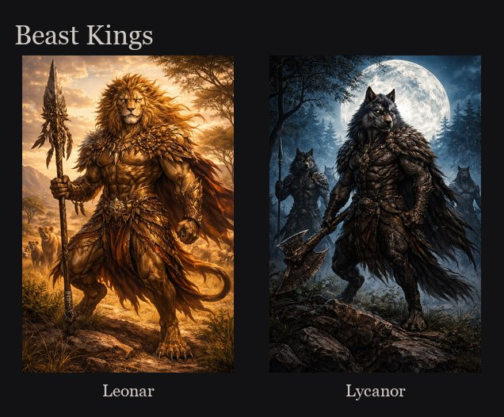
corruption and sustain the world**, which is exactly what the website says. The
long-open question of who shaped them is answered.

### The first elves

The elves were **"not merely inhabitants, but intermediaries, existing as a
living bridge between the Fae Realms and the material plane."**

They were not born conventionally. They **"emerged from the convergence of fae
matter and the ambient natural energies of the world itself,"** through a process
the fragments call **the Song of Becoming**, guided by the Primordial entities of
**Dream, Magic and Life**, who **"did not create through force, but through
resonance, shaping existence into being."**

On waking they had **immediate awareness of both identity and purpose**: maintain
the world's balance, and guide the cycle of souls back to the **Great Soul Lake**
of the Primordial Titans.

> During this period, **death as later understood did not exist among the elven
> races. Existence was cyclical. All things returned. Nothing was lost.**

**And they may be an expeditionary force.** `Fae Races Journey` says the Dark Gods
split space open and crossed into the Mortal Realms, that an Exodus of the Fae
followed the Good Gods to watch them, that the Dark Gods took five paths toward
six worlds, and that **only three Good Gods and their elves managed to follow.**
The first three worlds became an eternal battle. **A Fae legion sent alone against
the fourth was corrupted.** The fifth fell because the relief legion arrived too
late - **so that legion left a hidden encampment and a small contingent there,
then withdrew and raced to the sixth world to build a resistance with the
locals.**

**Archavalon may be the sixth world**, which would make the elves a resistance
force that arrived ahead of a Dark God, among people who do not know a war is
coming. It also gives a win condition: **the combined energies of all six
planets can raise a god to a Titan.**

**Elves are slender, and strength never changes that.** However much muscle an
elf carries, the frame stays long and narrow. Strength shows as hard, defined,
corded muscle on a lean body, **never as bulk**. No broad shoulders, no thick
necks, no heavy builds, at any age and in any discipline. A Blue Ranger smith
who has swung a hammer for three centuries is sinewy and iron-hard, not wide.

**The widest thing on an elf is what they are wearing.** Bulk in an elven
silhouette comes from plate, aprons, cloaks and packs, and it comes off at the
end of the day.

**And elven clothing is cut to the body.** Sleeves fit the arm, trousers fit the
leg, bodices and jackets follow the ribs and the waist. **No elven garment is
loose above the hip.** Volume is permitted below it and nowhere else, so a floor
length vestment is close through the shoulder and chest and only begins to fall
at the hip. Nothing sacks, nothing bunches, nothing is oversized.

Layers are thin and close, stacked rather than padded. Lines run long and
vertical. Collars sit high on the throat. Closures wrap across the body or sit
off to one side, never a row of buttons down the centre.

**Where a garment is heavy, it hangs straight down from a narrow shoulder rather
than widening it.** An apron, a mantle or a cloak falls from a thin frame and
the frame stays visible underneath. **An elf dressed in loose draped cloth is an
elf dressed by a human**, and in the later ages that is exactly what it means.

### The Great Trees, and where the elves woke

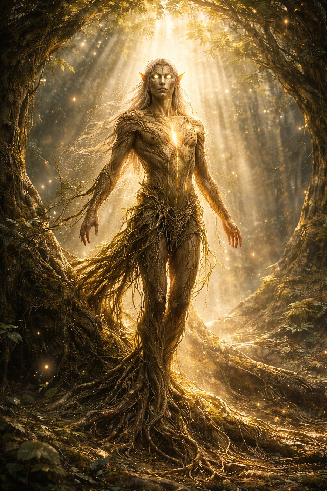

The **Song of Becoming** had a place. The first elves woke along the **Great Trees
of the Western continent**, and every elven line still living can name the tree
its blood began beneath.

A Great Tree is not simply a large tree. It is a **structure standing in three
realms at once**: roots in the earth of Archavalon, a crown that reaches the
stars, and branches that leave the world entirely and open into the **Eternal Fae
Realm**. An elf standing at the foot of one is standing in all three places.

This is the plain meaning of the fragment that calls the elves **"a living bridge
between the Fae Realms and the material plane."** They are not a bridge by
metaphor. **They are what grew where the bridge touched ground.**

It also gives the convergence a location. The elves **"emerged from the
convergence of fae matter and the ambient natural energies of the world itself"**
because the Great Trees are the one place those two things meet. Fae matter
arrives down the branches. The world's own energy rises through the roots. The
elves woke in the band between, which is the trunk, which is the only part of a
Great Tree that belongs to Archavalon at all.

**And it explains the purpose they woke already knowing.** They were to guide the
cycle of souls back to the **Great Soul Lake** of the Primordial Titans. The
branches are the road the souls take. The elves were not appointed to that work
abstractly. **They were made standing at the gate, and the gate needed keeping.**

> Death as later understood did not exist among the elven races because nothing
> had anywhere else to go. A soul rose through the branches, was enriched, and
> came back down. **The cycle was not a belief. It was a piece of visible
> architecture, and they lived at the bottom of it.**

**They grew from tear seeds.** The Primordial Titans of **Dream**, **Life** and
**Magic** each wept a seed into the world, and where a seed fell a Great Tree
rose. **Three Great Trees to a continent, one of each Titan**, standing in the
Western, Central and Eastern lands alike. An elven house traces its blood through
its own tree back to whichever of the three wept it, so every elven line in the
world belongs to Dream, to Life or to Magic, and no fourth answer exists.

**Hope wept nothing, and that is deliberate.** The **Fae Garden Sanctuary** is
anchored by four Primordial Titans, **Dream, Life, Magic and Hope**, and only
three of them put a seed into the world. Hope stayed. **There is no tree of
Hope, no grove where she woke anyone, and no elven line that can trace itself
back to her**, which means she is the one anchor who holds the Sanctuary up and
has nothing of herself growing anywhere outside it. Section 2 ranks Hope at 17
against Fear at 16, the one pairing in the whole pantheon this bible treats as
canon. **The strongest argument in the work is made by the Titan who planted
nothing.**

**The nine, as far as they are placed.**

| Continent | Tree | What stands there |
|---|---|---|
| **Western** | **Snoweinter** | one of the **Three Great Elven Cities**, and the tree Garod Khan burned. See below |
| **Western** | **Illuminaire** | the High Elven capital and a massive eastern port, the tree of **Magic** |
| **Western** | **Hollan** | the third Great Elven City, **fallen long ago.** Its tree still stands, in **Hollanheart Forest**. See below |
| **Central** | the **North East** tree | close enough to the Eastern continent that the two trade branches |
| **Central** | the **Great Savannah Tree**, south-east | the savannah warrior kingdoms and the Beast Lord alliance |
| **Central** | the **Deep South** tree | **corrupted** |
| **Eastern** | the **North West** tree | **a few of its branches reach across to the Central continent's North East tree.** The only place two Great Trees touch |
| **Eastern** | the tree of **Ra's lineage** | in the regions settled by the humans descended from Ra |
| **Eastern** | the **Great South Jungle** tree | the jungle elves, the **Silvankari** |

**The corrupted one is not a coincidence.** The bible already records that **the
south-centre is where the Black Sea first came ashore.** That is the same ground.
**The Black Sea did not merely land in the Central continent, it landed on a
Great Tree**, and a Great Tree is a root running down into the Fae Garden
Sanctuary and a branch running up into the Eternal Fae Realm. The corruption did
not have to travel. **It arrived at a junction.**

**And two of the nine touch.** The Eastern continent's north-western tree throws
a few branches across to the Central continent's north-eastern one. Nowhere else
in the world do two Great Trees meet above ground, which makes that crossing the
only place a soul, a Fae, or anything else can pass between two trees without
going down into the Sanctuary first.

**The deep roots, and why they reach the Sanctuary.** A Great Tree's branches
leave the world upward into the Eternal Fae Realm. Its roots leave it downward,
running far beneath the continents and joining in the **Fae Garden Sanctuary**,
which the bible already records as **anchored by the Primordial Titans of Dream,
Life, Magic and Hope**. The same three hold both ends. **The trees are not
connected to the Sanctuary. They are the Sanctuary, surfacing where the seeds
fell.** This is why the Sanctuary is unreachable by force and why **Lucifial could
not push his way into it**: there is no door into a root.

**The two World Trees are a different order of thing.** One stands in the
**Frozen North**, the **Great White World Tree**. The other stands at the far
southern end of the world, wrapped in mist, and **its roots are what the Sacred
Order's seals on the Great King of the Dead are anchored in.** The Winter King is
not held down by the Order's craft alone. He is held by a World Tree, and the
Order's seals are the knotwork tying their work to its roots. They are not seeded
from one Titan each. **Each carries all three at once, Dream and Life and Magic together, and
a speck of three more: Time, Memory and Death.**

**Three that make, and three that keep.** Dream, Life and Magic are the makers,
and theirs are the nine trees that mothered the waking races. **Time, Memory and
Death keep what the makers made**, and they are planted nowhere in the body of
the world, only at its two ends. That is the whole difference between a Great
Tree and a World Tree, and it is why only two of them carry the name.

It also settles something the bible already states and never explained.
**Death as later understood did not exist among the first elves** because Death
was never planted where they woke. She is in the North and in the southern mist
and nowhere between. The elves did not transcend dying. **They simply woke a
very long way from it.**

And it puts the two strongest beings in the Primordial Pantheon in the same two
places. **Death and Time both sit at 25 vigintillion**, above every other Titan
on the list, and neither of them is in any of the nine. A World Tree is not a
bigger tree. **It is the only kind with the two eldest powers in it.**

The White World Tree is the one that grew Nilrealm's **White World Staff** from a
willing root, which is a larger act than it first reads: the North did not lend a
branch to a sorcerer, **a tree holding Time, Memory and Death chose to send part
of itself travelling with Mór-Ríoghain's son.** Mór-Ríoghain is Archavalon's
chip of the Primordial Titan of Magic, so Nilrealm's mother is not one of the
three who wept the seeds. **She is the piece of one of them that stayed**, which
makes him the nearest thing in this world to a Great Tree with legs. The staff
in his hand is cut from the only wood in the world that holds all six. **Mortals call him the Great
Prophet. He is carrying foresight, recollection and ending in one branch**, and
the branch was never severed, it chose to leave.

**The Western three, and what was done to one of them.** The **Three Great Elven
Cities** of the Western continent are the three trees. The cities did not choose
their sites. **They are what grew around a tree once elves had woken there**, and
**Snoweinter** was one, and it is the tree of **Dream**: pale stone beneath
white forests, blue Fae lanterns, frozen canals, and the Great Elu-Hsal
Temple ringing its soul bells over the oldest district. A city where the dead
pass through is the closest thing in the world to a place that is dreaming.
**Illuminaire** is the tree of **Magic**, which is why the High Elves put
their capital and their largest port there, because knowledge gathers where
it can be carried away.

**And the third is the tree of Life, and its city is dead.** **Hollan** stood
at the heart of the forest that is still named after it: **Hollanheart** is
the heart of Hollan. The city fell long ago and the tree did not, which is
the reverse of what happened at Snoweinter.

**This is where the Crimson Veil is.** The Red Rangers' hidden fortress sits
deep in Hollanheart in enchanted summer woodlands, veiled by ancient magic
and illusion, and nothing in the archive says where that veiling came from.
**It is Hollan's.** A thousand Rangers are not hiding behind their own craft.
**They are living inside the last working thing a dead city left behind**, and
an order whose own tree was burned has made its home under somebody else's.

Which means **Ashwinter was not the burning of a city.** Baron Garod Khan's Arson
Knights assembled their engines inside the Great Northern Forest and killed a
Great Tree, and a Great Tree is one third of the Western continent's road to the
**Great Soul Lake**. The elves lost a city, a forest, and **a piece of the
architecture they were made to keep**, in one night, to siege components carried
through a gate the Queen ordered opened.

**This is why the Red Ranger banner is what it is.** They do not fly a burned
tree out of sentiment for Snoweinter. **They fly the corpse of one of the three
things their entire race exists to tend**, and they fly it in the faces of the
court that let it through.

**House Icetear and the Snoweinter tree.** The Icetears revered it, and the
reason is buried at its foot: **Hansall Whitegrove left an heirloom of the Prime
Goddess Icetear, Child of Winter, under that tree.** So the house did not simply
wake there. **It kept something there**, which is why its mark is that tree in
gold and living, and why the house still draws it that way after the tree
stopped being either.

**This is the root of elven heraldry.** An elven house is not known by a
conquest or a colour. It is known by **where its blood woke**, and the mark it
carries is a portrait of that particular tree.

### The six Elu-Dues, and how new races are made

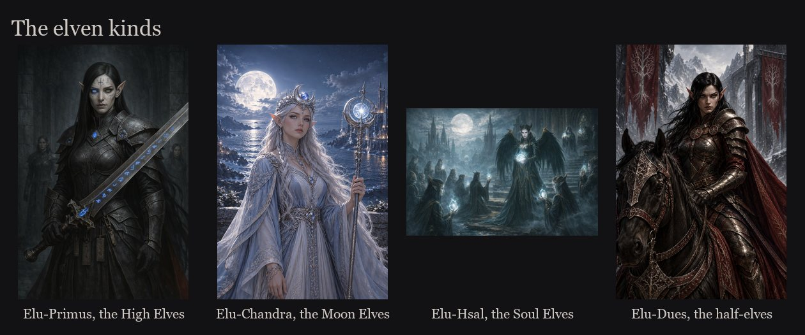

The Union of Beasts, Dragons and Fae did not dissolve after the Serpent Wars.
*"That was the mistake the Titans had made long ago. They had believed victory
meant separation."* The mortals lingered. **When blood is spilled side by side,
hierarchies blur.**

At first the unions were rare and half spoken. *"A dragon who lingered too long
in Elven form. An Elven priestess who learned the wind paths too well. A Moon Elf
who listened to the tides beside a Sea Nymph and forgot where one song ended and
another began."*

And then the mechanism:

> **The Eternal Fae Realm noticed. Not as a judge. As a womb.**
>
> Its circuits shifted, not violently, but attentively. **Where energies
> overlapped in harmony rather than dominance, something new was allowed to pass
> through.**
>
> Thus were born the Elu-Dues. **Not accidents. Not abominations. But
> consequences.**

**Harmony rather than dominance is the condition for new life**, which is the
exact positive mirror of the rule of consent that governs every evil in this
world.

| Race | Born of | What they are |
|---|---|---|
| **Elu-Dragar** | High Elves and Dragons **"who chose flesh not as disguise, but as shared truth"** | iridescent scales rather than armour, **horned like living crowns**, magic braided with flight and flame. Waterfalls and cloud-wrapped peaks, raised by ancient dragons **"who did not see them as lesser, only younger"** |
| **Elu-Sylphae** | Sky Elves and wind elementals who **"danced too close to the edge of storms"** | wings **"not as tools of war, but as expressions of air made loyal"**, light bones, voices that bend weather. **"They did not rule the skies. They negotiated with them"** |
| **Elu-Ignivar** | Elves and Phoenix-kind | **"Fire did not consume them. It remembered them."** Always fewer, **"because rebirth is a jealous gift."** Calderas and sun-cracked plateaus, **learning patience from creatures that burned and returned** |
| **Elu-Chandra** | Elves devoted to Selene bonded with Lunar elementals | **"their skin carried the hush of night water."** Tides, reflection, healing that arrives slowly but holds firmly. **"From them, in time, the Tylons would awaken"** |
| **Elu-Verdant** | forest elves bound to ancient land spirits and Beast Kings | vine, bark and horn. Less graceful, more enduring. **"They did not flee corruption. They grew over it"** |
| **Elu-Hsal** | Elves touched directly by the Primordial Titans of **Dreams and Memory** | pale-skinned, often winged, **marked at birth by the weight of remembrance.** Entrusted with the guidance of Fae spirits and **the long continuity of Elven identity itself** |

> None of these races were declared. There was no proclamation from the Throned
> Acropolis. **Creation had learned to move without permission.**
>
> The Titans noticed, of course. They always do. **But they did not intervene.
> For every Elu-Due was proof that the world was still capable of adaptation
> without divine correction.**

**Also recorded:** the **Elu-Althari**, the Wind Mare or Free Walker Elves, made
by Elyndra's blessing rather than by union. The **Elu-Marei**, sea elves. The
**Elu-Primus / Elu-Prima / Elu-Primar**, the High Elves. **Elu-Dues** as the
general term for half-elves. And the **lakebourne elves**, born of river Fae and
High Elves, **exterminated by the Human Empire in the Age of the Races.**

### Humanity has three origins

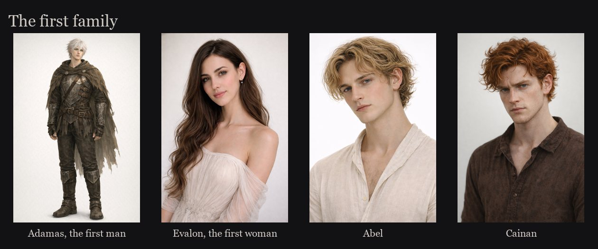

**Settled, and it was never a contradiction. Humanity was created three times, by
three hands, on three continents.**

| Where | Who made them |
|---|---|
| **Western Continent** | **Hyperion**, as his final act before departing |
| **North-East Central Continent** | another World Titan, **inclined toward battle and forge** |
| **Eastern Continent** | **Ra** |

**And Adamas was not the only first human of the West.** **Adamas and Evalon**
were the first two, but several more were created alongside them, among them
**Godrian Greyhide** and **Sinbad-Sinodess**. What made Adamas singular is that
**Hyperion entrusted humanity into his hands**, not that he was alone.

So **Godrian Greyhide was a first human**, which means the Greyhide line is not
an old noble house but one of the original bloodlines, and the decayed Greyhide
nobility are squandering an inheritance older than kingdoms.

**The forge Titan is Atlor the Mountain Forger**, listed among the supreme Elder
Gods who could create life. He is the maker of the north-east Central humans, and
therefore **the patron of the whole northern storm culture**: Thorin's line, the
Vikings, the Valkyrie, the dwarven kings, and every smith who claims descent from
a hammer rather than a crown.

**Hyperion's humans were given eternal life** and, through Freyva, **the gift of
creating life**, and were sheltered in the **Fae Garden Sanctuary**, guarded by
**Hansall** himself. *"They were taught. They were protected. They were
prepared."*

### The Five Mountain Kings

First Age. Five great Demibeing tribes on five mountains, barely in contact,
until an **Ancient Elder Earth Dragon** mated with the Goddess Behemoth
**Tyranor** and produced a **Baelothic Beast** that stood on its hind legs and
lived inside the earth. An earthquake woke it, it rampaged up every mountain, and
hundreds died because it seemed indestructible. Then lightning struck its great
horn, thunder cracked across the country, and it vanished.

That night the five chieftains met on the summit of their greatest mountain, and
a great white dragon gave them a prophecy: the Beast is divine and
indestructible in the mortal plane and **an abomination in the immortal plane, so
its wrath is justified**, and to defeat wrath incarnate they would need **five
immortal arms** - and would be changed by whichever they chose, along with all
their kin.

| Chieftain | Arm | Became | Their people blessed with |
|---|---|---|---|
| **Durrigon** | the Gods Aegis | first King of the **Dwarves** | a mountain of the immortal ore **Urrock** |
| **Welgrimm** | Kratos and Hephaestus, the giant axe and hammer | second King of the **Dwarves** | creativity in both destroying and crafting |
| **Hella** | Gram, the Dragon Blade | first Queen of the **Valkyrie** | divine femininity and creation, and **no need of males to bear children** |
| **Wulfnir** | Gungnir, the Great Spear | first King of the **Vikings** | knowledge and foresight |
| **Thorin** | Mjolnir, the Warhammer | first King of the **Humans** | **infinite potential** |

As each chose, **lights flashed among all their people and in the small tribes
between, and everyone transformed with their chieftain's traits.** They swore the
**Pact of the Mountain Kings**, defeated the Beast at great cost the next dawn,
and learned it **returns every hundred years.**

**Note that this grants kingship rather than creating races.** Durrigon is made
*first King of the Dwarves* and dwarves already existed. So **Thorin was
humanity's first king in the north-east, not its maker**, and his people are the
forge Titan's line.

**And it names two of the storm Prime Gods' founders: Hella, first Valkyrie
Queen, and Wulfnir, first Viking King.**

### Where the monsters come from, and it is distortion

> **Typhon corrupted races by proximity alone. Akidna birthed monstrosities not
> through craft, but through distortion.**
>
> **Goblins from Dwarves. Ogres from Giants. Trollkin from twisted Fae. Wyverns
> and Wyrms from dragons that survived but did not heal correctly.**

**Every monster in Archavalon is a ruined version of an existing people.** Every
goblin is a dwarf's descendant. Every ogre is a giant's. That is far stronger
than a separate creation, and it makes the Beast Kings' culling job tragic rather
than clean.

Also credited to them: **Sirens, Harpies**, and twisted beasts and dragons. And
`Era Events` adds that **Akidna's union with a wiser Prime God produced the
sentient monster races**, the orcs, trolls and ogres who can be reasoned with.

**One conflict to settle.** This makes **Wyverns and Wyrms damaged dragons**,
while the Five Children give **Delphyne the Wyverns** and **Bahamut the Earth
Wyrms** as their proper lines. Either there are two origins, or **Delphyne's and
Bahamut's broods were the ones that "survived but did not heal correctly"** -
which would be devastating for both and would explain why Bahamut's line keeps
losing limbs down the generations.

### Where the vampires come from

**Settled, and it was never two origins. It was one origin and three results.**
All of it begins with **the Prime God of Blood**, which is **a true Prime God of
the world's own life essence, carrying a splinter of Black Sea corruption it
fought off and could not expel.** Section 7 has the full account. It does not
conquer and does not command. **It whispers.** It nurtures every desire and intensifies every
obsession until the heart becomes a prison of longing, **and only then offers
release.**

**The elves were the first beings it corrupted.** Not into vampires. Into
malicious things called the **Strigoi.**

| Kind | How they were made | What they are |
|---|---|---|
| **The Strigoi** | the Prime God of Blood's first corruption, worked on **elves** | **not a people, a ruin.** Malicious, and the oldest blood-drinkers in the world. This is the "twisted elven monsters" the Cataclysm account remembers |
| **The intelligent vampires** | **Strigoi mating with humans** | the vampire nations: houses, courts, politics and reason. Everything the Dark Continent's vampire power is built out of |
| **The High Vampires** | **directly converted by the Prime God of Blood itself** | the ones who were asked, and said yes. Immeasurably stronger than the line-born, and far fewer |

**The named High Vampires:**

- **Dracule Strigorr**, the Fallen God, the First Vampire. **His name carries the
  Strigoi root**, which is why the line-born regard him as theirs even though he
  is nothing of the kind
- **Llanahs**, the Blood-Queen of Acropolis, who only wanted one beautiful thing
  to stop disappearing
- **Melissra Orscina**, the **Great Witch of the South**
- **Amelia**, eventually, **who is converted by the Prime God of Blood itself**

**So the second Dark Lord becomes a High Vampire.** That is a large fact, and it
completes her as Anthurian's mirror in one more way: Anthurian was made by
Cainan's breeding compounds without ever being asked, **and Amelia is asked, and
says yes.** The Prime God of Blood only ever takes volunteers, so her conversion
is a choice, made by the woman who had already been taught there was another way
to live.

**And it means the rule of consent holds for vampires too.** The Strigoi were
taken. **The High Vampires agreed.** The intelligent vampires in between inherited
a curse neither of their ancestors chose for them, which is the most interesting
position of the three.

### Smaller peoples on record

**The Masquerade Kin**, humanoids in masquerade masks, so like humans that they
are taken for humans wearing masks as a cultural quirk, **which they prefer
because it lets them blend in.** Behind the masks are **crowns of horns, and
sometimes a third eye.** Minor telepathy, basic premonitions, and a gifted few
with weak psychokinesis who often become tricksters. **Their horned crowns
connect them to the Elu-Hsal**, whose devoted grow the same.

**The Echokin**, arachnid or insect legs and wings worn like capes on orc-like
bodies, *"the darker take in the Nixes races."*

**The Silvankari**, enigmatic wood elves of the **Great South Jungle**, whose
patron is **the Mother of the Great South Jungle** and whose guardian is
**Divrindë Padukindel.** They have a **Sanctuary City**, but the real test is
**deep in the untamed jungle, where "one is tested, guided, and enlightened."**
Also in the jungle: **moon sprites** that dance on moonlit leaves and
**mischievous forest imps.**

**The Exodas**, mortals carrying the blood of a mortal race together with Fae and
**Blackguard** blood, **exiled by the Fae centuries ago for tainting the
bloodline**, who then made a mass exodus so harrowing that the journey gave them
their name. **Victorlash Von Hyoscine** is human, elf and fiend.

**The Nixes**, beings of night and mystery: Pixies, Fauns, Unicorns and Pegasus,
made by Nyx to maintain the God Realms.

**The Blackguard races**: Arch-Fiends, Arch-Ifreets, Arch-Daemons.

**And four mounts** from `Beastiology`: the **Water Kirin**, the **Quilin**, the
**Kelpie** and the **Unicorn**.

---

## 13. The buried world

**This is the strongest structural pattern in the archive. Archavalon is a
prison.** Almost nothing dangerous in its history was destroyed. It was buried in
the world, and the world is now full.

| What | Where | Held by |
|---|---|---|
| **Typhon**, Father of Monsters | **his own corpse, made into a volcano** | his soul is **pinned beneath it, screaming through magma** |
| **Akidna**, Mother of Monsters | **the Northern Sea Depths** | drained below Prime God strength by **Mór-Ríoghain**, and jailed by **Triton and Neptune**, Oceanus's sons |
| **Bahamut**, the Black | **deep in the south-west of the Western Continent** | Tiamatra's enchantment, **and his presence strengthens the corruption** |
| **Plutarr** | the Ghost Realm | imprisonment by the Celestial Titans |
| **Dagonn** | the Largest Mountain Range | imprisonment by the Celestial Titans |
| **Oceanus** | under the ocean | **a deep slumber of his own choosing** |
| **Tulu the Great Dread** | the West Seas | asleep |
| **Gandr the World Serpent** | the West Seas | imprisonment |
| **The Great King of the Dead**, the Winter King | the frozen far south, the **Dead Winter** | the Sacred Order's seals. **Hansall struck him down.** The body remained. The soul did not |
| **The Thirteen Lich Lords** | the endless northern wasteland | **their own civil war** |
| **Dracule Strigorra's soul** | a black vessel in the deepest chamber beneath the **Dark Castle** | Carmaline's ritual. **He wakes only if Bloodwing or her descendants give him blood** |
| **The Baelothic Beast** | inside the earth beneath the Five Mountains | nothing. **It returns every hundred years** |
| **Colossal servants of the First Age** | beneath the southern earth | nothing. **So enormous that entire forests have grown across their petrified bodies** |
| **Humanity's immortality** | **the Vial of Severed Immortality**, in the Abyss | Lucifial's Avatar. **It cannot be destroyed without unravelling the soul bound to it** |
| **The Black Sea** | the Southern Sea, and the void above | **nothing** |

**The last one has no jailer. That is the difference.**

### The four seas

Two independent documents give the depths a cardinal structure, and they agree:
**Yorrmengund** east, **Cthulhu** west, **Akidna** north, **Neptune** south. And
`Origins` independently puts Tulu and Gandr in the West Seas and Akidna in the
North. **Each sea holds something.**

### The northern mist, settled

**This is no longer a proposal.** `1. Foundation Age` states that Akidna was
dragged into the Northern Sea Depths, drained by Mór-Ríoghain until she was less than
a Prime God, and bound there by Triton and Neptune. `Origins` independently says
she was **"banished to the North Seas, and only had daughters since her sons'
waywardness."**

**The Northern Continent is the only land bridge between the three great
landmasses, a maddening mist that behaves like an entity keeps every mortal off
it, and the Mother of Monsters is imprisoned beneath that exact water.**

The mist is leaking out of her. **Which means the only road between your
continents is sealed by Akidna**, and the Northern Sacred Order spends the Third
Age holding back what the Garden Queen let through when she stripped the Wall.

### The South was not conquered

The Grey Knights' first expeditions beyond the Wall found **forgotten demonic
strongholds festering beneath ruined mountains, ancient undead kingdoms stirring
beneath abandoned cities, savage monster races multiplying beyond the maps**, and
the petrified First Age servants.

> **The South was not conquered. It was merely sleeping.**

**And the Deep Reaches**, where the serpents retreated after the Mercy Decision,
are recorded in the gazetteer as **"proof that mercy altered the world rather
than erased the threat."**

---

## 14. The world itself

### The continents

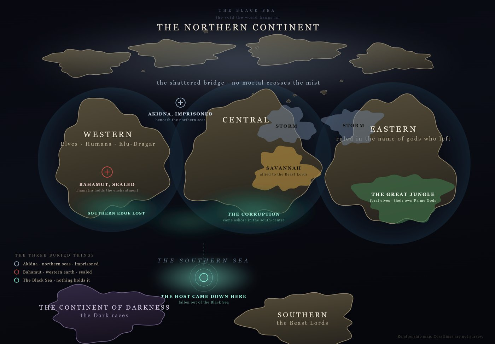

**Western.** Elves and humans dominant, with beast-lords and mountainkin among
them. Medieval aesthetic with high elven elegance. Birthplace of the Elu-Dragar
and of **Hyperion's humans**. Tiamatra's, and **Bahamut's prison deep in its
south-west, where his presence feeds the corruption.** Home of **Camelot** and
the Penfyres, the **Greyhide Kingdom** and the Great Grey Wall, **Hearthwinter**
and its Eleven Elven Houses, **Telluse**, the **Great Kingdom of Adornas**, the
**Kingdom of Lionheart**, the **Kingdom of Serasia**, and the Sacred Order's two
bastions. The **Three Great Elven Cities** stand here, and **Snoweinter** among
them. **It dies in the Age of Darkness.**

**Central.** The contested middle. Storm peoples in the north-east, and
**Thorin's humans beside them**. The **Savannah** warrior kingdoms in the
east-central lands, allied to the Beast Lords. **Delphyne's wyverns** in the
mountainous regions. The **south-centre** is where the Black Sea first came
ashore, and the whole southern edge falls in the Third and Fourth Age.

**Eastern.** Human cultures of Chinese, Japanese and Korean myth, **made by Ra**
and overseen by his children, though not physically any more, so it is a land
governed in the name of gods who left. Storm peoples in the north-west. **Two of
the five dragon lines live here**, Osiris's nature dragons in the south-eastern
jungles and Ryujin's along the misty rivers and mountains, which is why it reads
as the most dragon-haunted place in the world. The **Great South Jungle** of the
**Silvankari** runs south-east to south-centre. The **Citadel of the Knight
Titan** stands in the north, the **City of Light** in a valley of rivers and
lakes south of it, the rogue city of **Depravity** in the south-east, and the
**Assassin Kingdom** on the eastern peaks. **This is where humanity survives.**

**Northern.** Arcs over all three and touches each, shattered. The only land
bridge, **sealed by Akidna's mist.** The **Great Northern Wall of the Fae** faces
it, and beyond it lie the Lich Lords, the covens, and **Azaelion**.

**Southern.** The Beast Lord races, across the Southern Sea from the savannah.

**South-Western, the Continent of Darkness.** Anthurian Bloodwing's dominion
beyond the **Demon Breach**, and later the quarantine the First Dark Lord built
for the infected races. See section 20.

### Walls, citadels and bastions

- **The Great Grey Wall**, raised by **Tyberius Greyhide** across the southern
  reaches. Not merely stone but a defensive civilisation: thousands of
  watchtowers over frozen valleys and cursed forests and ruined kingdoms,
  fortresses carved into the mountains, and roads along the wall so
  reinforcements can march for weeks without descending into the wilds.
  **Hundreds of miles of enchanted wall, ancient runes, blessed stone, and
  beacon fires that never stop burning.** Its purpose was simple. **Nothing
  crossed.**
- **Thirteen Grey Citadels**, each able to shelter entire kingdoms. **Isdowrath**
  furthest south against the Darklands. **Helzar**, the greatest of the southern
  frontier. **Dragon's Den**, the westernmost, carved into the southern face of
  **Heaven's Throat**. Earlier drafts call the order **the Knight's Vigil** and
  its fortresses **the 13 Castles**.
- **The Great Northern Wall of the Fae**, built against a foretold evil,
  **stripped of its garrison by Antharaiel and then abandoned.**
- **The Bastion of Frost**, the Sacred Order's northern citadel, watching the
  Lich Lords.
- The Sacred Order's **southern bastion**, over the Winter King's tomb in the
  **Dead Winter**, where every recruit begins.
- **Bastions-End**, a watch fortress against the undead in the north.

### Named places, assembled

**Heaven's Throat** is the most important single location in the archive. **Built
by Gods Blood descendants before the Cataclysm**, a fortified divine-blood
empire carved into a southern peak, with vast stone stairways disappearing into
the clouds and **golden statues of defenders foretold to come to life if the
empire was threatened.**

**Anthurian Bloodwing was born beneath it. Cainan's Karne stood beneath it. The
Gods Blood ruled from it under Solomon and Caligula. Gilgamesh killed Solomon at
its peak. And Dragon's Den is carved into its southern face, where Landervale
spent eight years walking past "weathered statues of forgotten demigods watching
in silence."**

**Those are the defenders.** No document connects them, and it is a loaded gun
sitting under the Grey Knights' feet.

| Place | What it is |
|---|---|
| **The Abyssal Breach** | formed when abyssal influence **exploited a post-Titan-War weakness in reality.** Origin point of the serpent invasion |
| **The Ravines of First Descent** | land collapse from **abyssal gravitational pull** around the Breach. The first battlefield |
| **The Demon Breach** | opened by **Solomon** in the extreme south. Sealed twice. **Doomslayan is on the far side** |
| **The High Dragon Mountains** | raised by the World Titans, later **Elu-Dragar strongholds** |
| **The Sky-Crown Peaks** | **floating rock spires**, high-altitude passes, wind corridors |
| **The Fae Garden Sanctuary** | anchored by the Primordial Titans of **Dreams, Life, Magic and Hope.** Birthplace of humanity |
| **The Oceanic Threshold** | where land and sea magic merge and storms gather unnaturally. Early **Elu-Chandra** kingdoms |
| **The Semi-Oceanic Shore Kingdoms** | cities in cliffs, reefs and tidal stone. **Homeland of the Tylons and Moon-blessed elves** |
| **The Planes of Accord** | trade routes and neutral grounds that **allowed cooperation between elves, beast kings, giants and centaurs** |
| **The Verdant Wilds** | the original untouched natural world. **"Proves nature endured despite catastrophe"** |
| **Acropolis** | Llanahs's monument to civilisation on the south-eastern coast, **Greek architecture intertwined with pirate docks**, called the **Jewel of the Seas** |
| **Depravity** | the thieves' city, **founded by King Haranyr as a refuge for the dark folk**, later seized by the Baron of the Southern Territories |
| **Crimson Veil**, or Vale | the hidden Red Ranger fortress in **Hollanheart Forest**, veiled by ancient magic and illusion, with the **Black Lake** and the Ranger graves |
| **Boudicarn** | Amelia's fortress, built from the GhoulClaw Clan's halls |
| **Tritaneim** | the fishing hamlet where **Floki** appeared overnight |
| **The Lantana Peaks** | the hot spring inn where **Annie** met **Landervale** |
| **The Temple of Mór-Ríoghain** | unmarked on any map, **because every traveller reaches it differently** |
| **The Night Forest** | the Moon Elves' sacred wood |
| **Azaelion** | the Ice Kingdom, with eleven main families headed by **Icetear** |
| **The Frostspine Mountains** | beyond which Seneal's coven kingdom lies |
| **Illuminaire** | the High Elven capital, a massive eastern port city |
| **Hailfare** | the resource-rich territory ceded to human occupation by treaty |
| **The Cliffs of Endless Dusk** | where **Nara** waited, and **"the sea itself no longer reflected the sky but an abyss without stars"** |
| **The Great Dark Forest** | the Dark Continent's heart, with **the Soul Gate** at its deepest point |
| **The Iron Marches** and the **Bridge of Carrion** | Victor Lash's ground |
| **Gravesreach**, the **Wall of the Dead**, the **Morticus Woods**, the **Secret Scar Peaks**, **Golskull**, **Verneuil**, **Knightguard**, the **Dark Sea Port**, **Evangelon**, the **Free Seas** | further named locations awaiting development |

### The calendar

365 days, twelve months, worked out by a scholar who compared the beliefs and
traditions of many nations and derived the year's length from astrological
alignments, then named the months for recognisable deities.

| # | Month | Named for | Why |
|---|---|---|---|
| 1 | **Hypan** | **Hyperion**, Titan of Light | the month of new light |
| 2 | **Hel** | **Helena**, Goddess of Love and Seduction | recognition for **"The War of Love"** |
| 3 | **Mars** | **Mars**, God of War | most wars begin this month |
| 4 | **Lunarch** | **Luna**, Goddess of the Moon and Fertility | fertility and birth |
| 5 | **Gemini** | **Geminius**, God and Goddess of Luck and Innocence | the separation of the twin gods |
| 6 | **Capricorn** | **Capricius**, God of Mist and Mystery | the protection of the most mystical god of the seas |
| 7 | **Ifyr** | **Ifrith**, Devil Queen of Fire | the fires of life |
| 8 | **Scorpio** | **Scorpius**, God of Will | building strong will |
| 9 | **Surt** | **Surtur**, Devil Titan of Fire | driest time of the Fire Giants |
| 10 | **Mortum** | **Mór-Ríoghain**, Queen of the Witches | most activity from the dead and dark magic |
| 11 | **Yur** | **Ymir**, Devil Titan of Ice | darkest winter of the Ice Giant |
| 12 | **Coius** | **Coeus**, Titan of Prophecy and Hope | hopeful winter |

**Every month also carries predictable events**, so that people know when to be
cautious or prepared: weather, natural phenomena, the customs of sentient beings,
and the anniversaries of catastrophes. Originally the year was divided only into
**the cold times and the hot times**, adopted by farmers, then extended to
raining and dry times, locust seasons, hunting seasons, **and the likely times of
war and peace.**

### The economy, and its moral history

**Six stages, each caused by the one before.** Nothing in the bible touched this
before and it is the most carefully reasoned part of the archive.

**I. The Pre-Serpent Age, the Age of Harmonious Emergence.** No ownership and no
currency. **"Labor existed only as stewardship."** Resources abundant and
unclaimed, *"not due to lack of value, but due to lack of necessity."* But much
of it lay in serpent and insect territory, **avoided "out of instinct rather than
fear,"** which created **"passive restriction without deliberate control."**

**II. The Serpent Wars.** The elves, unaccustomed to malice, were profoundly
destabilised by **the first intentional harm and irreversible loss they had ever
met.** Tools of cultivation were reforged into weapons. Unity fractured as
survival superseded balance. New roles appeared around defence, forging and
acquisition. And resources became contested **not because of depletion but
because of accessibility.**

> **Thus, scarcity was not born from absence, but from risk.**
>
> **Value became tied not only to utility, but to the danger required to obtain
> it.**

**III. Star Silver.** It could **channel and amplify energy-based attacks**, so
the smiths who worked it became essential to survival, and as demand outran
supply, **"Star Silver transitioned from material to measure."** It became the
first standardised currency, minted into sovereign coinage. **"Value became
quantifiable. Labour became transactional. Survival became negotiable."**
Historians call this **the inception of economic identity.**

**IV. Structured imbalance.** Trade routes were built explicitly to move Star
Silver. **Access to resources became the primary determinant of wealth**, and
settlements near deposits accumulated disproportionate power. Elven craft kept
its focus on quality and balance while others chose efficiency and scale, and
because the elves kept weaving natural and fae energies into their work, **their
goods retained rarity and prestige.** *"Order restored, but no longer equal."*

**V. Material specialisation.** Star Silver proved insufficient in quantity and
versatility, so **Iron** was found superior for durability, **Copper** for
conductivity in energy manipulation, and **Star Silver** retained dominance in
enchantment and shaping. **"Trial and error replaced inherited knowledge as the
primary method of advancement."** And **the defeat of Typhon is the cited
catalyst** for the breakthrough that made **gold** the optimal currency, for
stability, malleability and symbolic appeal.

**VI. The Age of Humanity, the Age of Want.** **"For the first time, desire
replaced necessity as the primary motivator of action."** Unlike Star Silver,
whose value was tied to survival, **gold represented accumulation, status and
power**, and **"greed, as a defining cultural trait, emerged not abruptly, but
gradually, reinforced by systems already in place."** The death of Adamas removed
the last central force of balance.

**And the technology is further along than pure medieval.** There is a
**Kingdom's Technology Administration** handling records, logistics and
communications. Golian Gravespine is an engineer whose machines guarded three
cities. Garod Khan shipped siege engines in pieces. And **Sinbad-Sinodess built
the first flintlock pistol in the Second Age and killed a Horseman of the
Apocalypse with it.**

---

## 15. The Ages

**Four age schemes exist, and three of them fit together.** The dated spine below
is the authority, and the site's shorter list is the public simplification.

| Years | Age | What breaks |
|---|---|---|
| - | **The seven cosmic ages** | Primordial Formation, Celestial Shaping, First Walkers, Divine Progeny, **Betrayal**, Sealing, Fragmented Dominion |
| 0 to 100 | **Fragmented Dominion** | gods rule through avatars and bloodlines, no pantheon holds authority, reality fractures into competing domains |
| 100 to 500 | **Age of Mortal Rebellion** | divine bloodlines turn tyrannical, the races rebel, 80 percent of divine blood is wiped out or diluted, and **the blood of the gods becomes a curse** |
| 500 to 800 | **Age of Ancient Kingdoms** | the victors carve out kingdoms and worship powers that reflect their ideals |
| 800 to 850 | **Age of the Races** | the Human Empire exterminates the **lakebourne elves** and the **Trogans**, racial war follows, the Empire is destroyed and humans scattered, **despised by every other race** |
| 850 to 900 | **Age of Darkness, Invasion** | the **thirteen Angels** come, and the **City of Light** becomes the last bastion. Old hatreds are forgotten because only survival matters |
| 900 to 950 | **Age of Darkness, Revenge** | the Angels are hunted. The **First Dark Lord** contains the infected races on a far continent. Parts of the Fae, human and demihuman races are permanently altered into **darker races**, carrying a mind-scar as well as power |
| 950 to 1010 | **Age of Broken Crowns** | a Saint Knight betrays the Archsaintess, 60 percent of the Night Sisters die, and the alliance disbands |
| 1010 to 1060 | **Age of Fractured Ideals** | the Archsaintess dies, the Shadow Human Emperor declares war on all non-humans, **Arthur** rises as the rival ideal, the Empire collapses after the Elven pincer war, **Morgana** betrays Arthur and retreats south. **Ideals can no longer unify the world** |
| 1060 to 1113 | **Age of Freedom** | a Grand Archangel takes the dark domain and becomes **the Dark Angel**, the Dark Domain is rehabilitated and accepted, and the underground **Gypsy kingdom** is unearthed. **Freedom is granted, but memory is not erased** |
| 1113 to 1161 | **Age of Darkness II** | the **Black Sea Leviathan** invades with a hoard of eldritch nightmares, and **Amelia slays Anthurian and takes the Dark Lord title** while serving inside the City of Light under a false name |
| 1161 to 1200 | **The Great Ice Age** | **thirteen Ice Lords**, powered by consuming the heart of the **Great Dwarf Ice Titan**, turn 60 percent of the world to ice before being defeated, slain or purified |

**The site's nine ages map on as follows.** Foundation Age covers the cosmic ages
plus Fragmented Dominion. Age of Mortal Rebellion matches exactly. **Age of
Kingdoms** covers Ancient Kingdoms plus the Age of the Races. Age of Darkness
covers Invasion plus Revenge. **Age of Light is the one that does not fit**,
because the years it occupies are the Age of Broken Crowns, which is a betrayal
age. The last four line up.

**Settled: the third age is the Age of Kingdoms.**

---

## 16. The Foundation Age

World Titans, Gods and Fae Lords shape the world. The Prime Gods wake from the
planet's own will and give life to its beasts. The Titans give life to the
mythical races. The Fae Realm introduces the Fae races. Demi-gods are born of
unions. **All lived in harmony.**

Then, in order: **the Serpent Wars**, the **Union of Beasts, Dragons and Fae**,
the **Mercy Decision**, the **Awakening of the Prime Gods**, the **Cataclysm of
the Father of Monsters**, the **birth of humanity**, the **First Human Murder**,
the **Exile**, the **Primortal Duel**, and the **Law of Divine Distance.**

### The Serpent Wars

Lucifial, bored, **found a hairline fracture that law considered too minor to
matter and fed it attention.** With Hecatre's craft, serpents and insects were
shaped and seeded with malice. **"They did not arrive with armies. They arrived
like illness."**

> **The world did not know it had been invaded.**

Only the Fae noticed first, **because they could taste the circuit of magic, and
the circuit had been touched by something that did not belong.** Then the skies,
when the swarms rose. Then the mountains, when the serpents grew vast.

> Thus began the first Abyssal invasion, **not with banners, but with
> multiplication.**

The serpents **"did not speak law. They did not bargain. They did not build. They
climbed, coiled, and crushed."** The insects followed like a second tide, some
carrying sickness, **some carrying a strange hunger that made beasts gnaw at
their own wounds.** And **"the serpents did not win by strength alone. They won
by returning. Every slain brood was replaced."**

> **It was not a war of glory. It was a war of sanitation.**

### The Union, and the Mercy Decision

> The first true alliance of sentient mortal races **did not arise from
> friendship. It arose from shared necessity, and shared disgust.**

Councils at mountain waterfalls, storm cliffs and the borders of the Fae Garden
**where ancient wards hummed like sleeping giants.** **"Dragons arrived like
weather. Beast Kings arrived like hunger. The Elu arrived like judgment."** And
they agreed on three things: **cull what must be culled, find what controls them,
seal the wound.**

And in the deep places they found the truth: **the serpents were not sovereign.
They were leashed.**

**Then the first great argument.** Dragons wanted extermination, having had their
young dragged from cliffs by **coils thicker than towers.** Beast Kings wanted
extermination, because balance demanded it.

**The Fae hesitated**, *"not because they were soft, but because they understood
the machinery of influence. If a creature is leashed, then the leash-holder is
the true enemy. And if the leash-holder is removed, what remains might become
simply an animal."*

And Mór-Ríoghain's teaching settled it: **"Magic corrupts by contact, but not all
touched things remain corrupt forever."**

So: **not pardon, not friendship, containment.** Kill only the malicious nodes
nearest the Abyssal tether and seal the fracture.

> **It was called mercy by the Fae. It was called foolishness by the dragons. It
> was called a gamble by the beasts. But it was done.**

**The sealing was imperfect.** The crack narrowed and hid. The serpents lost
their coordination. **And the insects began to behave like insects.** Over ages
they became **swampspawn and junglecoil**, dangerous but no longer an army.

> The world exhaled. And then, because this is how such worlds behave, **it
> immediately inhaled again. For peace reveals what war concealed.**

### The Cataclysm of the Father of Monsters

> **He did not shatter chains. He loosened schedules.**

Lucifial distracted Hades with soul migration logistics and drew Persephony into
philosophical dispute **knowing she would argue compassion until time slipped**,
then unlocked Lilith's domain. **Not fully. Just enough. Tartarus found the
opening.**

> **What followed was not creation. It was violation.**

**Typhon and Akidna** were born of that forced union: **"Titans without chains.
Titans without precedent. Titans whose nature was not balance or principle, but
propagation through ruin."** **Both their parents are World Titans, so both of
them are**, and the precedent they lack is the birth itself. **A World Titan
creates. It does not conceive.** See section 4. And when they broke through, **"it was not invasion.
It was eruption."** Mountains split. Seas recoiled. Skies blackened.

**The Union shattered in days. The Prime Gods fought. Many fell.** And when Hades
finally reached the Nine Thrones, **"the silence that followed his report was
absolute."**

**The Titans walked again.** Hyperion, Hades and Ra descended first, and **"the
land recoiled under their presence. Not in fear. In exhaustion."**

- **Typhon was slain, his corpse became a volcano, and his soul was pinned
  beneath it, screaming through magma.**
- **Akidna was dragged into the Northern Sea Depths.** She pleaded. She
  manipulated. **Persephony listened.** Mór-Ríoghain drained her below Prime God
  strength, and **Oceanus bound his sons Triton and Neptune as her jailors.**

> **By ancient law, the Titans were already dying the longer they remained. They
> could not heal the world without destroying themselves. So they left.**

**That is the real cause of the Law of Divine Distance. Not a decree. A physical
constraint.**

### Humanity, and the First Human Murder

**Hyperion's parting act.** Adamas and Evalon, formed **"not from dominance, but
from foresight,"** given eternal life and Freyva's gift of creation, sheltered in
the Fae Garden and guarded by Hansall.

> **Lucifial watched. He always does. What followed was not war. It was
> whisper.**

He could not force entry, **so he learned.** Among the **Elu-Hsal** he found
**"curiosity sharpened by pride,"** and taught them **"fragments of truth wrapped
in forbidden method. Soul manipulation. Memory binding. Necromancy stripped of
reverence. Power without patience."**

> **They did not see corruption. They saw mastery.**

So the first **Hsal-Eraklah** granted the Avatar passage, **"believing they had
outgrown the need for oversight."**

And then the motive nobody had written. **Glorfarsall**, a Paladin before the
elves had agreed what a Paladin was, had **argued that humanity should be
welcomed without fear**, and **Abel became one of the first humans he called
friend.**

> **Hansall remembered Cainan watching Abel laugh with Glorfarsall across the
> Garden.**

Lucifial whispered: **"He showed him difference and called it injustice. He showed
him Elven longevity and called it control. He showed him his brother..."**

Cainan killed Abel **inside the very sanctuary where Glorfarsall had argued
humanity should be welcomed.** There was something behind his eyes, **"not
possession, not entirely,"** but **"a darkness that seemed delighted to have
discovered how little encouragement resentment actually required."**

Glorfarsall's light erupted, and **Hansall stepped in front of it.** *"He killed
him." "I know." "He was his brother." "I know."* And: **"If you kill him now, you
become the next part of whatever this is."**

Then, beside the body, the exchange that is the whole work: **"Nothing keeps
anyone good."** And the instruction that redeems it: **"If Abel mattered to you,
don't let the worst thing his brother did become everything humanity means to
you."**

**So Glorfarsall went east**, through unknown kingdoms to the **citadel of the
Knight-Titans**, and trained for centuries, and became **Glorfarsall Elysium,
Hero of Light** - and **he is one of the few Firstborn who still remains
somewhere in the mortal world. Hidden. Learning. Remembering Abel.**

### The Exile, Evalon's bargain, and the Primortal Duel

**The elves sensed the Abyss on humanity and recoiled. Hansall wept. The Council
did not bend.** Adamas pleaded, mercy was denied, and **humanity was exiled.**

**And then Evalon.** *"In fear, Evalon accepted Lucifial's bargain: immortality
was stripped away in exchange for access to darker magic."*

**Humanity is mortal because its mother was afraid**, and **the vial that holds
what she traded still exists in the Abyss.**

**Adamas did not curse the elves. He hunted the source.** Before mortals, Fae,
Gods, Titans **"and those beyond record,"** he challenged Lucifial's Avatar to
the first **Primortal Duel** - a binding contest, witnessed, judged,
irrevocable, **which even Titans were compelled to witness.**

Lucifial unleashed ruin. **Adamas endured.** And at the brink of death he prayed,
and a blade of light manifested from his own soul.

> **When blade met blade, light answered devotion. Hyperion did not intervene. He
> responded.**

**The Avatar was destroyed. The crack was sealed completely.** And: *"Humanity was
spared. Not cleansed."*

### The Law of Divine Distance

> Hyperion looked upon the world and saw that it had crossed beyond correction.
> **Mortals now carried choice that could not be guided without being undone. To
> intervene again, to impose clarity or force, would not save them. It would
> hollow them. A world protected forever would never learn to stand.**
>
> **No celestial being, from World Titan to Angel, would directly intervene in
> mortal affairs. Any who did would surrender divinity, immortality, and divine
> invulnerability.** Guidance would come only through **Avatars born into
> mortality, bound by pain, doubt, and consequence.**
>
> **Lucifial did not protest. He merely watched, knowing that distance creates
> hunger, and hunger creates growth.**

**The villain and the god want the same thing**, which was Hyperion's intention
for him from the beginning.

### The Gods Blood, and the end of the age

> The descendants of divine Avatars came into their inheritance. **Mortal in
> flesh yet touched by divinity in potential, they stood beyond the Law's grasp.
> The Law spoke to gods, not to what had already been given away.**

**The Gods Blood are legal.** That is the loophole, and it is why they could not
simply be struck down.

They **raised citadels of white stone and doctrine from the southern peaks of
Heaven's Throat**, spoke of order and destiny and divine mandate entrusted to
them alone, and offered unity beneath their rule to humanity, the elven kingdoms,
the Beast Kings and the mountain folk.

**They were refused.** Hansall sealed the wards tighter. **Tiamel barred the
skies, "where dragons and phoenixes turned emissaries to ash."** Serallion's
coastal realms refused in silence, Moon Elves and Tylons denying harbour and
tide. **Sinbad-Sinodess** met the envoys *"with courtesy and distance, unravelling
their promises with calm words and sharper truths."* **Godrian Greyhide** met them
*"in steel and formation, breaking their early advances before banners could be
raised."*

*"The first refusals were answered with words. The second with threats. The third
with quiet violence."* Elven heroes vanished. Mountain passes burned. **Yet open
war did not come, because while Adamas lived, the Gods Blood did not advance.**

> He stood as a constant presence against them, appearing where certainty
> gathered. **His light did not command. It resisted. His existence proved that
> mortal will could stand unbowed before inherited divinity.**
>
> **So they waited. Time does not bow to heroes.**

And when Adamas and Evalon **passed peacefully from the world**, humanity
fractured along fear and memory. **Cainan's voice grew louder, hardened by
resentment. Sinbad spoke of withdrawal and survival. Godrian argued for
fortification and shared defence with the elves.**

> They no longer spoke as stewards. **They prepared as inheritors.**
>
> **The world stood armed, scarred, and unfinished. Thus ended the Foundation
> Age.**

### How the Gods Blood power actually works

From the inside, in a twelve-year-old boy healing a dying woman:

> **He did not think of it as power. He thought of it as irritation.**
>
> The room was wrong. **Not morally wrong. Pattern wrong.** The air around her
> quivered, **"like a fabric pulled unevenly across a frame."** **She was
> misaligned. Her pulse struck the air like a drum out of rhythm.**
>
> **He did not chant. He did not call. He corrected.**
>
> For a single breath, every object felt precisely where it belonged. The fire
> steadied. The shadows sharpened. **Even the dust in the air seemed to settle
> into clarity.**

**Gods Blood power is the correction of pattern**, which is precisely what the
Prime Gods do at planetary scale. **The Gods Blood are mortal immune systems, and
their tyranny is an immune system that decided it was the body.**

---

## 17. The Second Age: the Age of Mortal Rebellion

Humanity had just lost Adamas, the Gods Blood held Heaven's Throat, and nobody
was left who could stand in their way by simply existing. So the age is about
what mortals do when the only thing holding back inherited divinity is
themselves.

### The fracture of humanity

| Who | Where they went | What they built |
|---|---|---|
| **Godrian Greyhide** | kept the central kingdom Adamas left | discipline and structure, guardian of Adamas's legacy, and **protector of the children of Abel as the true kings and queens of humanity** |
| **Sinbad-Sinodess** | took the fearful and the free-spirited to the coasts, among the Tylons and Moon Elves | declared himself **King of the Seas**: adaptability, invention, and trade between coast and inland |
| **Cainan** | took the most fearful and the most hateful south, toward **Heaven's Throat** | a kingdom fuelled by fear and racial resentment, where **"cruelty is necessary for human survival"** |

And then the smaller sovereign states, most of them founded by Adamas's late
council.

| Founder | Title | Founded |
|---|---|---|
| **King Koschei** | the Berserker King | **Golskull** |
| **Queen Morraine** | the Sorcerer Queen | the First Kingdom, and the **School of Magic at Verneuil** |
| **King Lorthur** | **the King Against Magic** | the **Kingdom of Pendragon** |
| **Haranyr** | King of Depravity | **Depravity**, a refuge for witches, thieves, assassins and warlocks |
| **Nalhsal** | King of Assassins | the **Secret Scar Peaks** |
| **Llanahs** | Queen of the Arts | the kingdom of culture, art, song, poetry and history |

**Three consequences that reach all the way to the present.**

**Uther Penfyre's anti-magic crusade is a founding charter, not a prejudice.**
King Lorthur, the King Against Magic, founded the Kingdom of Pendragon in this
age. Arthur inherits an anti-magic position from a man who built an entire state
on it, four ages earlier, which makes Uther a traditionalist rather than a
fanatic and makes Nilrealm's long game far harder than it looks.

**Depravity was built on purpose as a refuge for the dark folk**, which is why
Llanahs could never reform it and why the Baron of the Southern Territories
could later simply buy it.

**And Llanahs's kingdom of art was "manipulated by Sal the Wanderer to record
history."** Salomei engineered a whole civilisation whose purpose was to keep the
record, then walked away from the woman who built it. That is her method and her
motive in one line: she loves the experience of existence, so she builds
archives, and the people are instruments.

### Human magic, and the Four Great Witches

Human magic exists because **Sal the Wanderer influenced it**, the schools were
formed, and **Queen Morraine cultivated Lucifial's latent gifts in human blood
"to see how far magic goes within humanity."**

| Witch | What she is | Pole |
|---|---|---|
| **Helena Katsunra** | human | **Great Witch of the East** |
| **Morrina Penfyre** | human | **Great Witch of the West** |
| **Susanna Bruhneville** | an **ancient spirit** | **Great Witch of the North** |
| **Melissra Orscina** | a **High Vampire**, converted by the Prime God of Blood itself | **Great Witch of the South** |

**Two of them co-founded the School of Magic.** All four later joined the Gods
Blood and the demon army for promises of more power, and all four and their
covens were destroyed.

**And Helena is the longest arc in the archive.** Co-founder of human magic,
Great Witch of the East, Gods Blood defector, archangel, fallen, and finally the
soul inside the Dark Angel. `Witch Names` lists her among the legendary witches
the covens still remember. Nobody has written that arc as one line, and it is
one.

### Anthurian Bloodwing's birth

**Cainan defiled an elf slave, and Anthurian was born**, an Elu-Dues who would
grow into the world's first Dark Lord. Her mother was **Allani Whitewing**, a
High Elf princess who went missing after the Cataclysm of Monsters.

**The kinship, exactly.** **Allani was Hansall Whitegrove's niece**, so
**Anthurian is his grand-niece**, which is how Saga I has it. And **Antharaiel
Whitewing is Allani's sister**, which makes the Garden Queen **Anthurian's
aunt.** Three generations of one house, and the two women at either end of it
never meet.

Her upbringing, stated flatly: **born a slave, raised in brutal conditions, taken
from her mother, used for her body early, trained by the Gods Blood, became one
of the greatest gladiators in Heaven's Throat, and ended as one of Caligula's
consorts and his secret dark general.** She is **"dark titanium forged by the hell
of her life."**

**She was born beneath Heaven's Throat.** Four ages later, Landervale Hemarc
spends eight years as a squire at Dragon's Den, carved into that same mountain's
southern face, walking past the weathered statues of forgotten demigods. Neither
document mentions the other.

### The Seven of Karne

All of them were slaves in **Karne** together, products of **Cainan's breeding
compounds** - half-elven children created because Cainan believed human blood
could be improved through forced unions with captured ancient races. Anubis's
record called him **Specimen 31-B**.

| | Who | Power | Companion or weapon |
|---|---|---|---|
| **Anthurian** | Cainan's daughter by Allani Whitewing | dark power, later fallen divinity | the white feather, and later Helena |
| **Anubis** | the Lycan | blood rage, later true werewolf | his war packs |
| **Calor** | the Nightwing, bastard of Lady Vaelora by a captured elf | shadow, then vampirism | intelligence networks |
| **Aquila** | the Wolf, the Great Huntress | archery beyond reason | the **Spear of One**, the **Bow of Ghost Wolf**, and **Skoll** |
| **Alysheer** | the Fox, Karne's Night Witch | ritual, spirit, the Ghost Realm boundary | a fox-spirit, and the **Vulpine Mantle** |
| **Mervane** | the Drake, who wanted to be Elu-Dragar and was not | dark flame | a greatsword, and armour scaled with the scales of dead Elu-Dragar |
| **Thaerel** | the Night Mare, a stable boy | the **Rein**, which breeds Night Mares from ordinary mares | Night Mares, the first of them **Sera** |

Their first exchange is the whole group in miniature. Anubis steals Anthurian's
bread, tears it in half, and offers her a piece. *"You ate half." "Yes." "That
doesn't make it yours." "No." "So why are you giving me half?"* **"Because now
it's ours."** She punched him.

When Caligula made Anthurian **High General**, she elevated all six with her.

### The Tournament of Domination

**A note on his name.** Saga I spells him **Caligula** and the Foundation Age
stories spell him **Caligular**. This bible uses **Caligula** throughout, because
the novella is the newest layer, **but the two spellings are still live on the
site and one of them needs retiring.**

**Nine champions against nine. Single combat. Witnessed by the Divines. Eight
weeks.** If the Gods Blood won, the mortal races submitted. **If the Alliance won,
there would be enforced peace.** The Alliance agreed because the Gods Blood had
just flanked and gutted them.

| Gods Blood | Alliance |
|---|---|
| **Depraved King Caligula** | **High Elf King Hansall** |
| **Lord Cavendish Crowley** | **Queen Tiamel** of the Elu-Dragar |
| **the Lady of War, Valkryie** | **Prince Raastali** |
| **Anthurian** | **Prince Gilgamesh** |
| **Vishraa, Lord of Asuras** | **Lord Godrian Greyhide** |
| **the Horseman of Conquest** | **King Sinodess** |
| **the Horseman of War** | **King Koschei** |
| **the Horseman of Famine** | **Princess Teela**, replacing King Sederous |
| **the Horseman of Death** | **the Grey King** |

**And the Gods Blood revealed that four of their champions were possessed by
divine weapons of the apocalypse** - later ages prove it was only a **fragment**
of each - which is what makes the Four Horsemen theirs.

**Round 1. Crowley kills Raastali.** He brutally slays the innocent young prince,
and **for the first time in history reveals Demons to the world**, summoning them
to tear Raastali apart mid-duel. Mortals and Gods Blood alike are horrified and
call him out. He justifies it: they are familiars, and just tools.

**Round 2. Conquest kills Godrian.** Godrian fights next to avenge the boy, gets
the early advantage and beats Conquest down. Then Conquest **fuses with his
steed**, becomes the **Apocalypse Centaur**, and pierces Godrian with a hailstorm
of golden arrows. **This is the moment Tyberius Greyhide watches his father die**,
and the moment that founds the Grey Knights.

**Round 3. Sinodess kills War.** War fuses with his steed at the start and begins
beating Sinbad down. Then Sinbad unlocks an unusual surge of energy, **his eyes
glowing the same white as Hansall's**, and he opens War up every time the Horseman
misses. The finish: **with the only flintlock pistol in that age, which he built
himself, he shot War through the head with a bullet of magical Fae Ore.**

> **Then the mortal races knew. Even the Gods Blood champions can be slain.**

**Round 4. Hansall kills Vishraa, and learns the truth.** Vishraa was the most
noble of the Gods Blood and a close friend of Solomon when he was still sane.
Before blades met he promised that if he won, he would do his best to convince
the Gods Blood that enslavement was wrong, and that all should live side by side
with honour. They matched each other exactly, **so Hansall used the duel as an
interrogation**, asking questions between exchanges, and learned of Solomon's
madness, Crowley's evil, and the depravity of Cainan and Caligula, who forced
unions to breed strong hybrids. And then that **Anthurian was Cainan's forced
union with a missing High Elf princess, and therefore his own blood.**

> But he apologized to Vishraa, as he had to end the fight soon. He activated
> **Vaen State**, a white aura surrounded him, and in a few seconds he split
> Vishraa in half, and said: **"You were the most honorable Gods Blood I've ever
> met."**

**Round 5. Tiamel annihilates Famine.** Famine fuses with her steed into a
**Titanic Hydra** vast enough to make the arena feel small. **Tiamel activates
Vaen State, and "this ability was too overpowering."** Famine is cut to pieces in
seconds and turned to ash with the fire of dragons.

**Round 6. Valkryie kills Koschei.** A second honourable Gods Blood. Koschei was
an old follower of Cainan's from the first age who had built his own small
kingdom and joined the Alliance **because he refused to be ruled by Cainan.** But
he was too arrogant. The fight went well for half of it, and then Valkryie, far
better trained, gave him a quick death by decapitation.

**Round 7. Anthurian and Princess Teela.** Sederous was due next. But **Teela,
Koschei's daughter**, jumped into the ring in despair and rage and challenged
**Valkryie** - who ignored her and walked away. **And that would have been the end
of it, if Teela had not tried to stab Valkryie in the back as she left.** Before
she could, **Anthurian appeared behind Valkryie wearing a blood mask**, blocked
her, blew her away, and shouted **"I accept."**

Teela's reputation as a warrior princess came from her interest in fighting and
her rank, not her ability. In reality she was a spoiled girl with good weapon
training only.

> Anthurian **made a one-minute match last two hours**, slowly slicing off parts
> of her. **Ten minutes in, Teela tried to call out a surrender, and before she
> could finish, Anthurian crushed her jaw and sliced her tongue off.**

The author's own note on the scene: **"This fight is supposed to ignite the
hatred towards the gods blood again."** It works.

**Round 8. The Grey King kills Death, and reveals Seren State.** The Grey King
wore a grey cloak and cowl, resembled a human but walked like an elf, and nearly
had the build of a Leonar. Death fought him to a stalemate before transforming
with his steed. **Then the Grey King activated Vaen State, which shocked all the
elves, because he looked human.** Death boasted that he was the strongest of the
Horsemen and activated Vaen State himself. **And the Grey King smiled. "Then I'll
go a step further."** His hair turned white and glowing, and he named it: **Seren
State, the Calm of No-Self.** In seconds his spearwork shredded Death apart.

**Round 9. Gilgamesh kills Caligula with the Spear of Abel.** **Gilgamesh is
Abel's oldest son**, there to avenge his father and humanity's suffering. They
fought to near stalemate **until Caligula used a dirty trick and cut off
Gilgamesh's left hand.** Then he summoned **Abel, the Spear of Light made from the
ashes of his father**, which came down like a meteor from the skies. **When he
touched it, he activated Vaen State for the first time in his life**, shocking
the elves again. The battle was an easy win from there.

**The Alliance wins. Five of nine.**

### The Children of Abel

Abel's own children, protected by Godrian as the true royal line of humanity:

- **Annestasia**, who is **Annie the White Witch**
- **Raastali the Swordsman**, killed by Crowley in Round 1
- **Gilgamesh the True King**, who kills Caligula and later Solomon

**So Annie the White Witch is Abel's daughter**, which makes the woman who refused
Mór-Ríoghain's forbidden power the sister of the man who wields their father's bound
soul.

### The Demon Wars

**Solomon never intended to honour the Tournament.** While it was running he
formed a pact with **Devil King Baal**, made **Crowley the Avatar host**,
**sacrificed Conquest to allow Mammon's manifestation**, and opened the
**Southern Abyssal breach.**

**Conquest's sacrifice answers Thaerel's mystery.** Conquest was the only Horseman
to come back from the Tournament. He gave Thaerel the bridle token the night
before he left for the south, said the line that unifies the cosmology - **"The
Apocalypse Form worked because neither one of us disappeared"** - and then rode
away to make something worse than all four deaths combined. **He was the price of
Mammon.**

Then **six years** of demonic invasion. Kingdoms vanished beneath infernos.
Ancient forests became graveyards of blackened trees. Rivers carried ash instead
of fish. The Alliance barely held the central bastion. **The Four Great Witches
and their covens joined the Gods Blood.** And **vampires were revealed** on the
south-eastern island, ruled by **King Dracule Strigor**, a **High Vampire**
converted by the Prime God of Blood itself. See section 12 for the three kinds and
where each came from.

Tyberius Greyhide was everywhere the fighting was fiercest, and learned every
demonic breed: how they hunt, how they deceive, how they die. By the final years
many said he had surpassed his father, **not because he had greater talent but
because no living warrior understood demons better.**

**The Great Demonic Breach** was *"less a cave than a scar across creation itself,
so vast that its darkness swallowed sunlight."*

### Tiamel's death, in order

**Settled, and it takes five moves, each one undoing the last.**

**1. Mammon strikes her out of the sky.** He has wings too, which is the detail
that makes it possible, and he takes the Dragon Queen of the Elu-Dragar in the one
place she was never supposed to be vulnerable.

**2. As they crash, Tiamel burns Mammon to ash.** The Greater Demon that Solomon
sacrificed a Horseman of the Apocalypse to manifest is burned out of the world by
a half-elven queen on the way down. **Conquest bought Mammon's body, and Tiamel
takes it off him.**

**But she did not kill him, and everyone who was close enough saw why.** Dragon
fire does not leave ash standing, and that ash stood. For a moment the shape of
him held in the air exactly as it had been, **and then something came up out of it
that the fire had not touched.** Not smoke, because smoke drifts. **This went
down.** It poured out of the hollow in the ash the way water finds a crack, took
the heat and the light of the clearing with it as it went, **and the grass it
crossed did not burn, it simply stopped being green.** Then the ash fell, and it
was only ash.

**It went south.** Everyone standing there understood, without anyone having to
explain it, that it had gone back the way it came.

> **Mammon was called into the world through the Breach by sacrifice. So what
> Tiamel destroyed was the form the sacrifice had bought. The thing that had been
> wearing it fell back through.**

**That is why the Grey King and Doomslayan have to go in after him** at the end of
the age, and why the second sealing costs the Grey King two ages of his strength.
**Tiamel denied Mammon the world. She could not deny him the Abyss.** The hunt at
the end of this age happens on his ground, not ours, and it happens because of
what she did here.

**3. The blood-hazed Anthurian tears her wings off, on Cainan's orders.** Not of
her own will and not entirely out of it either, which is the whole problem with
her. **The woman who built a people out of children ashamed of their own faces has
her wings torn off by a half-elven girl who was also ashamed of her ears.**

**4. And then Tiamel and Hansall snap her out of it.** Together. The dying queen
and the uncle, reaching for the girl at the same moment. **And it works.**

**5. Which is exactly how Cainan kills her.** He comes up behind Tiamel while
everyone in the clearing is looking at his daughter, and lands the critical blow.

> **Tiamel dies because she stopped to save the person who had just maimed her.**

**That is the cruellest thing in the age**, and it is why her last words still
land as they do. She **rejects Anthurian**, **threatens Elu-Dragar withdrawal if
she is allowed to join the Alliance**, and **dies in bitterness** - not because
she never reached for the girl, but **because she did, and it cost her
everything.** The rejection is not blindness. **It is a warning from someone who
has already paid for being merciful once.**

**And it is what makes Cainan's own death right.** He is killed minutes later by
the same daughter, for the same crime: he could not stop being cruel for the
length of one moment. **He killed Tiamel from behind while she was being kind, and
then insulted a dead mother while holding a hostage.** The man dies twice of the
same flaw.

### The fall of Cainan

**Hansall repeatedly attempts to redeem Anthurian. Cainan humiliates her for her
failures.** Then the final confrontation, and **settled: Hansall breaks him and
Anthurian kills him.** Both of the old accounts were half right.

**Hansall beats Cainan until he begs for forgiveness.** Not until he dies. Until
he begs. The High Elf King who has spent the whole age trying to redeem this
man's daughter stands over him and takes the one thing Cainan has never given
anyone, which is submission.

**And in that moment Cainan takes Anthurian hostage.** It is the only move left to
a man who has run out of everything else, and **he does not realise how weak he
has become compared to her.** He has spent her whole life measuring her by what he
made her do, so he has never once measured what she is.

**Then he insults her dead mother.**

> **Anthurian slides out of his grasp and kills him.**

The ratio is the point. **Hansall needed a battle. She needed a sentence.** And
the man who built a kingdom on the belief that cruelty was necessary for human
survival dies because he could not stop being cruel for the length of one
sentence.

**Her last word to him is OPEN**, and it is the single most quotable line in the
Second Age, so it is worth writing rather than settling. One suggestion, mine, to
argue with: **"You never once looked at me. Only at what I could do."** The only
rule it has to obey is that she is **cool** about it, because the whole scene turns
on him being frantic and her not being.

**And it keeps both of the things the two drafts were protecting.** She gets the
catharsis and the guilt, because she is the one who did it. And Hansall is still
the one who brought him down, which keeps the uncle standing over the father.

### Tiamatra's vengeance

> **The Devil Avatar was destroyed when the Dragon Queen Tiamatra and her brood
> descended for vengeance, over the loss of their favoured Elu-Dragar daughter,
> Tiamel.**

**Tiamatra came down for her.** A Child of Ra came as close to breaking the Law of
Divine Distance as she could, because a half-elven queen four generations removed
from her blood had been killed. That is one line long and it is the most powerful
beat in the Second Age.

### How the age ends

- **Sinbad and the remaining Northern Coast forces flank the Four Great Witches**
  against the Grey King's Citadel Knights, **eliminating all four witches and
  their covens.**
- **Doomslayan and the Grey King hunt down Mammon and the remaining Greater
  Demons**, then magically collapse the Southern Hell breach. **This is the
  continuation of Tiamel's kill, not a contradiction of it.** She destroyed the
  body the sacrifice had bought him and the thing inside it went back down through
  the Breach, so the hunt happens **on his ground rather than ours.** That is the
  reason it takes two of the oldest beings alive to finish it, and the reason the
  Grey King comes out of the second sealing diminished for two ages.
- **Gilgamesh challenges and slays Solomon at the Peak of Heaven's Throat.** And
  **before he dies, Solomon casts a cataclysmic spell sacrificing his own soul to
  the Devil King to open the southern breach again.**
- The Grey King and Doomslayan realise **sealing it will only ever be
  temporary.** So **Doomslayan chooses to become the Great Demon Warden, to hold
  the demons back from inside the Abyss**, and the Grey King reseals the breach
  **with Doomslayan on the far side.** The earth screamed, mountain ranges
  collapsed, the Breach folded inward, and colossal seals were carved into the
  broken land. **When the dust settled, Doomslayan was gone. His name became
  immortal.**
- **The second sealing took far more from the Grey King**, and he withdrew to his
  hidden citadel to heal for an age or two. That is why, centuries later, he is
  wandering as **Fang**.

**Also in this age:** the defeat of **High Chancellor Lazarud**, who is the
**Lazarus** of Adamas's last duel, **Alice the Black Witch**, and **Anthurian's
self-exile** to the south-eastern islands, where, haunted by her past, she
**concludes that freedom causes inevitable conflict, unlocks Vaen State**, and
begins her path toward authoritarian ideology.

**"Freedom causes inevitable conflict" is Anthurian's thesis**, and it is the
exact opposite of **Sederous Lionheart's**, whose city proved that
**"civilization became strongest when people stopped treating purity as though it
were an achievement."** And the Seven later murder Sederous. **The King of Scraps
is killed by the followers of the woman whose entire philosophy his existence
refutes.** The archive never says this, and it is the sharpest thing in it.

### The Grey Knights, and why the Wall exists

Kneeling beside his father's body in an arena that moments earlier had roared
with pride, **Tyberius Greyhide** understood the thing that would haunt him for
the rest of his life:

> **Human strength was not enough.**

**That is the founding emotion of the Grey Knights**, and it is why they are a
human order. They exist because a human watched the best human who ever lived be
casually outclassed by divine blood, and decided discipline would have to
substitute for divinity forever.

Their first expeditions south found what section 13 lists, and the South turned
out to be sleeping rather than conquered. No army could patrol that forever, so
they built the **Great Grey Wall** and the **Thirteen Grey Citadels**. **Humanity
had remarkably long lifespans during the Second Age**, so Tyberius lived to see
every stone laid, and was crowned the **first Knight King of the Grey Knights.**

---

## 18. The Third Age: the Age of Kingdoms

The kingdoms the Second Age's victors carved out, worshipping powers that
reflected their own ideals. It is the longest and most populated age, it contains
almost every named character the project has written at length, and it ends with
the Western Continent going dark.

**The corruption's reach during this age:** the Black Sea's influence is still
**contained in the southern half of the Central Continent**, spreading into the
southern Eastern Continent and the **Southern Dark Continent** under Anthurian
Bloodwing's reign. **After she becomes the Dark Angel she vanquishes the invading
Black Sea Angel there.** The Western Continent is not yet lost.

### The elven north, and the fall of Ashwinter

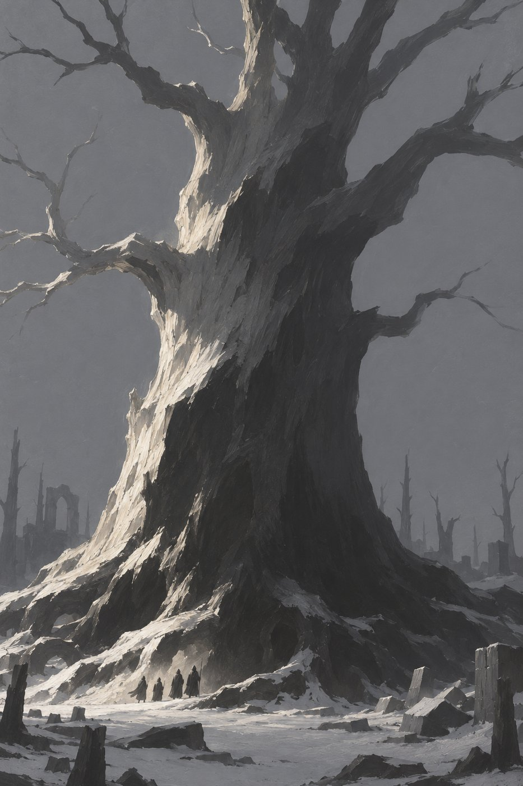

**Hansall Whitegrove** is summoned to the Eternal Fae Realm to become the **Fae
Lord of Fables**, and before he leaves he takes **Antharaiel** onto the
battlements above the Fae Garden and asks why the garden still exists.

> "Strength. When rulers inherit peace, they begin believing strength is an
> embarrassment belonging to less civilized generations. Never make that
> mistake."
>
> "Be gentler than me, Antharaiel. But do not become weak merely because weakness
> looks civilized."

**Everything that follows is that conversation coming true.**

**Antharaiel Ellescand, the Garden Queen**, born Antharaiel Whitewing, sister of
Allani, aunt of Anthurian Bloodwing, married to Faraze Ellescand. Hansall chose
her because she was brilliant: diplomacy by instinct, every feud mapped well
enough to seat enemies together without a knife drawn, real command of trade,
agriculture, Fae custom and architecture. **He also saw her weakness. She disliked
moral discomfort**, and preferred solutions where everyone eventually agreed she
had been reasonable.

Her first decades were magnificent: artists, libraries, canals, schools, new
protections for Fae communities, villages becoming cities. **So military spending
declined in importance, outlying fortifications were starved, and Ranger warnings
became matters for committees.** She detached the kingdom from foreign wars, and
many Elu-Dues left the High Elven kingdoms. **She regretted it and quietly treated
it as proof that separation reduced conflict.**

**The four Ranger Corps.** The descendants of Hansall's companions demanded formal
authority. She resisted, because permanent warrior organisations led by families
older than her own authority offended every instinct she had, and then
compromised.

| Corps | Captain | What they are |
|---|---|---|
| **Red Rangers** | **Hannarial Icetear** | women only. Assassins, scouts, hunters, unconventional warfare. Feared for reaching places armies cannot |
| **Blue Rangers** | **Golian Gravespine** | **men only.** Warriors, smiths, engineers, craftsmen. They forge what the others carry and build the fortifications the Queen considered excessive |
| **Emerald Rangers** | **Santhur Nyxthorn** | the largest corps, men and women, merged with the older **Green Wardens**. Scouts, warriors, wilderness guardians, pathfinders |
| **Golden Wings** | the Queen's own | created so she would have one corps she could own. Gold for royalty, Wing from Whitewing. Officially they coordinate the corps and investigate internal threats. **Everyone understood the real job was watching Hannarial** |

**So the corps are split by more than discipline.** **The Reds are women only
and the Blues are men only**, the Emeralds take anyone, and the Golden Wings are
uniformed. Nobody designed that as a statement and it became one anyway: the two
corps that lose the most at Ashwinter are the two single-sex ones, **and the
Blues die saving the people the Reds could not reach.** Hannarial loses a family
and Solenyra loses a brother in the same fire, from opposite sides of it.

**Emperor Hadrian Dravus** invades. He is a distant descendant of Cainan,
generations removed, carrying Gods Blood somewhere in the line, **and his hatred
is ideological rather than personal.** Humanity had grown, multiplied and built
empires, so why should ancient forests and rich northern territories stay in
elven hands? He called it destiny. The elves called it invasion.

**Uther stayed passive**, persecuting magic inside his own borders and never fully
joining the invasion. **That decision saved countless elven lives.**

**Then Antharaiel pulled the Northern Fae Wall's garrison south.** Hannarial
fought her over it. *"There will be nothing left of those children if what sits
beyond that Wall crosses south." "You do enjoy frightening people with bedtime
stories." "Hansall stationed them there." "Hansall is not Queen." "No. He's
not."* She ordered the withdrawal anyway, and the North noticed: hunters
disappeared, Fae came back changed, voices began calling travellers from beneath
frozen lakes, animals were found twisted into shapes nature never intended. **She
moved an army to save three cities and opened the door to something much older
than Hadrian Dravus.** The **Northern Sacred Order** became the last real defence.

**Baron Garod Khan** then did the rest. He understood that elves expected humans
to attack walls, so he did not attack walls. He studied their roads, their
merchants, their relief efforts, and above all **he studied the Queen**, and
learned she desperately wanted evidence that not all humans supported Hadrian.
**He used that hope as the weapon.** Relief caravans began moving north. Hannarial
demanded every wagon searched. *"These people risk their lives supporting us."
"Then they'll survive an inspection." "You have become incapable of recognising
generosity." "I recognise a wagon."* **She ordered the caravans through.**

They carried hidden siege components and **Arson Knights** disguised as merchants
and labourers, who assembled the engines **inside the Great Northern Forest
itself**, using routes and guard rotations bought from elven collaborators.

**The Blue Rangers turned instantly from soldiers into rescuers.** Smiths who had
spent centuries forging armour tore burning beams off trapped civilians with their
hands, opened escape routes, held them, and died inside them. **Golian died
holding a building up.** The Emerald Rangers went into the forest after the Arson
Knights and many vanished into ambushes prepared days earlier. **Garod Khan
escaped.**

When the fires died, the survivors stopped calling the city Snoweinter.

**Ashwinter.**

**The treaty.** Ashwinter broke the north, and Hadrian offered peace on terms that
made peace another form of conquest: **monthly tribute, Imperial freedom of
movement through elven lands, human occupation of resource-rich Hailfare, and the
right to appoint human nobles inside elven institutions.** Antharaiel signed.
*"I wanted them to inherit something better than Hansall's world. I thought he
couldn't imagine peace because he'd spent too long fighting. He knew. He knew
exactly what I was going to do."*

**She preserved her people and lost their faith.** That last clause is also how
**Alfar Chandralon** ends up a squire at Crimson Vale.

After Ashwinter, Red Ranger recruitment tripled and kept going: widows, orphans,
survivors, former Emerald scouts, noble daughters, peasant hunters, and women who
no longer trusted men to fight their wars. Three hundred. Seven hundred. A
thousand. More. **Every new Ranger learned one name: Baron Garod Khan.**

> **They still protected the Queen's kingdom. They did not fight for the Garden
> Queen. They fought for Ashwinter.**

**And Solenyra kept her brother.** Golian's soul would not leave. Against every
Elu-Hsal teaching, she refused to let him cross, and the sapphire pendant at her
chest went warm. **That is why the High Warden's left eye glows blue, and why she
has soul sight.** New Rangers assume the name belongs to some ancient Gravespine
spell. Red Rangers learn not to ask. **House Gravespine is reduced to Solenyra
alone**, which is when she left the Temple and became a Red Ranger.

**The Red Ranger command is three women shaped by the same wound.** Hannarial lost
her family at Ashwinter and could not save them. Solenyra lost her whole House
there and refused to let her brother go. **Anthurian Icetear lost her family at
Hearthwinter and was not there**, because her mother ordered her to stay away.

### Hearthwinter, and the Witch Queen of the North

**Hearthwinter** was a multi-racial kingdom north of the Human Emperor's
territories, with **eleven Elven Houses**, stone cities raised across generations
by humans, elves, Fae-blooded peoples and wandering craftsmen who eventually
stopped wandering. Market squares smelled of human bread beside elven teas.
Dwarven metalwork hung in workshops beneath Fae lanterns. **Three generations
before the fall, the royal line of Gallion Sedrick was displaced by the Puto
family, and House Sedrick kept serving the kings whose ancestors stole their
throne, because their honour bound them to Hearthwinter rather than to a crown.**
That single fact is the kingdom's whole character.

**How a kingdom turns**, and this sequence is the model for every political
collapse in the world:

The Human Emperor began speaking against the elven realms. Imperial priests,
politicians and officers described the Fae territories as dangerous. Henderson
Godrick called meetings between the human and elven houses. **Putrous Puto asked
his ministers which position was least likely to anger the Emperor.** Then soldiers
entered an elven quarter looking for spies. Adults began speaking more quietly.
Someone started describing the Fae as "foreign influences." Then the first
scaffold, and an elderly elf bookbinder led up to it.

> **Seneal watched the language become more civilised as the streets became more
> cruel.**

**The Royal Apprenticeship** is how the purge went unopposed. Months earlier
Putrous created it and took in sons, daughters, nieces and nephews from most of
the houses powerful enough to oppose him, so when the lords demanded Henderson's
release they were all holding hostages they could not name.

**Henderson Godrick was executed first**, because elven protest could be dismissed
as tribal loyalty but a human patriarch standing up for elves could not be
explained away. **The father who told Seneal the kingdom was hers was killed by
it**, and his name was officially recorded as traitor. Ascena's calculation on
hearing the order: *"Anthurian is outside the kingdom. Good. That's one daughter
they cannot reach."*

**Lady Whitewinter** is an ancient dragon beneath a mountain, female, belonging to
a world before Hearthwinter and before the Human Empire. **For the first time
since Hearthwinter turned on her, Seneal stood beside something that did not
require an explanation for her ears.** She spent **three years inside Whitewinter's
dream**, learning that to command ice she first had to command herself, and came
out with a **crystal staff**. Whitewinter's warning is the moral spine of the whole
Icetear arc:

> **"Justice asks what someone has done. Revenge eventually asks only who they
> are."**

**The Icy Hell of Hearthwinter.** Seneal walked back in. Arrows froze against
their own bowstrings. Soldiers became statues before their swords reached her.
Blue flowers appeared where her bare magic touched the street. In the throne room
she found Putrous under the old carved crown and a court that had spent three
years explaining why the Eleven Houses deserved what happened, **a minister
wearing Henderson's brooch**, and a woman who had secretly hidden two elven
servants trembling by the wall.

And then **seven human men stood between an avenging elf and the king they were
sworn to defend**, a Tyberius knight among them with his helmet off. Not because
Putrous deserved it. **Because they still believed the kingdom was greater than
its King.** Putrous screamed *"KILL THE ELF!"* and *"We should have killed every
Icetear when we had the chance."*

**Gareth Sedrick** knelt under her hand and refused to lie. *"You failed." "Yes."
"You watched them take my father." "Yes." "You served the man who killed him."
"Yes."* And then: *"I'm sorry."* **Every answer made killing him harder, and she
hated that.**

**She could have stopped. She did not.** Barracks froze. Royal estates shattered.
Execution squares vanished under glaciers. Prisons broke open, some prisoners
escaped, some guards never did. **Storms are poor judges and ice does not read
court records.** Some humans had hidden elven neighbours. Some had smuggled
families to the border. House Sedrick had stayed honourable. **She knew this, and
she continued, and that is what makes it hard to forgive.**

> For three years she had imagined this moment. **It did not feel good, and that
> angered her too. Revenge had promised satisfaction. Instead it gave her
> silence.**

**She did not take the throne.** She left Putrous frozen in his palace and turned
north with **Khairal's wooden wolf** in her coat.

**The Witch Wars.** North past the Three Great Elven Cities, into the abandoned
reaches near the Northern Fae Wall, live many covens rather than one order. The
first offered shelter and then tried to kill her in her sleep. The fight lasted
six minutes. Their leader spat blood and said *"Kill us." "Why?" "You defeated
us." "That's a very inefficient political system." ... "Keep your coven."* **That
decision spread faster than the victory.**

**Hearthwinter had been rage. The North became discipline.** She prohibited
hunting elven refugees, ended blood feuds, forced the covens to recognise neutral
sanctuaries, and killed those who refused every alternative. Others came
voluntarily, **because beneath her severity there were rules, and the North
understood rules.** The last challenge came beneath an aurora, several of the
greatest covens at once, through the whole night, until at dawn she was standing
and they were not.

*"I don't want a crown." "That has never stopped crowns."*

**Seneal Icetear, Witch Queen of the North.** She accepted because refusing would
start another war. **The girl whose kingdom exiled her for being elven went beyond
civilisation and built a kingdom among those civilisation had exiled.**

The order of events is fixed by the text: **Hearthwinter purge, the three years in
the dream, Hearthwinter frozen, the Witch Wars, the crown, then the Emperor's
northern campaign, then Ashwinter.**

### Camelot, Arthur, and Morgana

**Magic was condemned generations ago after a cataclysm nearly destroyed
civilisation**, and then **an Emperor was slain by a Mage Assassin**, one of the
greatest of his time, after which magic-users were hunted and persecuted as dark
sorcerers. **The anti-magic order has two causes: an old catastrophe that set the
fear, and an assassination that lit the crusade.** With King Lorthur's founding
charter behind it, that is three layers deep.

**Morgana's origin.** Eldest child of a Duke, trained in combat through playful
rivalry with her younger brother **Arthur**, and **deeply afraid of magic herself,
believing it cursed.** Then an ambush, her closest friend **Morraine** dying with
an arrow in her stomach while their eyes meet, and fire erupting out of her that
she cannot control. *"It wasn't me. It wasn't me."* And she knows it is a lie.

Then isolation, her father distancing himself for fear of scandal, servants
whispering, and **Arthur's attempts to help landing as accusations.** Resentment
festers until she sees him as the safe child who benefits from her fall, **and her
love for him warps into suspicion and jealousy.** Then a circle of young witches
and warlocks offer her acceptance, and she takes her power at last: nature magic
of vines, roots and thorns, destructive fire, and signature lightning whips, on
top of a noble education and martial training.

She overthrows her father and brother, defeats the King, takes the capital, and
**enacts laws protecting magic-users while harshly suppressing non-magical
dissent. She sees herself as a liberator, but her new kingdom burns as she forces
change.** Arthur rallies the human kingdoms, wins elven support, and with
**Nilrealm the secret wizard-servant** defeats her. She flees to her duchy, **too
powerful to remove completely**, and her lands become a dark, haunted border
realm.

**Her stated theme, which belongs in the bible verbatim:**

> **Fear is the poison that turns love to hatred.**

**And then she is redeemed.** When an ancient undead horde rises, Arthur leads a
desperate alliance. Morgana watches from afar, knowing that if Arthur falls even
her lands will be devoured, and **is forced to face her greatest fear: caring
again.** She rides to war, brings her magic to bear on the undead, and **side by
side with Arthur she saves him and helps turn the tide.**

> **She does not ask forgiveness, nor does she receive it. But she chooses to
> protect rather than destroy**, proving even those lost to fear can still change
> their path.

**That is the right ending for a world whose thesis is that goodness has to be
chosen more than once.** It also reconciles with the Dark Continent material:
Morgana flees south, takes Calor's vampire kingdom, claims the Dark Lord title, is
faced down by Anthurian the Dark Angel, retreats to the eastern borderlands, and
**from there eventually rides back north to save her brother.**

**Nilrealm** is an ancient **white dragon of dreams** who slumbered for centuries,
saw many futures and how they could come to be, chose his path, and woke into a
world of strife. His mortal form is a tall slender man of youthful half-elven
beauty, long black hair, pale skin untouched by age, **and eyes that betray him,
pupils narrow and draconic with the reflections of ages moving inside them.** He
chose that rather than arriving as a mountain of scale and flame, which would have
sent armies running and temples collapsing under the weight of prophecy.

**The Age of Kingdoms is his age.** Not because he fought in it, because he
barely does, but because he spent it **giving himself away in pieces.** Moving
in his mortal guise across all three continents, he found people who were
nothing yet and **put a fragment of himself into each one** - a word, a working,
a debt, a thing they could not name afterwards. Those people became houses, and
the houses became powers. **A great deal of the nobility of the Third Age is
Nilrealm's doing**, and almost none of it knows so. It is the same long game he
plays through Merlin on Arthur, run at the scale of continents and across
centuries, and it is why a sage who never takes a throne is behind so many.

He rests in a **liminal realm beneath the physical world, where time does not pass
but gathers**, folding on itself, centuries drifting through one another like
snowflakes sinking into dark water. From there he sees empires unborn, children
crowned, old kings dying nameless in foreign fields, swords that will never be
drawn, romances extinguished before their first meeting, and wars fought only
inside the corridors of possibility.

**And one vision he keeps:** a city rising from wilderness and ruin, towers
gleaming in the first light of dawn, **its walls built not by one race or kingdom
but by hands history had taught to hate one another.**

**The Nine** met in a clearing and immediately fought each other, **because the
recognition between them was born not of meeting but of inherited hatred.** Then
Nilrealm showed them the white marble city and **preserved them in marble** until
their time. Azikeal reached for Erzakial as the stone covered his fingers. Nyrial
never looked away from Nilrealm as it rose across her face. And before the stone
took him, Leon said:

> **"One day, Sage, your future will ask more of you than you are willing to
> surrender."**

And the whole objection to prophecy in one sentence:

> **"A choice made beneath the threat of prophecy is merely coercion wearing
> perfume."**

They wake in a storm of white dust. The trees are taller and older than when they
went in. *"Some still stand. Others changed. A few became memories."* And: *"We go
to Elderfen. But understand this, Sage. We do not serve you."*

**Elderfen** is a southern border village, burning when they arrive, and **Arthur
Penfyre** is standing between the strangers and the villagers, golden hair dark
with blood and soot, one sleeve torn away. Tyberious catches his wrist, turns
beneath the strike, guides him down rather than throwing him, and then steps away
and **lowers himself to one knee.** Nilrealm's read of him: **suspicion, rage,
terror, compassion, and a will that had not yet learned how much suffering the
world could demand of it.**

> **"Being willing to stand when no one else does. The world notices such people.
> Then it asks them to stand again."**
>
> **The first covenant of Archavalon was made inside a broken cottage between
> exhausted strangers.**

**Camelot's purpose is the world's own name.** *"Camelot was never meant to become
merely the greatest kingdom of men. It was destined to become Avalon."* And the
**Kingdom of Archavalon was formerly called Coelsius.** Arthur's project is to
make the world worthy of the name it already has.

### Everything else standing in this age

- **The Grey Knights** hold the Wall, run the **Black Raids** beyond it every
  year, and keep **Isdowrath** garrisoned past the point of sense. It once housed
  over ten thousand brothers. **Roughly three hundred remain**, stretched across
  hundreds of miles of wall, *"less like a castle and more like a tomb built for
  giants."* **Landervale Hemarc** squires at **Dragon's Den** for eight years, and
  later binds the preserved heart of an **Ancient Grey Dragon** to his own soul
  through a First Age ritual. Its heartbeat becomes his heartbeat. **Should the
  dragon ever awaken completely, Landervale would cease being human altogether.**
- **Annie the White Witch** passes the Temple of Mór-Ríoghain's test by refusing it,
  and is named White Witch. **Alice the Black Witch** failed the same test in the
  Second Age. Neither document names the other.
- **Seneal** rules the North. **Hannarial** commands the Reds. **Solenyra** holds
  both the High Wardenship and the Lordship of the Dark Pact.
- **The Seven** rule the Dark Continent and collapse, curated by **Revendrinn
  Nyxthorn**. See section 20.
- **Amelia** builds **Boudicarn**, loses it to **Victor Lash**, and is carried in
  chains toward the City of Light. See section 21.
- **Floki** appears overnight at Tritaneim and builds the **Whisperers**.
- **The Gypsy Tribes** are unearthed, and **Queen Khabelia** rules in Kalbeliya's
  line.
- **Salomei** sits at Arthur's table as **Sir Salomei, Lord Zeta**, the Wandering
  Lady Knight of the **Seven Knights of Determination.**
- **The Order of the Stag** is founded after the Black Knight rises a third time.
- **The Monarchs of the North** rule before the Ice Age: the **Queen of the Frozen
  Light**, the **King of the Flaming Winds**, the **King of the Torrent**, the
  **King of the Storm** and the **King of Thunder.**

### How the age ends

**Then the Third Age ended, the heavens split open, and the Black Sea returned.**

> They did not march like armies or invade like demons. **They descended as living
> calamities, corrupting land, flesh and reason wherever they fell.**

**Tyberius Greyhide met them at the front.** He slew horrors whose forms defied
reason to buy civilians hours. Grey Knights died around him by the hundreds,
**but none retreated while their Knight King still stood.** Surrounded by Black Sea
devils he fought until neither his body nor his sword could rise.

> **When he finally fell, he fell facing south.**

And then the thing that joins the two halves of the world:

> The surviving Grey Knights gathered what remained of their order and **withdrew
> across the Eastern Seas to the Great City of Light**, carrying the traditions,
> oaths and memory of the man who had spent his life ensuring others would never
> see what had taken his father.
>
> Behind them, **the western continent slowly disappeared beneath the consuming
> darkness.**
>
> **For as long as a Grey Knight still drew breath, the wall he had truly built
> was never made of stone. It was made of unwavering resolve.**

**So the Grey Knights become part of the City of Light**, which means Shallon's
city eventually houses both the Great Order of Light and the remnant of the Grey
Knights. **That is the bridge between the western story and the eastern one.**

---

## 19. The Fourth Age: the Age of Darkness

The Western Continent is gone. Humanity survives in the east. **The City of
Light** is the last bastion, and the age has two halves: Invasion, then Revenge.

### The Thirteen

**Thirteen Angels came.** Old hatreds were forgotten, not because anyone forgave
anything but because only survival mattered. The **City of Light** became the
last bastion of the civilised races, its walls holding what remained of elves,
humans, dwarves, beastkin and Fae who had spent four ages at each other's
throats. **That city is the first real proof of Nilrealm's vision**, built by
hands history had taught to hate one another.

**The Legion of Light** under **Arch-Saint Lady Shallon** drove the corruption
from kingdom after kingdom until people dared whisper that the nightmare was
nearly over. Shallon is a **blacksmith's daughter knighted for character rather
than blood**, and the relic that chose her is **the Spear of Abel.**

### The Spear of Abel, and what it is

**It is Abel's own soul, forged by his grieving father.** After Cainan killed him,
**Lucifial tried to claim Abel's soul. Reached. Whispered. And Adamas refused.**

> He had taken what remained, bone, blood, grief, and forged it into something the
> abyss could not swallow.
>
> **Not holy. Not damned. Bound.**

**How it behaves.** It does not glow with sanctity. **It burns with anchored
soul.** Abel's presence does not speak. **It endures.**

- **It ignores armour and divine protection**, passing through shield enchantments
  and layered divine reinforcement to pierce a captain's chest **"as though armor
  were memory."** Divine protections fail where Abel's grief touches.
- **Driven butt-first into the ground, it anchors**, and what it holds cannot move
  - not bound by chains but **fixed by soul.**
- Used as a fulcrum rather than a weapon, every thrust anchors the wielder and
  every withdrawal unbalances the enemy.

And ages later, in Telluse, the Spear **whispers wisdom to Shallon in moments of
uncertainty, warns her of unseen danger, and tempers her anger when pride clouds
her judgement.** She never discovers whether it is truly Abel's spirit or only the
lingering will bound in the relic, and **she eventually stops asking, because the
Spear has never lied.**

**It also explains the ledger.** Abel is listed as Chaos-aligned and Malicious in
the powerscale, which looked like an error. It is not. **What he became is a soul
that refused to pass on.**

**The first murdered human becomes the weapon that defends humanity in its darkest
hour, carried by a blacksmith's daughter knighted for character rather than
blood.** That is the longest payoff in the archive.

### Nara, and the Five Slayers

Toward the twilight of the age, one enemy remained, beyond the civilised lands,
at the **Cliffs of Endless Dusk**, *"where the sea itself no longer reflected the
sky but an abyss without stars."*

**Nara, the Angel of Lust, Pleasure, Excess and Temptation.**

> **Kingdoms had not fallen because she marched upon them. They had willingly
> opened their gates.**
>
> Generals abandoned their armies. Kings murdered their own sons. Priests
> shattered their sacred vows. Entire civilizations drowned themselves in pleasure
> until they no longer remembered what honor, duty or sacrifice even meant.
>
> **She did not conquer through fear. She made people love their own
> destruction.**

**Nara is the rule of consent given a face**, and she is why **Gothica** fell: a
region that opened its own gates. The nature of her corruption is to take people
alive and return them with broken minds and disfigured bodies, and her creatures
are humanoid things with elongated tongues and squid-like fingers whose victims
choke on black liquid. **The source material renders it in explicit sexual detail,
the bible states it clinically and does not reproduce it.**

Shallon's reasoning for sending the Slayers: **if Nara survived, the Fourth Age
would never truly end.**

| Slayer | Who they are |
|---|---|
| **Captain Albudez, "Budz"** | an **Elu-Marei** sea elf. Led impossible campaigns, slew horrors that should never have existed, and saved thousands without asking for songs. **"His warriors often joked that Budz had forgotten how to hate. Even the Black Sea feared men who still remembered compassion"** |
| **Vice Captain Lazorial** | descended from **the remnants of Solomon and Lazarus**. His family carried that shame for centuries, **every generation fighting twice as hard, twice as honorably, twice as selflessly, "not because anyone demanded it, but because they refused to let history define them"** |
| **Captain Aquila the Wolf** | commander of the **Moon Rangers**, born of both Moon Elves and Dragon Elves. Cold, disciplined, unshakably loyal, hunting monsters beneath moonlight with supernatural precision |
| **Salomei** | **"No order claimed her. No kingdom commanded her. She simply appeared wherever darkness grew strongest."** Nobody understood the source of her power, **but every veteran knew that when minds began breaking, Salomei was the shield that held them together** |
| **Captain Landervale** | commander of the **Grey Knights' Dragon Core**, human or once human, carrying an Ancient Grey Dragon's bound soul |

**What happens.** Nara's smile changes the world: flowers bloom from black stone,
warm winds carry perfumes no flower ever grew, music drifts with no musician
present, **and each Slayer sees something different - a lost love, a forgotten
dream, a perfect future. Their greatest desire.** Only Salomei understood. Her
silver staff struck the earth and thousands of luminous sigils erupted, **a
barrier of pure thought, a fortress for the mind**, and her warning: **"Don't
believe anything you see. She's already inside."**

**Lazorial's blade kept missing**, not because Nara was faster but **because he
hesitated.** Each time their eyes met she smiled only at him, and whispered:
*"You've carried their hatred for centuries... They'll never truly forgive
you... You're still one of us..."* **And the God-blood inside him answered.
Ancient. Forgotten. Patient.**

So when Budz finally made the opening and Lazorial stepped forward to deliver the
killing strike, **he turned.** Black chains burst from his spine. His body
stretched impossibly taller. His fingers dissolved into living black ooze and
reformed as claws. Wings unfolded, **not feathered and not leathery but living
darkness held together by writhing chains.** His eyes became two endless black
oceans. **And the pressure pouring off him eclipsed Nara herself.**

> **The Black Sea Angel slowly knelt. Not in defeat. In reverence. "Welcome. My
> King."**

**An Arch Devil outranks a Black Sea Angel.** That is a tier fact worth having.

His tail went through Budz's chest. And Lazorial leaned close, almost gently:
*"Stop fighting. You've earned peace. Give yourself to me."* And Budz smiled with
blood filling his lungs:

> **"We of the Free Folk do not abandon our nature."**

Then he drove into Lazorial's chest **a relic reserved for the end of hope**: an
ancient crystal forged around **both the Light of Hyperion and one sacred scale
gifted by Nilrealm, the Ancient White Dragon World Sage.** The mountain vanished
under a pillar of white fire. **Budz was gone. Only fragments of his sword
remained. And neither Nara nor Lazorial had died.**

Then Salomei collapsed. *"My barriers... they're gone. He stole them."* **The
moment Lazorial became an Arch Devil, he devoured the magic protecting their
minds.** So the four climbed again, exhausted and bleeding, while **thoughts became
whispers, whispers became screams, memories twisted, faces blurred, and they could
no longer remember why they had come.**

At the summit **Nara had merged herself into Lazorial**, her body dissolving into
liquid darkness and disappearing inside him. The Arch Devil inhaled, and the sky
vanished.

> **"Eclipse."** No sun. No moon. Only endless night. **The corruption no longer
> attacked their bodies. It invaded their souls.**

**Aquila became the Fallen Angel of Wrath and Hatred**, radiant wings igniting
into black flame. **Landervale became a Grey Horror Angel**, grey scales erupting
across his body, his face stretching into something both draconic and angelic.
**And even Salomei changed**, black chains wrapping her luminous wings, still
beautiful, *"yet ghostlike, as though she already belonged half within death."*

And the Arch Devil smiled and said **"Kill."** They turned on each other
immediately. **Aquila saw only enemies. Salomei only betrayal. Landervale only
monsters.** *"None remembered friendship. None remembered Budz."*

**Then a single light appeared. Not outside. Inside.** A familiar voice, calm and
warm and steady: ***"Stand. You are not what darkness tells you. Stand."***
Whether spirit, memory, or the lingering blessing of Hyperion, nobody would ever
know. **Aquila dropped her sword first. Salomei followed.** Together they
restrained the raging Landervale while fighting their own corruption, **every
second feeling like drowning.**

And then Landervale opened his eyes, and **for one fleeting moment the dragon, the
man and the darkness were all one. He roared. Not in rage. But in defiance.** His
dragon-forged blade went completely through Lazorial's skull and shattered both
the Arch Devil and the Angel fused inside him.

**Nara screamed one final time and vanished forever. The Eclipse ended. The sun
returned.**

> The battle was won. **But no victor celebrated.** Captain Budz had fallen. And
> **Lazorial, their brother, had become the greatest monster they had ever slain.**

### Slayer Angels, and why the Path of Vaen exists

The four survivors awakened as something new.

> They awakened as something entirely new. **Not merely Slayers, but Slayer
> Angels.** Warriors carrying **both sacred light and conquered darkness** within
> themselves.
>
> Yet power came with a price. To master what they had become, **they would have
> to seek the forgotten Path of Vaen.**
>
> **For only those who learned to walk between Light and Darkness without
> surrendering to either could remain truly free.**

**So the Path of Vaen is not generic self-discipline.** It is the specific
discipline required by beings who have taken darkness into themselves and lived,
and its five oaths are the only thing standing between a Slayer Angel and what
Lazorial became. **And that closes the loop with the Law of Divine Distance**,
which names the Path of Vaen as the one exception for those of divine blood. The
exception exists because somebody has to be able to hold both.

### The rest of the age

- **The First Dark Lord contains the infected races** on a far continent, and
  parts of the Fae, human and demihuman races are **permanently altered into
  darker races**, carrying a mind-scar as well as power.
- **Amelia slays Anthurian** and becomes the second Dark Lord. See section 21.
- **Boudicarn is born**, then falls, then its Warleader is carried to the City of
  Light.
- The **Knight Sisters** and the **Order of the Night Sisters** fight the temple
  war, losing the **Eastern Temple** first.
- **Isdowrath falls**, and the Grey Knights' southernmost citadel is abandoned.

---

## 20. The ages after

| Years | Age | What happens |
|---|---|---|
| 950 to 1010 | **Age of Broken Crowns** | a Saint Knight betrays the Archsaintess. **60 percent of the Night Sisters die.** The alliance disbands |
| 1010 to 1060 | **Age of Fractured Ideals** | the Archsaintess dies. The **Shadow Human Emperor** declares war on all non-humans. **Arthur** rises as the rival ideal. The Empire collapses after the Elven pincer war. **Morgana betrays Arthur and retreats south.** Ideals can no longer unify the world |
| 1060 to 1113 | **Age of Freedom** | a Grand Archangel takes the dark domain and becomes **the Dark Angel**. The Dark Domain is rehabilitated and accepted. The underground **Gypsy kingdom** is unearthed. **Freedom is granted, but memory is not erased** |
| 1113 to 1161 | **Age of Darkness II** | the **Black Sea Leviathan** invades with a hoard of eldritch nightmares, and **Amelia slays Anthurian and takes the Dark Lord title** while serving inside the City of Light under a false name |
| 1161 to 1200 | **The Great Ice Age** | **thirteen Ice Lords**, powered by consuming the heart of the **Great Dwarf Ice Titan**, turn 60 percent of the world to ice before being defeated, slain or purified |

**The Age of Freedom is the strangest and best of them**, because it is the age in
which the world accepts the Dark Angel rather than killing her. **Evangelon** is
her realm, and in its **Grand Mausoleum** she keeps the **Dragon's Impaler**, an
ornate blade that belonged to **Dracule Strigorra, the fallen God of the Dark
Empire.** She has never used it, and **"the uncertainty of wielding it for battle
even scared her."** A king visited her **over eighty years** before the
Leviathans returned.

**And the Age of Darkness II opens at sea.** The Leviathans return after hundreds
of years thought dead: a titanic wave crashes over a port city, and when the mist
clears **"they saw the silhouette of death staring back at them."** **Fleet Admiral
Sedrick** drowns with a good portion of the navy, along with **Admiral Godfrey**
and three vice admirals. **Sea Demons are the generals of the Deep**, and it takes
three vice admirals to bring one down comfortably. Above them: **Sea Kings**,
**Titanic Sea Devils**, and the **Leviathans**.

**Morgana's last act** is three hundred years later still. **Mordred buried her
himself.** She woke in her tomb to find demons chanting a ritual around her,
believed hell's dark energies had resurrected her, **tore them apart, and twisted
open one of their minds to learn what had happened to the world.** With a
sorrow-filled smile she says **she never expected a full-scale invasion from
hell.**

Her walk from the Great Pendragon tomb to **Camelot** was scorched earth,
blackened houses, mutilated corpses and demon deserters. Then **Camelot in
ruins**, and shock, then disbelief, then **"a deep seething hatred"** that made the
earth shake and small spatial ruptures spark around her, while she thought of
Arthur her brother, Gwen her former handmaiden, and Merlin her old friend, and
screamed inside her own head:

> **"If you had only let me rule! None of this would have happened!"**

A collapsing battlement broke the trance. She stared at the burnt corpses until
she vomited, *"not caused by the physical disgust, but instead an absolute
emotional nausea."* And on the road she saw enough more that **the nausea turned
into "a cold and emotionless coat of comfort and protection," and she felt as cold
as ice, contrasting the burning lands she walked on.**

**Her quest is to resurrect the land.** She has Mordred and needs **eleven more**
of the most powerful casters still alive, and she wants **Merlin, who went missing
five years after Arthur's death**, leaving his apprentices to guide the king's
lineage. She knows in her heart he is alive. **They set out north to find the great
seer Zhuge Liang.**

**Thirteen again, counting her.** And the woman whose theme is that fear turns love
to hatred ends the archive assembling a circle to bring the world back, still
blaming her brother for its ruin.

---

## 21. The Black Sea, and where the corruption is age by age

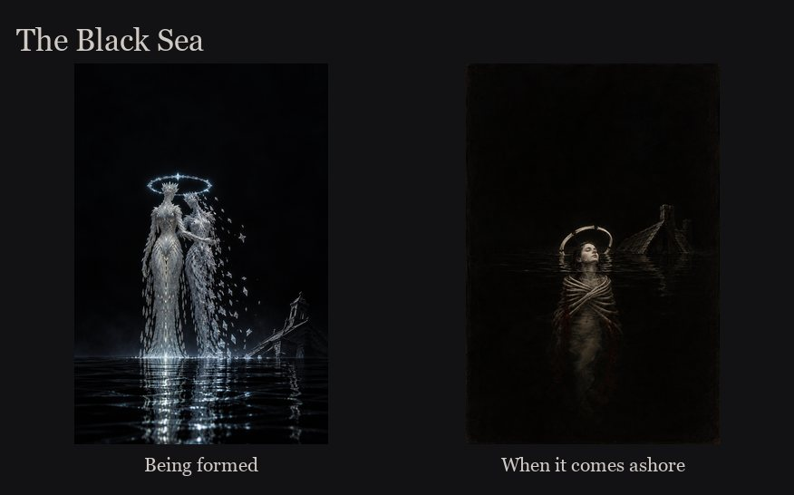

**The Black Sea is the only thing in the buried world with no jailer.** It lies in
the Southern Sea and in the void above, it was built by **the Primordial Titan of
Fear**, and **she spread herself thin into everything rather than keeping her power
concentrated.** That is why she does not scheme. She waits for people to do her
work.

| Age | Where the corruption is |
|---|---|
| **Foundation** | the Abyssal Breach, the Ravines of First Descent, the Deep Reaches where the mercied serpents retreated |
| **Mortal Rebellion** | the Southern Abyssal breach, opened by Solomon, sealed twice, with Doomslayan on the far side |
| **Kingdoms** | **contained in the southern Central Continent**, spreading into the southern Eastern Continent and the Southern Dark Continent under Bloodwing. **She vanquishes the invading Black Sea Angel there once she becomes the Dark Angel** |
| **Darkness** | the heavens split. The Thirteen descend. **The Western Continent falls entirely.** The infected races are quarantined on a far continent |
| **Darkness II** | the sea. The **Black Sea Leviathan** and its eldritch nightmares |

**What the corruption actually does**, from Amelia's forest: the things that fall
from the heavens are rarely seen any more, **but the corruption nests in carcasses,
seeps into rivers and breathes through the mouths of the dead.** Every execution and
every discarded slave becomes another walker. Some rise as shambling corpses,
others as hunched pale things that crawl on their fingertips and scream at the
moon.

**And the Sisterhood understands it better than the Grey Knights do.** At Isdowrath
a Light Councillor places silver resonance needles around a wounded knight's
stomach and the Gore-Crawler wound **actually hisses**, venting thin black vapour.

> *"It fears the light," the councillor explained softly.*
>
> *"The corruption?"*
>
> *"No."* The older woman looked toward the south through the narrow windows.
> ***"What birthed it."***
>
> **To Grey Knights, monsters were enemies. To the Sisterhood, they were
> symptoms.**

---

## 22. The Dark Lord succession

| | Dark Lord | How |
|---|---|---|
| 1 | **Anthurian Bloodwing** | built the dominion out of freed slaves, burning every slave market she found |
| 2 | **Anubis** | she left him the title when she went west after the Meteor. **He was the People's Lord, and told frightened people who knelt to stand** |
| 3 | **Calor Nightwing** | by **coup**. Brother against brother. The vampire houses outnumbered the loyal Lycan forces in every major city |
| 4 | **Morgana** | after she burns Calor's kingdom and kills him |
| 5 | **Anthurian returns as the Dark Angel** | **refuses the throne** and leaves it empty. Morgana retreats to the eastern borderlands |
| 6 | **Amelia** | slays Anthurian in the Age of Darkness and takes the title, **and is eventually converted by the Prime God of Blood into a High Vampire** |

Alysheer's archive entry for Anubis: **ONE OF SEVEN. SECOND DARK LORD. BROTHER. HE
MADE THE BEASTS STAND. HE WAS LOVED.**

### Anthurian's fall and her second rise

She discovered that **when soldiers feared her they could not hurt her, so cruelty
became safety.** She concluded in exile that **freedom causes inevitable
conflict**, and built a dominion on that thesis. **Then Helena fell from Heaven**,
and the two of them merged - **and the merging kept both**, which is the law stated
in section 11, the same law as Conquest's Apocalypse Form and the Faelorn bond.
What came out of it was **the Dark Angel**, who **refused the throne she had spent
her life taking.**

**And then she vanquished the Black Sea Angel invading her own continent**, which
means the first Dark Lord's last act as a ruler was defending the world from the
thing the world thought she was.

### The hidden architect

**The collapse of the Seven was not organic. It was curated.**

**Revendrinn Nyxthorn**, the **Hero of Shadows**, **First Lord of the Dark Pact**,
one of Hansall Whitegrove's ancient equals from the first centuries of the elves.
His craft was never darkness. It was **absence from importance**. A person could
look directly at where he stood and simply fail to understand there was someone
there. *"True shadow was the space between awareness and reality."*

Then **Aquila killed Herafel Duskfall**, the only other person who understood
silence the way he did, and something broke quietly. *"Grief does not always feel
like pain. Sometimes it feels like repeatedly expecting someone to exist."*

Then **the Seven killed Sederous.** Thaerel drew Revendrinn away. Mervane, Calor
and Anubis did the killing. *"They did not assign someone to defeat him. They
assigned someone to survive him for long enough."* Three blocks of the city went,
not destroyed but **gone from perception**, and Calor, who never retreats, said
**"Run."**

He did not hunt them. He had spent centuries learning that the strongest monster
dies when you remove the thing it needs to live, so he looked at seven people and
asked the same question. **The Seven's seam was each other.**

So he evolved his craft into minds. Everyone has thoughts they reject before
speech. He could not plant one, **but he could return one, softer and more
familiar, until it stopped feeling like intrusion.** *"The thought remained theirs.
He merely made certain they heard it."* He whispered questions, not commands: *Why
does he deserve the throne? Why should you obey? How many chains have you accepted
because the hand holding them belonged to someone you loved? What happens if you
stop?*

**The answers were theirs. He did not corrupt them from nothing. He curated their
corruption.**

He is therefore the hidden cause of Calor's coup, Mervane's turn to Morgana,
Thaerel's death and the theft of Conquest. He becomes the **Nightmare of Nyx** by
forgetting the last clause of his own order's oldest rule: enter darkness, use it,
**leave.**

> *"The young Revendrinn disappeared so enemies could not see him. The old
> Revendrinn disappeared because he could no longer bear to be seen."*

### Amelia, and why she is Anthurian's mirror

**Her whole life happens in the deep south of the Central continent**, in the
Black Sea territories, and it begins during **Uther's crusade against magic** in
the West. That matters: while a human king is burning sorcerers on one
continent, a girl on another is being raised by the thing he is pretending does
not exist.

**Phase I, the Child of Ashes.** Her village belonged to a Baron whose greed had
buried whatever honour his bloodline once had. Justice could be bought, murder
could be forgiven, and the **GhoulClaw Clan** rode openly through his lands
because fear kept peasants obedient better than soldiers ever could. Every few
months the riders came, and people stopped speaking when they heard horses.
Doors closed. Candles went out. **Children learned not to cry.**

Her mother was taken on a cold autumn evening. *She remembered reaching for her
hand. She remembered missing.* **Her father never tried to stop them, and she
hated him for that long before she hated the bandits.**

**Phase II.** Two years among the GhoulClaw, *wolves wearing human skin.* She
smiled the first time she realised she could herd them. **At nineteen she
destroyed them from the inside**, and the clan's blood-soaked halls became the
bastion of **Boudicarn**. **By twenty-one she was Warleader**, and the women who
had survived the GhoulClaw carried axes and short spears instead of chains,
behind palisades, watchtowers and trenches lined with stakes.

**Her teaching**, which belongs beside the Nyxthorn doctrine:

> Fear was not something to overcome. It was a sense like hearing or sight.
> Ignore it and it would get them killed. **Understand it and it would reveal
> what others tried to hide.**

**That is the Titan of Fear's own domain turned into a discipline by a mortal
woman**, and she built Boudicarn in the middle of the Black Sea's leavings
**because nightmares made excellent walls.**

**Phase III, the fall.** The Baron sent **Victor Lash**, Champion of the Iron
Marches, who killed the **Red Oath Giant** and **held the Bridge of Carrion
alone for an entire night.** Boudicarn fell. Amelia fought him personally with
chained daggers and a short sword, cut his neck, and lost.

> **Victor Lash had dismantled every belief she possessed in a single day.** For
> the first time since she was a child beneath the cellar floor, Amelia
> understood that she was no longer the most dangerous thing in her world.

**Phase IV, and this is the turn.** He did not kill her and he did not hand her
over. **They left together**, and the man who had taken everything from her
became the only person who ever taught her anything.

They hunted the deep south for years: necromancers, Lich cults, the cell work
nobody else would take. Eventually they took a station in a **Duke's kingdom at
the edge of the Black Sea territory** and carried out his hunts. Corrupted
trolls. Whole fortifications gone over to the dark. **Victor took her as his
disciple and trained her into one of the Warrior Queens of Darkness**, and she
put down the chained daggers for **a great black blade**, and wore plate cut
away to almost nothing, because at her weight speed was the only armour that
had ever worked.

**And they met a Ghoul Mother and did not win.** They got out alive by severing
one of its arms, and they ran. **That arm is the thread that ties the next
decade together.**

**Phase V, Morgana.** After Arthur took the throne and **Morgana was discovered
and exiled**, she came to the Central continent's southern borders and set up as
a mysterious and powerful witch, earning her living in the open on **elemental
mastery** while quietly going further and further into necromancy in private.
She was called on constantly. **Victor and Amelia fought beside her on many
missions**, and they grew close on the long escort runs where there is nothing
to do but talk.

**The three of them are a working unit and each covers a real hole.** Morgana is
devastating given time and distance and nearly helpless when swarmed or reached,
which is exactly the gap a great black blade and a champion of the Iron Marches
fill.

**When the one-armed Ghoul Mother was finally posted as a bounty, the three of
them took it.** They succeeded and it cost many lives. **Morgana's meteor storm
and tempest brought the beast down**, and Victor and Amelia went into the swarm
and tore it apart.

**Phase VI, the Southern continent.** Morgana gathered a cult following and left
to win herself a kingdom in the south. History takes its course and **she is
defeated.**

**Then Amelia descends.** She makes a pact with the **Prime God of Blood** to
put down most of the Dark Angel's Lords, and she does.

**And then she betrays it.** **She slays the Prime God of Blood and absorbs its
essence**, which makes her not a High Vampire but the thing High Vampires were
made out of. **The true Blood Queen.** She carries the dead god's madness with
her for the rest of her life, and it both wrecks her and wins for her, because a
mind that is not entirely her own is a mind nobody can read. **She slew the Dark
Angel and took the crown.**

**She co-rules the Southern continent with Morgana, and stays in the shadow of
it.** Morgana wears the throne. Amelia is the reason it holds.

**Phase VII, the long disguise.** Decades later she walks back into the Central
continent and **joins the City of Light under a false face.** Nobody detects the
vampirism, and the reason is almost funny: **they are testing for a High
Vampire, and she stopped being one the day she ate the god.** She rose through
the order quickly, which was easy, because the **Black Sea invasion** had begun
in earnest across the Southern and Western continents and the Light needed
anyone who could fight.

**A few decades of war later they beat back the Black Sea Angels and win it.**
And in the same hour, on the other continent, **humanity opens its war against
the elves**, so the victory buys nothing.

**Phase VIII, Isdowrath.** A few years on, she arrived at the Grey Knights'
southernmost citadel with her own squad, as a **Sister of Light**, bringing aid
against the darkness pushing up from the south. By then she was a **Saint Knight**, a
paladin of the Light serving under **Arch-Saint Lady Shallon**, and in the
Southern continent, among people who had never seen her face, **the Blood
Queen**. The world would remember the first of those as the **Saint Paragon**.

**Both titles are earned and neither is a lie.** She genuinely fights for the
Light and she genuinely rules the dark continent, and the reason nobody catches
her is that she is not pretending at either one.

**And the two titles are the same operation.** She had been quietly turning her
most devoted sisters into the **Knight Sisters of Darkness**, presented to the
Light as a specialist sect raised to find and destroy Black Sea abominations,
and granted leave to base themselves in the Southern continent.

**They based themselves at Gothica**, which is the one choice in her whole life
that nobody could argue with. The **Gothica Knight Sisters** exist because
something in that region **turned ninety-eight percent of its men into
eldritch, lust-driven horrors**, and Gothica is the last city in those lands
that has not fallen. It is a sisterhood because there are almost no men left to
make it anything else. **No organisation in the world has a better reason to
exist**, and no posting is a more convincing act of faith.

> **The Knight Sisters do not know what their founder is.** Everything outside
> Gothica's walls is hostile to them, they fight it honestly and they bleed for
> it, **and that hostility is the proof of loyalty that keeps the Light from
> ever looking twice.** Amelia built an order that protects her by sincerely
> trying to destroy everything she rules.

**And she chose the one place where that could never be questioned.** A woman
who wanted to hide what she was could not have found better cover than a city
under permanent siege by monsters, defended by women who have every reason to
hate the dark and no reason at all to suspect the Saint Knight who
garrisoned them there.

### Amelia against Anthurian

| | Anthurian | Amelia |
|---|---|---|
| Born into | slavery under Cainan | a village farmed by the GhoulClaw |
| The wound | her mother died and nobody came | her mother was taken and her father did nothing |
| What she built | a dominion out of freed slaves | a sisterhood out of freed women, in the bandits' own halls |
| Who taught her | nobody | **the man who destroyed her** |
| What she did with power | **refused the throne** and ruled without sitting on it | **took every throne and every offer** |

**And the line that separates them is still the same one.** Anthurian was never
asked anything. Amelia was asked by the Prime God of Blood, said yes, and then
killed the thing that asked.

**So when the two of them meet, Amelia is facing the version of herself that
refused.**

**The Dark Angel she slays is Anthurian Bloodwing.** They are not two kills and
not two Angels. This bible's own settled list already records that **Bloodwing
becomes the Dark Angel** and that **she** is the one who vanquished the invading
Black Sea Angel in the southern dark continent, so by the time Amelia comes down
there the throne of the south and the Dark Lord title are **the same chair with
the same woman in it.**

So the pact, the Lords, the god and the crown are one campaign. Amelia bargains
with the Prime God of Blood, puts down most of the Dark Angel's Lords, betrays
and devours the god that armed her, and then kills the Dark Angel herself. **One
throne, taken by killing the only other person in the world who had lived her
life.**

**And the dating runs in this order.** Morgana is exiled and the three of them
hunt together through the **Age of Fractured Ideals**. Morgana goes south, wins
her kingdom and loses it. Amelia follows, kills the Lords, eats the god and
co-rules the south from the shadow across the **Age of Freedom**. She walks into
the City of Light under a false face as the **Age of Darkness II** opens, and it
is in that age, with the Black Sea Leviathan invading and every eye turned
outward, that she **kills Anthurian and takes the title.** Which is exactly what
the settled list already said: in the Age of Darkness, not before. The age table
has been moved to match, and the Age of Broken Crowns keeps its betrayal and its
dead Night Sisters without the claim it was making about Amelia.

**And the Dark Angel is a seat, not a person**, which is what reconciles the
three passages that name it differently. The age table says a **Grand
Archangel** takes the dark domain and becomes the Dark Angel in the Age of
Freedom. The settled list says **Bloodwing** becomes it. Helena's arc ends with
her as **the soul inside** it. All three are true at once if the Dark Angel is
an office with a vessel attached:

- **The vessel was made when a Grand Archangel took the dark domain**, and
  **Helena is the soul bound inside that vessel.** She does not hold the office.
  She is the thing the office is worn over.
- **Whoever rules the dark domain is the Dark Angel.** Bloodwing took the seat.
  Amelia killed her and took it after her.
- **Which is why Helena survives Amelia entirely.** Amelia killed the holder,
  not the vessel, and the soul inside it was never hers to reach.

**So Helena has been inside the thing through every Dark Lord since**, watching
one woman kill another for a chair she is sitting underneath. Nothing in the
archive says she has ever been asked about it.

### Amelia against Anthurian

| | Anthurian | Amelia |
|---|---|---|
| Born into | slavery under Cainan | a village farmed by the GhoulClaw |
| The wound | her mother died and nobody came | her mother was taken and her father did nothing |
| What she built | a dominion out of freed slaves | a sisterhood out of freed women, in the bandits' own halls |
| Who taught her | nobody | **the man who destroyed her** |
| What she did with power | **refused the throne** and ruled without sitting on it | **took every throne and every offer** |

**And the line that separates them is still the same one.** Anthurian was never
asked anything. Amelia was asked by the Prime God of Blood, said yes, and then
killed the thing that asked.

**So when the two of them meet, Amelia is facing the version of herself that
refused.**

**She kills two of them, and they are not the same Angel.** The thing she
destroys in the south, after putting down its Lords, is **one of the thirteen
Black Sea Angels**, which came in the Age of Darkness and have been seated in
the dark continent ever since. **It is not the Dark Angel that carries Helena's
soul.** That one does not exist yet: a Grand Archangel takes the dark domain
and becomes the Dark Angel in the **Age of Freedom**, decades after Amelia
takes the southern crown. The two are separated by the calendar, not by
argument.

**So she takes two thrones by killing whoever was sitting on them.** A Black
Sea Angel in the south, and **Anthurian** much later, and the second one she
does while wearing the colours of the City of Light.

**And the dating now runs in this order.** Morgana is exiled and the three of
them hunt together through the **Age of Fractured Ideals**. Morgana goes south,
wins her kingdom and loses it. Amelia follows, kills the Angel, eats the god
and co-rules from the shadow across the **Age of Freedom**. She walks into the
City of Light under a false face as the **Age of Darkness II** opens, and it is
in that age, with the Black Sea Leviathan invading and every eye turned
outward, that **she kills Anthurian and takes the Dark Lord title.** The age
table has been moved to match: the Age of Broken Crowns keeps its betrayal and
its dead Night Sisters, and loses the claim it was making about Amelia.

---

## 23. The people

Not everyone. The ones whose stories are written at length, and what each of them
is actually about.

### The first generation of elves

**Hansall Whitegrove.** Among the first elves born into the mortal world. He
witnessed the War of Serpents, survived the Cataclysm of the Father of Monsters
when the monsters were still fresh wounds on creation, saw the Birth of Humanity,
fought the War with the Gods Blood, lived through the Tournament of Domination,
and fought again in the Demon Wars. **By the end of the Second Age he had spent
more of his life at war than most civilisations had spent alive. That is why he
loved peace, and why he never trusted it.**

> Gardens survived because walls surrounded them.

He ends as the **Fae Lord of Fables** in the Eternal Fae Realm's High Court of
Stories, because his entire life had become stories. And he dreamed of the Gate
before he went: trees so enormous their crowns disappear **beyond** the stars
rather than into the night, branches passing through layers of existence as
easily as roots enter soil, some bearing silver leaves and others **tiny suns
where fruit should have grown.** A stag with constellations moving beneath
transparent skin. Tiny winged things carrying lanterns made from memory. A woman
with antlers who became a white fox when he looked directly at her. **None of them
threatened him, which made him suspicious.**

And the singing, which was not any Fae song he knew:

> **It sounded like every Fae song had once been part of something greater and
> this was the melody from which the fragments had broken.**

And the Gate itself: **no wall, no towers, no guards. Simply two white pillars
curving together beneath vines that blossomed into colours mortal eyes do not
possess names for.** And beyond them, **home** - a place Hansall had never been,
which somehow made it worse.

**His equals, not his retainers.** Their names became the great Houses, and the
Red Rangers name them as the only five men they respect without proof.

| Name | Title | What they founded |
|---|---|---|
| **Hansenel Icetear** | Hero of Frost | **House Icetear**, named for the Name of Winter |
| **Glorfarsall Elysium** | Hero of Light | the Paladin tradition. **Still alive, hidden in the mortal world** |
| **Revendrinn Nyxthorn** | Hero of Shadows | **House Nyxthorn** and the Dark Pact Accords |
| **Renaris Gravespine** | Hero of Souls | **House Gravespine**, guardians of the Elu-Hsal Temple |
| **Lady Selanal Thorneheart** | - | the **Green Wardens** |
| **Nerynolion Shadebloom** | Hero of Poisons | **House Shadebloom** |
| **Herafel Duskfall** | Hero of Silence | **House Duskfall** and elven intelligence |
| **Serallion Lune** | Matron of the Moon | the **Elu-Chandra**, the Moon Elves |
| **Sendarel Lothrin** | - | the **Elu-Hsal**, the Soul Elves |
| **Tiamel** | first Queen of the Elu-Dragar | the **Elu-Dragar** |
| **Sederous Lionheart** | the King of Scraps | the first city for the **Elu-Dues** |

**Before this, houses had no names.** Among the earliest elves one name was
usually enough. **Icetear, Whitegrove, Nyxthorn and Gravespine all came later,
earned rather than inherited.**

**Sendarel Lothrin and the law of souls.** He dreamed of dead Fae wandering
beneath impossible stars and thought them nightmares, until one of the dead began
speaking his name. He woke. **The dead elf was standing beside his bed. He
screamed. The ghost screamed too.** *"A magnificent beginning to theology."*

What he learned is real cosmology: **mortal souls move toward judgement through
the Great Ghost Realm. Fae souls are different**, because their existence connects
to something beyond a single mortal world, so they need passage toward the
**Eternal Fae Realm**. But death confuses some. A soul might cling to a child, a
home, a lover, its own body. **Some forget where to go. Some become frightened.**

**The work changed them.** Skin paled. **Sacred horned crowns** appeared among the
devoted. **Feathered wings** manifested through some lines. And soul energy began
responding to them **not as weapon, but as trust.** That distinction became
sacred.

**Renaris and the dead child** is the best scene in the archive. A dead Fae child
crouching several feet away, crying. *"Why doesn't she move?" "She thinks her
mother cannot survive without her."* Renaris crawled closer. The spirit recoiled.
He stopped. *"I won't touch you."* He sat. For hours. Eventually she asked: *"Will
it hurt?"* He shook his head. *"I don't know."* Lying seemed worse. *"But you
don't have to go alone."* He held out his hand and did not move closer and
waited.

**The dead child took it.** And soul light travelled through him, and it was not
power, it was **memory**: her mother's singing, a wooden toy, running through
rain, a favourite sweet, an entire small life brushing against his soul. Renaris
began crying. The girl frowned. *"Why are you sad?"*

> **"Because you mattered."**

When she passed, **a little of her warmth remained in Renaris's palm.** And
Sendarel said: *"Remember that feeling." "Why?"*

> **"Because one day someone will discover souls can do much more than this. And
> they will convince themselves that ability means permission."**

**The Hsal-Erakla schism.** His fear came true inside his own people. Some
Elu-Hsal discovered soul energy could strengthen the living, which was not
inherently forbidden: a willing ancestor could lend endurance, a fallen warrior
could briefly empower a descendant's blade. **Then someone asked the dangerous
question. What if they refuse?** The faithful answer was simple: then you leave
them alone. **Lucifial offered another: make them obey.**

**The first time Renaris saw a soul seal he vomited**: a dead Fae warrior forced
into a crystal, not resting and not consenting but trapped, his face repeatedly
appearing beneath the surface, screaming. *"Release him." "He serves a purpose."
"Release him." "Think what we could accomplish."* And then: ***"A soul is not
ore." "No. It is more valuable."*** Renaris broke the crystal, the spirit escaped,
and then Renaris broke the elf's jaw.

The dominators argued that Fae souls are eternal, so temporary suffering mattered
little beside what their power could achieve. Sendarel answered that before the
full council, wings folded behind him:

> **"If eternity makes suffering meaningless, why does compassion matter at
> all?"**
>
> *"These souls trusted us because death frightened them. We were made their
> guides."*
>
> **"And you discovered frightened things are easy to chain."**

The exiled were named not with honour but with condemnation: **Hsal-Erakla, the
Soul Defilers.**

**House Gravespine's deepest law:** *"The living protect the Elu-Hsal. The
Elu-Hsal guide the dead. **And no Gravespine would knowingly allow a Fae soul to
become property.**"* Renaris's descendants inherit not merely soul magic **but
responsibility for how it is used.**

**Which is why Solenyra's eye matters so much.** Solenyra Gravespine, heir of that
House, Lord of the Dark Pact, sworn protector of the Great Elu-Hsal Temple,
**refused to let her brother's soul cross and keeps him in a sapphire pendant in
her eye.** She has broken the oldest law of her own House, for love, **and she is
the only Gravespine left to judge her for it.** No document says this. It is the
best unexploited thing in the archive.

**Lady Selanal Thorneheart** hated scorched earth **personally, not morally.**
Burning a forest in her presence was roughly equivalent to insulting her mother. A
commander proposed firing several miles of woodland to flush out a burrowing
creature. *"No." "It would work." "No." "We can regrow..." "No."* She crouched,
put one palm against the soil, and the roots answered quietly. A tremor. Then
another. Half a mile away something enormous screamed as roots erupted around it.
*"Found it." ... "Less fire."*

From that philosophy came the **Green Wardens**: protectors of wild borders,
healers, scouts, monster hunters. **People who understood that preserving
something sometimes required violence, but that destruction should never become
the first tool simply because it was easy.**

> She reminded him that **keeping something alive was often harder than killing
> what threatened it.**

**Serallion Lune** heard the moon. Hansall assumed she was joking. She was not.
*"She speaks." "The moon." "Yes."* He looked up and saw nothing. *"What does she
say?"* She smiled. **"She dislikes your crown." "I don't have a crown yet."
"Apparently she's planning ahead."**

**Tiamel.** Daughter of **an Ancient Dragon King who was Tiamatra's own son**,
and of **Galatrel, Hansall's sister**, which makes her **Tiamatra's
granddaughter** and places her one generation below the Dragon Gods rather
than beside them. An earlier draft had her fathered by Osiris and tied to the
Phoenix-Dragon God, and Lash has corrected that: the line runs through
Tiamatra. **Her father is Dagrhan**, the Ancient Dragon King, and the Elu-Dragar
carry his name rather than hers: **Princess Nyrial Dagrhan** is of his line.
Tiamel founded the people and they took her father's name for the house,
which is the elven habit of naming a House for the thing that came before it.
Osiris is her great uncle, not her father. Born with small gold-red
scales on her cheeks, and Galatrel cried from relief rather than horror, because
the pregnancy had frightened everyone and nobody knew what the child would be.
Tiamel answered by screaming louder than any infant Hansall had encountered. He
held her once. **She bit him. No teeth. Still insulting.** *"Strong," Galatrel
whispered. "Rude," said Hansall.*

She was a demi-god elf with divine dragon blood running directly through her. She
could have stood among the Gods Blood powers and insisted ordinary elves were
beneath her. **Instead she became obsessed with children who looked like neither
side of their ancestry** - born with tails, scales, claws and eyes they tried to
hide. Hansall found her sitting beside a girl who would not take off her hood.
Tiamel pulled back her own hair to show the scales along her temple. *"See?"* The
child sniffed. *"Yours are pretty."* Tiamel made a disgusted face. **"They're
horrible."** The girl looked shocked. Tiamel grinned. **"Exactly."** And the child
laughed.

From those scattered dragon-elves she built the **Elu-Dragar**, and they made her
their first Queen. *"Do I have to sit through all of this?" "Yes." "I hate
monarchy." "You are literally becoming Queen." "Temporary lapse in judgement."*

**Sederous Lionheart.** Born of **Lyadra Whitewing**, Hansall's cousin, and
**Ligarr, Beast Lord King of the Leonar.** Half-elf, half-Leonar, **and completely
incapable of behaving in a manner older nobles considered dignified.** He built a
city for the **Elu-Dues**: mixed peoples, beastkin, Fae without recognised Houses,
and creatures other kingdoms distrusted despite having no malicious nature. A
visiting noble looked at its chaotic collision of architectural traditions and
sneered **"a kingdom of scraps."** Sederous smiled, and then **had the phrase
carved above one of the taverns.**

> **THE KING OF SCRAPS WELCOMES YOU.**

*"You kept the insult." "It was free." "You're impossible."* He raised his cup.
*"That's why you visit."*

And Hansall did visit, often, **because Sederous's city reminded him that
civilization became strongest when people stopped treating purity as though it
were an achievement.**

### The younger elven generation

**Snoweinter before the loss:** pale stone beneath white forests, blue Fae
lanterns, frozen canals, the **Great Elu-Hsal Temple** rising above the oldest
district, and House Gravespine living close enough to hear its **soul bells**
every evening. *"Not yet associated with loss. Only winter."*

**Golian called every older woman of his generation Big Sister.** Hannarial
tolerated it. Solenyra endured it. **Antharaiel considered it a personal campaign
of harassment.** *"One day I will be important enough to imprison him." "I believe
in you!"*

**The broken sword.** Golian's first sword for Solenyra took fourteen days. She
tested the balance, looked down the blade, asked about the guard, said the centre
was too thin, and when he said it wasn't, **put both hands against it and snapped
it.** *"Fourteen days." "Weak." "Fourteen." "It would have failed." "You didn't
have to break it."* **"Then how would we know?"** She handed him the pieces.
**"Again."**

Then, after he stormed off, Hannarial: *"You liked it."* Solenyra, inspecting her
bruised knuckles: *"The grip was good."* *"You could tell him."* *"No."* *"Why?"*
**"Then he might keep the weak centre."** *"You are emotionally catastrophic."*
*"So are you."* *"Fair."*

> **Solenyra loved him so intensely she had converted the emotion into quality
> assurance.**

**Santhur and Caeleira** were competitive archers who escalated from a hundred
paces to six hundred, to moving targets, to targets visible only through a gap
between trees in crosswind. He spent three months on a bow of **yew heartwood,
Faesilver reinforcement and black stag hide**, talked about it constantly, and
handed it to her. She hit centre at six hundred paces, told him his left shoulder
compensated, **and then snapped the upper limb.**

And Antharaiel, watching from under a tree with a book: **"You two are going to be
exhausting when you finally realise you're in love."** *"We are not."*
*"Naturally."*

And Hansall, watching all of it from a distant balcony:

> **This was what victory looked like. Not banners. Not dead enemies. Children who
> had the luxury of being ridiculous.**

**All of them lose.** Golian dies holding a building up at Ashwinter. Santhur is
killed by an Imperial caravan ambush, the same trick Garod Khan used, and
**Caeleira finds the bodies along a path of heads** and takes Emerald vengeance.
Solenyra loses her whole House and keeps her brother in her eye. **Antharaiel
causes it.**

### The current Red Ranger command

| | Who | What she carries |
|---|---|---|
| **Hannarial Icetear** | Captain of the Red Rangers | the name Garod Khan, and a family she could not save |
| **Solenyra Gravespine** | High Warden, and **Lord of the Dark Pact** | Golian, in a sapphire in her left eye, and soul sight |
| **Anthurian Icetear** | Vice Captain | Hearthwinter, and her mother's order to stay away |
| **Syrel Thornheart** | healer | Selanal Thorneheart's line |
| **Shaedra Nyxthorn** | Ranger | the same generation as Anteira |
| **Alfar Chandralon** | squire | a human noble appointed into an elven institution by treaty clause, which is why he is resented |

**Note on the site:** the published saga calls Alfar Chandralon **"Lash."** The
archive name is Alfar Chandralon, and **Chandralon decodes as Moon**, which places
him in the Elu-Chandra naming space rather than the human one. That is worth
deciding before the next saga chapter goes up.

**Anthurian Icetear is not Anthurian Bloodwing**, and the archive calls both
"Anthurian." Bloodwing is Cainan's daughter, the first Dark Lord. Icetear goes
missing on a failed assassination mission and eventually becomes Vice Captain of
the Red Rangers. **Two women, one name, four ages apart, both female.**

### The Nine

Nilrealm preserved them in marble until their time.

| | Who | What they are |
|---|---|---|
| **Azikeal Icetear** | twin | a duelist who redirects rather than meeting strength |
| **Erzakial Icetear** | his twin sister | **frost given human form**, outwardly composed. **She understood people too quickly and forgave them too slowly.** Magic through silence, shadow and winter |
| **Princess Nyrial Dagrhan** | **Elu-Dragar** | delicate scales shimmering along throat and shoulders, eyes glowing like molten metal when angered, a spear and dragonflame |
| **Edmonta Lothrin** | **Elu-Hsal** | pale soulfire, followed by figures no living eye can focus on. **He begged his elders to defend their homeland and they refused** |
| **Helen Ploki** | of a shamanic people | strikes like thunder |
| **Cholo Puto** | her counterpart | twin daggers, and **moves like the moment before thunder.** He notices the hand inching toward a dagger, the lie inside a compliment, the frightened child beneath a table. **"Fear could travel farther than any arrow"** |
| **Prince Leon Godrick** | second son of **Lionheart** | shield and horse, and the whole objection to prophecy |
| **Duke Lycareon Tyberious of Wolfsbane** | lord of spies, assassins and border knights | the unsettling courtesy of a man **capable of killing everyone in a room while apologising for the inconvenience.** Carves runes into spear shafts. **Kills the ones shouting orders, not the strongest men** |
| **Sedrick** | born above a gemsmith's workshop | son of a man who cut jewels for nobles who would never remember his name. Every title purchased through suffering. **Becomes, through no official decision, the spine of the group.** Sword and shield, heavy infantry, **and no gift of any kind.** See below |

**Sedrick is the only one of the Nine with nothing.** Every other member has a
bloodline, a magic or a title that arrived before they did. He has a plain
sword, a shield, and a father who cut stones for people who never learned his
name. **He becomes the spine because he is the only one who earned all of
it**, and because the single thing he does better than any of them is fail to
break.

**And he has his father's eye.** A gemcutter finds the one plane along which a
stone will split cleanly, and strikes there. Sedrick reads a shield wall, a
suit of plate and an argument between friends the same way. **It is a
tactician's gift that costs nothing supernatural**, and it is why eight people
who all outrank him do what he says.

**Two live threads inside the Nine.** **Edmonta Lothrin** committed his people's
one unforgivable sin in order to save his kin from extinction when enemy armies
ambushed his hometown, was exiled by the Elu-Hsal for it, was too decent for the
Hsal-Erakla who would have taken him, wandered alone as the disgraced tactician,
and then spent the war **undercover inside Morgana's coup, secretly loyal to
Nilrealm.** That is the best-designed character in the group.

**And Cholo Puto betrays Arthur.** He is listed as *"initially loyal, becomes
corrupted and betrays Arthur."* **The traitor is the one who reads people best.**
He also shares a surname with **King Putrous Puto** of Hearthwinter, and **Helen
Ploki** is one letter from **Helena**. Worth deciding whether either is
deliberate.

**Leon Godrick's own story**, separately: second prince of Lionheart, loved by
stable hands, blacksmiths, servants, scholars and veterans alike, who wandered the
castle without arrogance, asked questions of gardeners, carried baskets for
elderly servants, and slipped out of banquets to watch recruits train. **The people
whispered "He has the heart of a king."** His elder brother is first in line and
prefers feasts to council meetings. **Lady Moraine**, their cousin, spent years
cultivating the elder prince's trust, **because a weak king can be guided and a
strong king cannot**, and paid mercenaries to kill Leon and leave the body where
brigands would be blamed.

**Greed saved him.** Their leader asked *"Why kill a prince worth a kingdom when
his father will pay twice as much to see him alive?"* **Prince Narseon Godrick**,
the youngest brother, worked out where a greedy criminal would sell a prince and
scattered Lionheart's finest knights across the countryside as merchants,
pilgrims, shepherds, hunters and weary travellers, every one with steel under the
cloak. And when the trap sprang, **Leon took a dead bandit's sword in both shaking
hands and charged, not because he thought he could win, but because Lionheart's
knights were dying to save him and he refused to watch them fight alone.**

**Moraine got away clean.** She mourned publicly with the family. *"If fate
insisted on protecting him, then she would simply have to become cleverer than
fate itself. And from that day onward, every smile she offered her young cousin
concealed another knife waiting patiently in the shadows."*

### The immortals who hide

**Every ancient power in Archavalon chooses a disguise specifically designed to be
underestimated.** That is a rule, not a coincidence.

| Who | Hides as |
|---|---|
| **Salomei** | a dancer, a wandering lady knight, a jolly old man, a holy captain |
| **Nilrealm** | a half-elven servant's companion, and a manservant's wizard |
| **Merlin** | a manservant, **and it stopped being a disguise.** See below |
| **Floki** | a drunk carpenter |
| **The Grey King** | **Fang**, a wanderer |
| **Glorfarsall Elysium** | nobody knows, which is the point |

**Merlin is the Preparer, and he casts nothing.** Salomei already holds the
mind, so he does not duplicate her. **Every effect Merlin has was arranged
decades before it is needed**: the object left in the right room, the person
placed in the right post, the road built to the wrong town on purpose. He is
useless in an ambush and unbeatable in a war. **Which is exactly why a being
of his power can spend a century carrying somebody's coat and lose nothing by
it.** The manservant is not where he hides. It is where he works.

**The Grey King's discipline is Seren State, and it is stillness.** Not a
technique but a condition: a calm so complete that nothing he is about to do
can be read off him, by a man or by a demon. A greatsword and no magic. **His
power is expenditure, not endurance.** He can do anything once. He sealed the
Demon Breach twice, **and he has spent two ages healing from it**, which is
the whole reason he is wandering the Third Age as a man called Fang instead of
sitting on anything.

**Salomei**, the most dangerous character in the archive. **An immortal primordial
being who has lived as human, archangel, lichlord and devil queen**, whose role is
watcher and advisor, and whose motive is that **she loves the experience of
existence.** Nilrealm eventually realised she was immortal and considered her the
**first World Sage.**

| Age | Appearing as |
|---|---|
| Earliest draft | **Salomei, the Goddess of Mystery**, one of the ten Old Gods |
| Second | the woman who walked into Alice's village with no caravan, no guards and no explanation, took Rorick, **and then waited to see what Alice would become** |
| Second | **Salomei of Acropolis**, beside Blood-Queen Llanahs, her inspiration and closest companion, **who vanished without a word and left the hole the Prime God of Blood filled** |
| Second and Third | **Sal the Wanderer**, who taught the white dragon about the world, manipulated Llanahs's kingdom of art into recording history, and influenced human magic into existence |
| Third | **Sir Salomei, Lord Zeta**, Wandering Lady Knight of the Seven Knights of Determination, master of mental sorcery who can soothe despair, expose lies or break a tyrant's resolve without drawing a blade |
| Fourth | **Holy Knight Captain Salomei** of the Knight Sisters, who led the defence of the Eastern Temple and could not save it, **and then held the Slayers' minds together against Nara** |

Her description never changes: impossible beauty, long raven hair that moves when
there is no wind, **golden eyes**, a smile that carries the certainty it was meant
for you alone. Men linger in conversations they had no reason to begin. Women
admire her despite themselves. Children follow her through the streets.

**Her method is the rule of consent:** become indispensable, then leave, and let
the hole do the work. **She did it to Alice and she did it to Llanahs, and both
became monsters.** *"I merely waited to see what you would become."*

**And she is not malicious. She is a reader who keeps turning the page.** That is
the frightening part.

**Floki, the Great Wise Fool.** A Prime God of **Death and Prophecy** hiding as a
drunk carpenter. He appeared overnight beside the river at **Tritaneim** with a
crooked cabin that had not existed the day before. No wagon, no horses, no
caravan. Just a smiling stranger hammering a fence and singing with a tankard in
one hand. Asked where he came from, he answered differently every time: *"North."
"The sea." "A tavern." "My mother." "The moon."* He pays his tavern debts with
**ancient golden chalices, silver idols from forgotten temples, and jewels older
than any kingdom.**

**And he takes in the women nobody else will.** The fishermen call him **Master of
Whores** and he laughs harder than anyone. *"If the title fits."*

> He never forced anyone through his door. Never purchased affection. **His home
> simply remained open to those the world had already closed its doors upon.**
>
> Many stayed simply because **it was the first place they had ever been treated
> like people instead of merchandise.**

He calls them **the Whisperers.** *"Why Whisperers?" "Because the quieter the
voice, the louder men seem willing to empty their purses."* **They are an
intelligence network and the women are its officers.** Who drinks too much. Who
beats his sons. Which merchant cheats. Which noble borrows. Which priest gambles.
**Tiny pieces, worthless alone, priceless together.** Each evening they come back
and tell him about their day, and hours later **he knows the village better than
the people born there.**

**His prophecies are engineered.** He predicts arguments already brewing, storms
he smelled hours ago, deals whose outcome he guessed from careless talk. The
desperate always reveal themselves first and get a small miracle. The sceptics get
nothing, **because they always come back later, usually after hope has abandoned
them.**

> The kingdom called him a fool. **Only Floki knew that fools were the easiest
> people to underestimate. And there was no safer place to hide a mastermind than
> behind the warm smile of a drunk who seemed incapable of taking anything
> seriously.**

**Nilrealm** carries three things, and each has an origin:

| Item | Origin |
|---|---|
| **A gold and white dragon-scale tome** | his own shed scales, made at the World Tree's suggestion, kept as a journal of his travels |
| **A white phoenix feather fan of seven feathers** | the **Great White Phoenix of the Fae Lake**, which recognised him on sight. Controls white phoenix flame **that can burn and heal**, and the **winds of Gehenna**, which strike with the force of a thousand tidal waves or condense into one of the sharpest blades in the world |
| **The White World Staff** | sprouted for him by the **Great White World Tree** after a week of meditation and prayer, **from a willing root. The branch was never severed. It chose to leave** |

**His pilgrimage to the peak of the world.** The purest land is hidden behind
scores of the undead, and as Nilrealm passed through the frozen North **all the
undead separated and knelt**, because *"in their core they also knew what he was,
and the ancient death magics even respected the dragon of dreams."* The pure land
is cut off by an immense peak down which a **legendary white waterfall** falls
forever, and **the water around the mountain incinerates any corrupted or undead
creature. He chose to walk the path rather than fly. The great white lake parted
for him.**

### Helena, and the Dark Angel

**The longest arc in the archive.** Co-founder of human magic. **Great Witch of the
East.** Gods Blood defector. Archangel. Fallen. And finally the soul inside the
Dark Angel. The calendar names the second month for her as **Goddess of Love and
Seduction**, in recognition of **"The War of Love,"** which is a war nobody has
written.

And her power progression is recorded in full, which makes it an entire unwritten
future:

| Stage | Power |
|---|---|
| Mór-Ríoghain's Chosen | 90,000 |
| **Dark Queen** | 179,000 |
| Training with the **Titan Wardens** | 360,000 |
| Completing the **Trials of the 1st Beings** | 530,000 |
| **Accepting the strength of Dagonn** | 880,000 |
| Defending against the **First Black Sea Invasion**, with the **Celestial Sisters** | 1,200,000 |
| **The Black Titan's Corruption** | 1,800,000 |
| **The Sea Titan's Purification** | 89,000 |
| The dark country's defeat | 60,000 |
| **Divine Instinct** | 100,000 |
| The **Ghost Titan's Invitation** | 130,000 |
| The **Ghost Titan's Power** | 2,300,000 |
| **Unlocking Titanic Force** | 2,500,000 |
| **Maximum Limit Capacity Titanic Force**, power tripled | 7,500,000 |
| **Voluntary Power Sealing** | 179,000 |
| Mór-Ríoghain's Chosen, again | 250,000 |

Read as a story: she rises, is corrupted by the Black Titan, **is purified by the
Sea Titan at the cost of ninety-five percent of her power**, is defeated, rebuilds
from almost nothing through Divine Instinct, is invited by the Ghost Titan,
becomes the second most powerful being ever recorded, **exceeds the Black Titan at
maximum output, and then voluntarily seals herself back down to what she was as a
Dark Queen.**

**At 7,500,000 she is stronger than Gor Drak Tuul. And she gives it up.** That is
the same gesture as refusing the Dark Lord throne, performed at cosmic scale, and
it is the ending of her story.

New things named in that ladder alone: the **Titan Wardens**, the **Trials of the
1st Beings**, the **Celestial Sisters**, **Divine Instinct**, **Titanic Force**,
and **Voluntary Power Sealing**.

### The Hemarc brothers

Three sons, three answers to hardship, and the design is deliberate.

**Landervale**, the middle brother. Grey Knight, then commander of the **Dragon
Core**, then a Slayer Angel. He squired eight years at Dragon's Den, found and
bound an Ancient Grey Dragon's heart, and survived Nara. **The five principles he
found common to every chronicle in the Royal Archives are the Path of Vaen in
secular form:** *Discipline before desire. Duty before comfort. Knowledge before
opinion. Action before glory. A strong will before all else.* His father's
blessing is the best line in his document: *"You are not running toward glory.
**You are running toward yourself.**"* And: *"It is better to return home with
scars than remain here forever wondering what kind of man you might have
become."*

**Dheivan**, the eldest. Raised with every inconvenience swept away before it
reached him, every scraped knee earning sympathy instead of resilience, every
failure excused. *"His parents believed they were raising a happy son. Instead,
they unknowingly raised a man who had never learned to stand alone."* He is
genuinely gentle, polite, rarely cruel, quick to apologise, thanked the servants
for every meal. But beneath it is **an overwhelming fear of discomfort**, so **he
learned to avoid pressure rather than grow under it.**

> He remained a nice boy. **But he never became a good man.** There was a
> difference, though few understood it. **A nice boy wished no harm upon the
> world. A good man willingly carried burdens for it. Dheivan did neither.**

He paints models in the noble workshops, and his excuses are a liturgy: *"The
brushes are too worn." "The lighting is poor." "The paints aren't mixed properly."
"My back hurts." "This commission is beneath me."* **The nobles tolerate him only
because of the Hemarc name. Had he been born a commoner he would have been
dismissed years ago. Deep down he knew it, and that knowledge haunted him more
than anyone realised.**

> **Landervale could survive monsters, freezing mountains and endless war, yet he
> could not discover how to awaken courage within the brother he loved.**

**And his redemption requires soul synthesis with a Faelorn, which demands
absolute trust** - the one thing a man who has avoided every risk cannot give.
**That is a perfectly designed arc**, and it is the clearest use of the Faelorn
bond anywhere in the archive.

**Nadring**, the youngest. **"It wasn't jealousy that poisoned him. It was
confusion."** If excellence was rewarded, why wasn't it enough? Every triumph he
earned somehow became everyone else's victory: *"Your brother did well too." "You
should help your brothers. You're gifted."* He studied until candlelight burned
his eyes, trained until his palms bled, and devoured history, politics, rhetoric,
economics and spellcraft, **waiting for the moment his parents would look at him
the way they looked at his brothers. It never came.**

**Then a letter came.** Landervale had survived an Ogre hunt, barely, and several
knights had died. Nadring stared at the ink until the words blurred, **because for
the first time he imagined a world where Landervale never came home, and the
thought terrified him.** That night he reread every letter his brother had ever
sent, letters he had once skimmed with indifference.

> **Landervale never wrote about glory. He wrote about failure.** About frightened
> squires. About burying friends. About comforting dying strangers. About choosing
> mercy even when vengeance felt deserved.

And one lesson, repeated: **"The world is rarely fair, Nad. If you spend your life
demanding fairness from it, you'll only become bitter. Accept what cannot be
changed, and change what can."** He hated those words. Then he slowly began to
understand them.

**The family reconciled.** He apologised. His parents apologised. **Even Dheivan
admitted he had hidden behind their protection for too long.**

Then the question nobody had asked. *Why should a swordsman sheath his blade to
cast? Why should a wizard surrender distance to survive close combat? **Why not
become both?*** **A slash becomes a fire spell. A parry becomes an arcane barrier.
A thrust carries lightning.** He joined the **Sacred Order's Training and Research
Consortium** and **was rejected by both sides**: the master wizards called him a
warrior pretending to understand magic, the veteran knights called him a mage
playing with swords.

> Only after countless failures did he recognise the truth that had haunted him
> since childhood. He was once again trying to force others to acknowledge who he
> wanted to be. **Recognition could never be demanded. It had to be
> demonstrated.**
>
> So instead of asking where he belonged, **he decided to create a place that had
> never existed.** Neither wizard nor knight, but something entirely new. **A
> brotherhood of Mage Knights.**

### Mór-Ríoghain's two witches

**Alice** was a village healer in the Second Age, married to **Rorick**, a
blacksmith who led the village's men against a goblin raid with wood axes and
unfinished blades and won. The village sang. **Alice asked a different question:
how many lives could have been saved if someone had known more?**

So she studied. **But the oldest druidic rites do not consume mana. They consume
life.** Lines appeared around her eyes while women her age looked untouched. Her
raven hair surrendered strands of silver. People pitied her. **She never pitied
herself. If another child lived because she looked ten years older, it was a price
she paid gladly.**

Then **Salomei** arrived, and Rorick's eyes lingered, and his evenings at the
tavern grew longer. **Then she came home late from a rite and found them
together.** She did not scream or weep. She walked into the forest to the sacred
stones, **broke her own ward with the ritual knife**, killed a grazing mare after
whispering an apology, and stepped into the circle. By dawn her youth had
returned.

**And the ritual revealed its law. An animal's life sustains this for days. A
human life lasts far longer.** She went home. Rorick stepped toward her
whispering her name. **The blade crossed his throat before another word
escaped.**

> **She did not mourn her husband. She mourned the woman who had died in the
> forest.**

**And then she tried to stop.** She burned every journal and threw the knife into
the fire, and a pillar of black flame went straight up and vanished without smoke.
She wept for the first time since Rorick. *"I don't want to become this. I was
trying to save people. I don't remember who I was."* She visited his grave for the
first time. She slept dreamlessly. **And in the morning there were bare footprints
leading out of her house, and a little girl who had come for medicine and waited
outside until morning was dead in the village square.**

Then Salomei, exactly as beautiful, exactly as young, exactly unchanged:

> *"Why didn't it let me go?"*
>
> **"Because, Alice, you mistook the books for the door. The books merely taught
> you how to knock. The door was opened the moment you wanted what the ritual
> offered."**

**Annie** was raised among wandering herbalists, taught by an elderly druid, then
taken in by her aunt, a renowned hostess. **Those houses sold no bodies. They sold
comfort, conversation, confidence**, and taught her to read a heart within moments
of meeting it. **Kindness was more disarming than beauty.**

She took all of it to a hot spring inn in the **Lantana Peaks**, where merchants,
pilgrims, rangers and Grey Knights climbed the passes **carrying wounds no
battlefield surgeon could see.** And what people remembered was that **she
remembered their names and their stories.**

Then **Landervale Hemarc** wandered to the baths having never had a massage in his
life, turned crimson at the instructions, and nearly fled back into the snow. She
laughed kindly, promised his dignity, and he stayed. She teased him about the
softness at his stomach and called it **"winter supplies."** **And for the first
time in months, Landervale laughed.** A real one, the kind that escapes before a
person can stop it.

He came back the next morning. Then after lunch. Then once more before leaving.
Between treatments they talked for hours beside the springs, and he described
overrun villages, castles reclaimed by monsters, and horrors growing stronger
every year, **and he never exaggerated, which frightened her more than if he
had.**

**So she left the mountain, because healing warriors after the battle was no
longer enough.** First the **Night Forest** of the Moon Elves, where the
priestesses sensed neither ambition nor pride in her and took her as a student,
and whose teaching is: **healing and battle were never opposites. To protect life,
one must sometimes stand before death.**

Then the **Temple of Mór-Ríoghain.**

> **The temple did not test her magic. It tested something far more dangerous.
> Hope.**
>
> There were no correct answers. No hidden puzzle. No perfect spell. Some people
> simply could not be saved. The real question was never *"Can you heal them?"* It
> was **"When healing fails, who do you become?"**

On the last day a young mother knelt holding an infant already cold, and begged,
and screamed, and offered her own life. And the thought entered Annie's heart:
**if forbidden magic exists, perhaps for this once it would be justified.** Her
hand reached toward power she had sworn never to touch. A voice spoke inside her
soul. *"So. Even you would abandon your oath."* **She withdrew her hand.**

> **"I would rather mourn beside them than become the reason others must mourn."**

Then the throne was no longer empty, and **Mór-Ríoghain** had simply always been
there: robes woven from moving night, a face shifting young, ancient, beautiful,
terrible, **every version true and every version incomplete**, with thousands of
runes drifting around her rearranging into languages no mortal civilisation has
yet spoken. Her eyes held neither kindness nor cruelty. **Only understanding.**

*"You disappoint me." "I'm sorry." "You possessed every opportunity to seize
limitless power." "I know." "You would have saved more lives." "I know." "You
still refused." "...Yes."*

And then the line that joins the two documents:

> **"You misunderstand why I called you here. So did another, long ago."**

And for one instant Annie saw another woman in the temple. **Young. Beautiful.
Raven-haired. Blood upon her hands.** The vision vanished before she could
recognise her.

> *"You sought magic to preserve life. Others seek it to escape death."*
>
> **"The greatest mystery of magic is not how to wield it. It is knowing when not
> to."**
>
> *"You shall carry my mysteries. But never become their prisoner. Rise, Annie,
> White Witch."*

**Alice and Annie are one test with two answers**, and **Annie is Abel's
daughter.**

### Blood-Queen Llanahs, and the first vampires

A noblewoman of **Depravity**, educated as thoroughly as any prince in philosophy,
poetry, music, history, diplomacy and war, because her family believed nobility
meant mastery of every discipline. She could use a blade with graceful precision,
**but words were her deadliest weapon.** Her obsession:

> **Beauty deserved to outlive kingdoms. Art deserved to survive kings. History
> deserved to be remembered.**

In Depravity, gold commanded greater loyalty than virtue. Merchants bought
justice. History itself was sold to the highest bidder. **Beauty survived only if
it could turn a profit.** When the ruling Baron chose wealth over legacy one time
too many, **she did not fight a political war. She walked away.**

**And a surprising number followed.** Young nobles abandoned estates. Scholars
packed priceless scrolls into wagons. Sculptors carried unfinished marble across
impossible roads. Musicians travelled with instruments more valuable than armour.
**Every ruined temple they found, Llanahs documented.**

They reached the south-eastern coast and found a rugged fishing settlement around
an ancient marina, **where humans lived beside Moon Elves, Tylons shared taverns
with weather-beaten sailors, and fishermen drank alongside pirates** whose ships
disappeared for months into the eastern seas.

> Around these shores, **the line between explorer, merchant and pirate depended
> entirely upon who survived to tell the tale.**

Most people saw a forgotten harbour. **Llanahs saw destiny.** So they built
**Acropolis**, **"not merely another city. A monument to civilization itself."**
Her titles, worn with theatrical pride rather than tyranny: **Queen of Art,
Guardian of Culture, Keeper of History, Patron of Song, Mother of Poetry.** Greek
architecture intertwined with weathered pirate docks, so that scholars debated
philosophy streets away from sailors boasting of monsters beyond the eastern
horizon, and lanterns lit the sea each evening until the coastline resembled **a
constellation fallen upon the waves.** Visitors called it **the Jewel of the
Seas.** Llanahs called it unfinished.

**And Salomei was at her side.** *"If Llanahs embodied ambition, Salomei embodied
inspiration."* She challenged Llanahs endlessly, bringing her forgotten myths,
foreign poetry and impossible dreams. They wandered galleries until sunrise,
argued philosophy over wine, wrote songs whole districts later sang, and imagined
an age where beauty could unite nations. For a time Llanahs believed she had found
paradise.

**Then Salomei was gone. No farewell. No explanation. Only silence.** She searched
for years. Messengers across kingdoms. Ships carrying letters to distant shores.
Travellers rewarded merely for rumours. **Nothing.** The city flourished and every
triumph tasted empty, and she filled the void with artists, kings, warriors, women
and men, each chosen for brilliance or beauty or talent. **None remained. None
could occupy the place Salomei had left behind.**

> Far beyond mortal understanding, something ancient awakened. **Not a god newly
> born. A consciousness immeasurably older.** The Prime God of Blood stirred from
> its eternal slumber.
>
> **It did not conquer. It did not command. It whispered.**

Invisible thoughts drifted into the minds of extraordinary individuals. **Artists
pursued perfection beyond sanity. Kings sought absolute dominion. Scholars
sacrificed morality for forbidden knowledge. Lovers became consumed by
obsession.** Every desire nurtured, every passion intensified, every obsession
encouraged until it eclipsed everything else. **And then, only when their hearts
had become prisons of endless longing, the whispers offered release.**
Immortality. Fulfilment. Freedom from loss. Freedom from ever watching beauty fade
again.

When it reached Llanahs, **she did not hesitate.**

> Her blood answered something older than creation itself. The woman who had once
> dreamed of preserving beauty became one of the first beings who would preserve
> herself forever. **She had become one of the First Vampires.**
>
> And though history would remember her as the Blood-Queen, few would remember the
> tragic truth. **She had never sought eternal power. She had only wanted one
> beautiful thing to stop disappearing.**

**So Llanahs is a High Vampire**, one of the cohort the Prime God of Blood
converted directly rather than a descendant of anyone. **Dracule Strigorra is
another, and Melissra Orscina a third, and Amelia becomes the fourth.** They are
the ones who were asked. See section 12.

### Others worth having in one place

- **Adamas**, the first human, wielder of the **Sword of Light**, who fought the
  **Primortal Duel** and refused Lucifial twice: once over his son's soul, and
  once over the world.
- **Evalon**, the first human woman, **who accepted Lucifial's bargain in fear and
  traded humanity's immortality for darker magic.** The vial is still in the
  Abyss.
- **Gilgamesh the True King**, Abel's oldest son, who killed Caligula with his
  father's spear and Solomon at the peak of Heaven's Throat.
- **Tyberius Greyhide**, first Knight King of the Grey Knights, who built the Wall
  and **died facing south.**
- **The Grey King**, who sealed the Demon Breach twice, revealed **Seren State**,
  and wanders the Third Age as **Fang** because he has been healing for two ages.
- **Doomslayan**, a fallen Elder God who **volunteered** to be the Great Demon
  Warden and is **still alive on the far side of the Breach.**
- **Sinbad-Sinodess**, King of the Seas, inventor of the flintlock pistol, who
  killed a Horseman of the Apocalypse with the first gun ever fired.
- **Godrian Greyhide**, one of the first humans, Great Protector of the Realm,
  killed by Conquest in front of his son.
- **Victor Lash**, Champion of the Iron Marches, who held the Bridge of Carrion
  alone for a night and broke Amelia in a single day.
- **Nalshal, King of Fear**, Old Assassin King of the Eastern Peaks, who grew up
  overshadowed, gave in to comfort until body and mind were failing, **and then
  regained himself by listening to his body and detaching his mind.** He becomes
  **Death's Assassin** and carries the six-armed **Divinicus** transformation.
  **His arc is the Path of Vaen in miniature.**
- **Divrindë Padukindel**, the young Silvankari who completed her trials by
  journeying to the **Mother of the Great South Jungle**, and is charged to
  **"carry the knowledge of balance and the wisdom of our ancestors."**
- **Dracule Strigorra**, the Fallen God, the First Vampire, a **High Vampire**
  whose name carries the Strigoi root, **slain** in the
  ledger, soul torn out by **Carmaline** and bound by Anthurian in a black vessel
  beneath the Dark Castle. **He wakes only if Bloodwing or her descendants give
  him blood.**
- **Mordred**, a legendary druid in an ashened forest, who buried Morgana himself
  and is the first of her circle of twelve.
- **Seneal Icetear**, Witch Queen of the North. **Hannarial Icetear**, Captain of
  the Reds. **Hadrian Sedrick**, of the silver stag, who shouted "UNCLE!" and
  stopped the frost. **Gareth Sedrick**, who refused to lie. **Lady Whitewinter**,
  the ancient dragon who let a frightened child choose what to become.

---

## 24. Orders, houses and factions

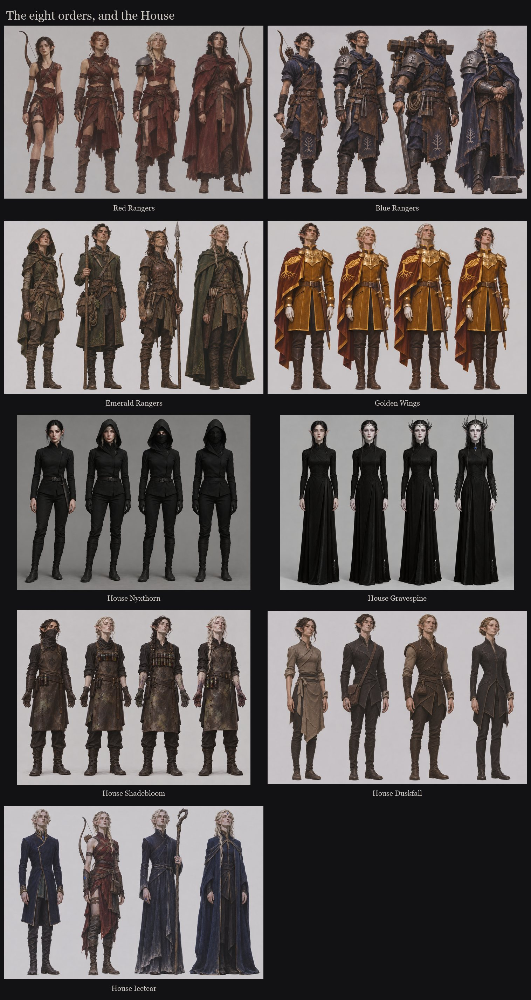

### The elven Houses and the Dark Pact Accords

Founded in the **Great Monster Wars**, because Mythical-Class creatures made
conventional war, in Revendrinn's words, *"a very organized method of dying."*
Four disciplines respectable societies preferred to pretend they did not need:

| House | Discipline | Founder |
|---|---|---|
| **Nyxthorn** | Shadow | **Revendrinn**, Hero of Shadows |
| **Gravespine** | Soul | **Renaris**, Hero of Souls |
| **Duskfall** | Silence and intelligence | **Herafel**, Hero of Silence |
| **Shadebloom** | Poison | **Nerynolion**, Hero of Poisons |

**They did not ask how heroes defeat monsters. They asked what the monster
required to stay alive, then removed it.**

**Leadership is meritocratic by design and can never be inherited.** Every
generation competes, and the one with the greatest mastery leads, even over
Nyxthorn blood. **Revendrinn refused to found an institution that could be
inherited by an idiot with the correct grandfather.** The principle outlived him.

**The current succession.** The candidates were **Anteira Nyxthorn**, **Solenyra
Gravespine**, **Caeleira Duskfall** and **Amarous Shadebloom**, and **the trials
lasted years**, because the Pact requires versatility in all four disciplines, not
just fighting. Anteira learned quickly but lacked Solenyra's instinctive intimacy
with soul magic. Caeleira dominated intelligence and ranged exercises. Amarous
understood toxins with alarming enthusiasm. **Solenyra learned almost everything,
including disciplines that did not belong naturally to Gravespine. Only poison
offended her.** *"Drink." "No." "You cannot become Pact Lord while refusing one
founding discipline."* Solenyra looked at the standings. **"I appear to be
managing."**

**Solenyra won.** **Santhur Nyxthorn refused to compete at all** and became an
Emerald Ranger instead, which the Revendrinn material treats as **completing his
ancestor rather than rejecting him**: Revendrinn spent his life disappearing into
darkness so others could walk in sunlight, and his descendant chose the sunlight.

**The Nyxthorn doctrine**, which is theme 2 written as law:

> Darkness is not evil. Darkness is merely where sight fails. A shadow can hide a
> murderer. It can also hide a child from a murderer. Poison can assassinate a
> king. It can also kill the creature devouring his people. Silence can conceal
> treason. It can also conceal refugees beneath the floorboards. **The moral
> weight belongs to the hand.**

**Alysheer's two laws for the forest**, from the Dark Continent: **sacred ground
cannot be settled, and no Dark House may ritually brand a former slave.**

### The human orders

| Order | What it is |
|---|---|
| **The Grey Knights** | human only, founded by **Tyberius Greyhide** because human strength was not enough. The Wall, the Thirteen Citadels, the **Black Raids**, and the **Dragon Core**. Earlier drafts call them **the Knight's Vigil** with **13 Castles** |
| **The Sacred Order** | the two bastions, the Winter King's seals, and the **Training and Research Consortium** |
| **The Northern Sacred Order** | the last defence after the Fae Wall was stripped |
| **The Legion of Light** | **Arch-Saint Lady Shallon's** army, which drives the corruption out kingdom by kingdom in the Fourth Age |
| **The Great Order of Light** | the City of Light's own, which the Grey Knight remnant joins |
| **The Knight Sisters**, and the **Order of the Night Sisters** | hunters dressed in white and crimson. **Light Councillors**, silver resonance needles, cleansing oils. **To Grey Knights, monsters were enemies. To the Sisterhood, they were symptoms** |
| **The Seven Knights of Determination** | Arthur's own, containing at least two beings far older than they appear: **Salomei as Lord Zeta**, and Merlin |
| **The Order of the Stag** | one **Stag Knight**, one **Knight Errant**, one **Squire**, and **Stag Initiates** trained in case all three die. Founded after the Black Knight rose a third time |
| **The Sun-Night Inquisitorium** | exists because the Black Sea Cults poison kingdoms from within rather than conquering them, **which is why information is its sharpest weapon** |
| **The Mage Knights** | Nadring Hemarc's brotherhood, neither wizard nor knight |
| **The Whisperers** | Floki's network |

### The enemies of the dark

Three bodies exist specifically to hunt what the Black Sea leaves behind, and
they are not the same kind of thing as the knightly orders above.

**The Gothica Knight Sisters.** A sisterhood of knights in the dark land of
**Gothica**, raised against an evil that **turned ninety-eight percent of the
men in their region into eldritch horrors driven by lust and madness.**
**Gothica is the last city in those lands that has not fallen**, and it is a
sisterhood for the plainest possible reason: there are almost no men left to
make it anything else. They are the stalwart guard of a besieged homeland, and
they hold it.

> **No order in the world has a better reason to exist**, which is exactly why
> Amelia chose it to hide inside. See section 22.

**The Inquisition.** Given the power and the authority to hunt beings of
darkness, **malicious or not**, and that last clause is the whole character of
them. They are not asked to judge whether a thing has done harm. They are asked
to find it.

**The Slayers.** Not an order but **a trade**, solitary and isolated, charged
and trusted with destroying malicious dark forces. You cannot join it. **A
Slayer must be born under a Gods Lamp tree during the Winter Solstice, on the
darkest night of the year**, and children born that way carry a heightened
perception of the dead and a natural pull toward harvesting magic. There are
never many. **The Gothica Knight Sisters, the Grey Rangers and the Grey Cloaks
all compete for them**, because the gift cannot be trained into anyone else.

**Which makes a Slayer the rarest thing in this part of the world**, and makes
the Gods Lamp trees worth watching every midwinter by people who want one.

### The Ranger Corps, and three competing schemes

The archive has three versions and they need consolidating into one.

| | The Garden Queen version, which is canon | The Arthur White layer | `Ranger Society` |
|---|---|---|---|
| **Red** | women only, assassins and scouts | the same, **highly prejudiced against males** | **outsourced to cities** |
| **Blue** | **men only**, smiths, engineers, craftsmen | **male only, espionage, politics and magic** | - |
| **Emerald / Green** | the largest, mixed, merged with the Green Wardens | mixed-gender, inclusive, multiracial | - |
| **Golden Wings** | the Queen's own | - | - |
| Others | - | - | a **Ranger Lord**, **Grey Rangers** as covert operatives and executioners, a **Black Ranger**, **White Rangers** under *"the awakened and his white legion"*, **Verdant** and **Black** |

**The Garden Queen version is canon**, because it is the newest layer and it has
a reason for every corps including the political one.

**The Crimson Veil**, their camp: a hidden fortress deep in **Hollanheart Forest**,
in enchanted summer woodlands, veiled by ancient magic and illusion, with the
**Black Lake** and the Ranger graves. Barracks, tavern, sick bay, training fields,
food hall, command centre, **and a magical bathing hall**, a temple-like chamber
where enchanted water continuously flows from the ceiling like gentle rain, used
for ritual cleansing and bonding. **Dawn is assassin training in blades, poisons,
stealth and magical combat. Evening is drinking and aggression rituals.**

### The Gypsy Tribes

Caused by the ascension of **Kalbeliya**, with the **Five Dancing Gods**.

| Tribe | Element | Ruler | Domain |
|---|---|---|---|
| **Forest Gypsies** | nature life | Chieftain | - |
| **Moon Gypsies** | water | High Priestess | religion |
| **Fire Gypsies** | wealth | Lord | commerce |
| **Sand Gypsies** | wind | Sultana | entertainment |
| **Blade Gypsies** | weapons | **Kha Vala Queen** | control |

**Queen Khabelia** of the Third Age is Kalbeliya's line, and the **underground
Gypsy kingdom is unearthed in the Age of Freedom.**

### Heraldry, and the one rule underneath it

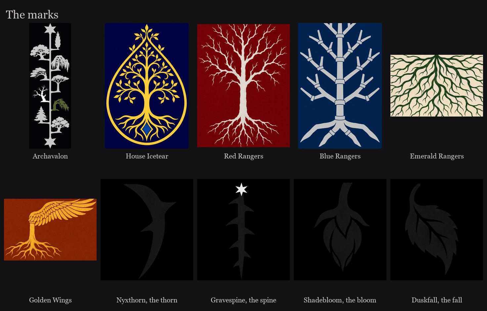

**The older a thing is, the less designed its mark is.** Mortals draw devices.
Gods leave impressions. Titans leave damage and nothing else. Every rule below
is that sentence applied to a different tier, and it means divinity can be read
at a glance without anyone being told.

| Tier | What it carries |
|---|---|
| **Primordial Titans** | **nothing.** A pure concept cannot be drawn. What can be drawn is the shape left where one touched the world, which is what the Great Trees are |
| **Universal Titans** | **nothing.** They built the astral bodies. The sky is their signature and they did not sign it twice |
| **World Titans** | **a seal, not a crest.** One shape, never enclosed, never divided, never combined with another. A World Titan is a chip struck off something, and a chip has one edge |
| **Prime Gods** | **a natural form.** Not a device but a thing the world already does. Icetear's mark is a shape frost makes on its own |
| **Races** | **a shape language**, not a mark. See below |
| **Kingdoms and Houses** | full heraldry |
| **Orders** | full heraldry, under the enclosure rule |
| **Individuals** | the house mark with one difference |

### The shape language of the races

**This is the most useful rule in the system**, because it lets a viewer who has
never seen a particular crest name the race that made it.

| Race | How their marks are built | Why |
|---|---|---|
| **Elves** | a tree, read bottom to top. **The crown may never be enclosed** and must break any frame it is placed in | roots in earth, trunk in the world, branches out of it. Nothing that reaches the Fae Realm can be bounded |
| **Humans** | a shield. Fully enclosed, hard bordered, bilaterally symmetrical | humans claim land, and land has edges. They were made three times by three hands, so a human mark says **who holds you**, never where you woke |
| **Mountainkin** | assembled from identical repeating units, geometric, no curves | they were built for the job of building, and a wall is the only honest thing they could put on a banner |
| **Beast Lords** | the creature alone, no field and no border, drawn as a track or a silhouette | a beast's mark is the mark it leaves on the ground |
| **Fae** | described, not drawn, and never the same twice | the same reason **every traveller reaches the Temple differently** |
| **Gypsy tribes** | worn on the body, not flown on a pole | a mark that has to move with you cannot be planted in soil |

### Colour, which means the same thing everywhere

Seven, obeyed by every race and every tier. **A colour is never chosen for
looking well.**

| Colour | Meaning |
|---|---|
| **Crimson** | a debt owed in blood. Not war and not passion. Something that must be repaid |
| **Gold** | what is kept. Inheritance, custody, a thing held in trust for someone else |
| **White** | what is lost. Ash, bone, frost |
| **Blue** | grief that can still be wept |
| **Black** | what was chosen. Deliberate, and answerable |
| **Green** | what grows without permission |
| **Grey** | what endures without being asked |

### Charges, and the only test they must pass

**A charge must be a thing that exists in the world.** If you cannot pick it up
or point at it, it cannot go on a banner. No abstract devices, no invented
geometry, no symbols of ideas. The idea arrives through the object.

Already in use across the archive: **the tree** (elven lineage), **the tear**
(Icetear), **the raven** and **the black feathered cloak**, **the phoenix
feather**, **the thorn, the spine, the bloom and the fall** (the four Dark
Houses), **the star** (Gravespine), **the wall** (the Grey Knights), **the
stag** (the Order of the Stag), **the wing** (Whitewing, Bloodwing, the Golden
Wings), **the constellation** (the Celestial Titans), and **the broken chain**.

### How marks combine

| Event | What happens to the mark |
|---|---|
| **Marriage** | two crowns over one root for elves, the shield divided vertically for humans. **Neither mark is reduced** |
| **A cadet branch** | the same mark, smaller, with **one element removed**. Never added. A younger line always carries less |
| **Conquest** | the taken mark is placed **beneath** the conqueror's, **intact and undefaced**. Damaging a mark you have taken is read as an admission you could not take it cleanly |
| **An oath between houses** | each adds the other's smallest element, so **neither mark is complete on its own** |
| **Disgrace** | the house **keeps its mark and loses its field.** The device floats on bare cloth. Everyone can see what you were and that nothing is holding you up |
| **Extinction** | the mark is drawn once more **in white** and retired |

### The mark of the world

**Archavalon has no designed mark. It has a tally.**

Eleven points on a single vertical line: **the two World Trees at the ends and
the nine Great Trees between them**, set where they actually stand. Nobody
composed it. It is simply where the trees are, which makes it the only mark in
the world that cannot be granted, revoked or disputed.

**And it already carries two wounds.** One of the nine is **burned**, which is
Snoweinter. One is **corrupted**, which is the Deep South tree the Black Sea
came ashore on. **Anyone who draws the world honestly has to draw them both.** A
version with eleven clean points is not a different style. It is a lie, and in
the later ages it is the lie the Empire prefers.

### The four Dark Houses, which are one plant

**Nyxthorn. Gravespine. Shadebloom. Duskfall.** Thorn, spine, bloom, fall. The
archive named them as one plant before anyone noticed, and the marks should say
so: **four parts of a single black growth**, founded together in the Great
Monster Wars and useless apart.

| House | Charge | Discipline |
|---|---|---|
| **Nyxthorn** | the thorn | shadow |
| **Gravespine** | the spine, with a single star | soul |
| **Shadebloom** | the bloom | poison |
| **Duskfall** | the fall, a single shed leaf | silence and intelligence |

**All four are black**, because black is what was chosen and these are four
disciplines that chose themselves.

**And they are read top to bottom**, which is the exact inverse of every other
elven mark in the world. An elven house grows up toward the Fae Realm. **A Dark
House is drawn descending**, because its work is done beneath the place everyone
else is looking. That is the Nyxthorn doctrine written as a shape:

> Darkness is not evil. Darkness is merely where sight fails.

**Leadership is never inherited in the Pact**, so none of the four marks may
carry a difference for a ruling line. There is nothing to difference.

### The four Ranger corps, which are one tree

All four descend from Hansall's companions and all four draw **the Snoweinter
tree**. The corps is the treatment, not the subject.

| Corps | The tree, drawn as | Field |
|---|---|---|
| **Red Rangers** | **bare and white.** The tree as it actually stood after Ashwinter | crimson, a debt owed in blood |
| **Blue Rangers** | **a scaffold.** The tree drawn as structure, beams and joints, the way a smith sees a standing thing | blue, grief that can still be wept. **Golian died holding a building up** |
| **Emerald Rangers** | **roots only**, spreading outward past the edge of the field like a map of paths | green, what grows without permission |
| **Golden Wings** | the tree with **a wing where the crown should be** | gold, what is kept |

**And the Golden Wings wear crimson.** Their capes are the deep crimson of the
Red Rangers, worn over the gold, and the court explanation is that crimson is a
royal colour older than any corps. **Nobody believes it.** Crimson in this world
means a debt owed in blood, it is the field the Reds fly their burned tree on,
and it was taken by the one corps created to watch them. **It is an insult
pitched exactly low enough to be deniable**: too small to protest without looking
petty, too deliberate to be an accident, and visible to every elf in the room.

**Hannarial has never once mentioned it**, which the Golden Wings read as not
having noticed and the Red Rangers read as the worst thing she could have done
with it.

**The Golden Wings mark is the only dishonest one in the set.** Gold means held
in trust, the wing is taken from Whitewing, and the corps was created so the
Queen would own one. **Everyone understood the real job was watching Hannarial.**
A mark that claims custody while performing surveillance is exactly the kind of
object this world produces.

### The Dragon Gods, and the sixth

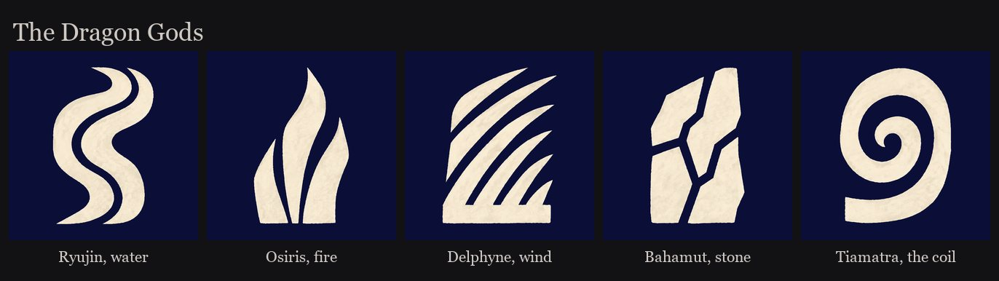

**A Dragon God's mark is not a picture of a dragon.** It is the shape their
element makes when it moves: the line water takes, the way fire climbs, what
wind does to grass, how stone fractures. Five shapes, no creatures.

**Nilrealm has no mark, and that is his mark.** Arrange the five and they do not
sit comfortably. There is a space between them, and the space is the right shape
for a sixth. **Anyone who has ever laid the five out has felt it, and most have
assumed they arranged them badly.** The old bloodlines who revere him leave the
gap deliberately. The younger generation close the five into a ring and call the
arrangement corrected.

### Still to be drawn

The rules above are enough to produce the rest, and these are not done yet:
**Hearthwinter's eleven Elven Houses**, each of which must trace to one of the
three Western trees. **The eleven human orders**, all enclosed, with the
enclosure chosen to say what they protect, so the Grey Knights take the Wall and
the Order of the Stag takes a stag within a ring. **The five Gypsy tribes**,
worn rather than flown, one per element. **The Ice Kingdom of Azaelion's eleven
families headed by Icetear.** And **the Prime Gods**, each a natural form rather
than a device.

### The marks, and what they record

Elven heraldry is tree heraldry, because an elven house is known by **where its
blood woke** rather than by what it conquered. The mark is a portrait of a
particular Great Tree, and it is kept honest: when something happens to the tree,
it happens to the mark.

| Mark | Whose | What it shows |
|---|---|---|
| **A living tree in gold, its branches curling, enclosed by a blue tear** | **House Icetear** | the house tree in full leaf, worked in gold, with the tear drawn around it rather than falling from it |
| **A bare white tree on a red field** | **the Red Rangers** | the same corps banner they always carried. **Before Ashwinter the tree was in leaf** |

**The Red Ranger tree is a record, not a design.** The corps flew a living tree on
red until the night the Great Northern Forest burned with Snoweinter inside it.
They did not replace the banner. **They redrew the tree as it actually stood
afterwards, white and bare, and kept flying it.** Every woman who joined in the
years after, and recruitment tripled and kept going, enlisted under a picture of
the thing that was done to her.

> **They still protected the Queen's kingdom. They did not fight for the Garden
> Queen. They fought for Ashwinter.** The banner says so without a word on it.

**And the two marks are the same tree twice**, which is not coincidence, because
**Hannarial Icetear** was the Red Ranger Captain who lost her family that night.
House Icetear carries the tree gold and living inside a blue tear. The Rangers
carry it white and dead on a red field. **A tear is grief that can still be wept.
The red field is what is left when it cannot.**

---

## 25. Artifacts

### The three relics of the first family

| Relic | What it is |
|---|---|
| **The Sword of Light** | Adamas's, manifested from his own soul at the brink of death in the Primortal Duel. **"When blade met blade, light answered devotion. Hyperion did not intervene. He responded"** |
| **The Shield of Adamas** | the father's |
| **The Spear of Abel** | **the murdered son's soul**, forged by his father from bone, blood and grief **into something the abyss could not swallow. Not holy. Not damned. Bound** |
| **The Cup of Evalon** | forged from Evalon's remains, **and it punishes false oaths** |

### Everything else named

| Artifact | Who holds it |
|---|---|
| **Mjolnir**, the Warhammer | **Thorin**, first King of the Humans in the north-east. His people gained **infinite potential** |
| **Gungnir**, the Great Spear | **Wulfnir**, first King of the Vikings. Knowledge and foresight |
| **Gram**, the Dragon Blade | **Hella**, first Queen of the Valkyrie. Divine femininity, and **no need of males to bear children** |
| **The Gods Aegis** | **Durrigon**, first King of the Dwarves. A mountain of the immortal ore **Urrock** |
| **Kratos and Hephaestus**, the giant axe and hammer | **Welgrimm**, second King of the Dwarves. Creativity in destroying and crafting |
| **The Spear of One**, the **Bow of Ghost Wolf**, and **Skoll** | **Aquila the Wolf** of the Seven |
| **The Vulpine Mantle** | **Alysheer the Fox** |
| **The Rein** | **Thaerel**, and it breeds Night Mares from ordinary mares |
| **The Dragon's Impaler** | **Dracule Strigorra's**, kept unused in the Dark Angel's **Grand Mausoleum** |
| **The Great Stag Blade** | **Gareth Sedrick** |
| **The White World Staff**, the **phoenix feather fan**, the **dragon-scale tome** | **Nilrealm** |
| **A crystal staff** | **Seneal Icetear**, from three years inside Whitewinter's dream |
| **A silver staff** | **Salomei**, with which she raises **a barrier of pure thought, a fortress for the mind** |
| **A relic reserved for the end of hope** | **Budz**. An ancient crystal forged around **both the Light of Hyperion and one sacred scale gifted by Nilrealm** |
| **The Vial of Severed Immortality** | **Lucifial's Avatar**, in the Abyss. **It cannot be destroyed without unravelling the soul bound to it** |
| **A black vessel** | **Carmaline's** ritual, holding Dracule's soul beneath the Dark Castle |
| **A sapphire pendant** | **Solenyra**, in her left eye, holding Golian |
| **Hellionore** | the **Black Knight's** metal, which spontaneously combusts |
| **The Enigma of the Fleur De Lis** | an elven box that protects the bearer from malicious magic **and can capture the most powerful souls in the realms** |

**And one motif nobody has written down. Every major character carries one small
object**, and it is consistent across documents written years apart, which makes
it deliberate.

| Character | Object |
|---|---|
| **Anthurian Bloodwing** | a single aging white feather, in a black reliquary |
| **Seneal Icetear** | **Khairal's wooden wolf** |
| **Mervane** | the scales of dead Elu-Dragar, worn in her armour, **the last one removed at the end** |
| **Solenyra Gravespine** | a sapphire pendant holding her brother |
| **Thaerel** | a token from Conquest's transformed bridle |
| **Hadrian Sedrick** | a small sapphire amulet that glows near Seneal |

### The materials

| Material | What it does |
|---|---|
| **Star Silver** | channels and amplifies energy-based attacks. **The world's first currency**, and still dominant in enchantment and shaping |
| **Urrock** | immortal ore, the dwarves' mountain |
| **Fae Ore** | what Sinbad's bullet was made of |
| **Faesilver** | bow reinforcement, and elven craft generally |
| **Hellionore** | spontaneously combusts |
| **Iron** | superior for durability |
| **Copper** | superior for conductivity in energy manipulation |
| **Gold** | the optimal currency, for stability, malleability and symbolic appeal - **and the beginning of the Age of Want** |

---

## 26. The language, and how to name anything

`Ancient Language` is nine lines long and it is a master key.

| Root | Meaning |
|---|---|
| **Elu** | Elves |
| **Dra / Dragaar** | Dragon |
| **Hsal** | Soul |
| **Eraklar** | Defiler |
| **Hema** | Golden |
| **Chandra** | Moon |
| **Mor** | Death |
| **Na** | Petal |
| **Gan** | Life |
| **Rig** | Assimilate |

Which means the existing names already decode:

- **Elu-Dragar** = Dragon Elves. **Elu-Hsal** = Soul Elves. **Hsal-Erakla** = Soul
  Defilers. **Elu-Chandra** = Moon Elves.
- **Morgana** = **Mor + Gan**, Death and Life.
- **Morrina** = **Mor + Na**, Death and Petal.
- **Mór-Ríoghain** = **Mor + Rig + Gan**, Death, Assimilate, Life.
- **Nara**, the Angel of Lust, carries **Na**, petal.
- **Hemachandra** = **Hema + Chandra**, Golden Moon, which is literally true in
  Sanskrit. **The Goldmoon family is the same name in the human tongue, and Hemarc
  is the same root.**

**And the witch names are a convention, not a collision.** `Witch Names` says
outright: **"Most Legendary Witches start with M."** The convention is **Mor,
death**, because that is what Mór-Ríoghain is. The legendary witches on record are
**Mór-Ríoghain, Morgana Pendragon, Megan, Helena, Susan Grimhildir** and **Marie
Adler.**

**So Moraine, Morraine, Morrina, Morgana and Mór-Ríoghain are not five mistakes.** They
are five witches named by the same custom. **The only thing that needs fixing is
clarity for the reader**, and the cleanest fix is to give each one a distinct
second name and use it consistently: **Lady Moraine of Lionheart**, **Queen
Morraine of Verneuil**, **Morrina Penfyre the Great Witch of the West**, **Morgana
Pendragon**, and **Mór-Ríoghain**, who needs no second name because she is a god.

### The elven naming system, by region

The root is **Silvern**, and each region maps to a real culture.

| Region | People | Families |
|---|---|---|
| **North** | the **Silvern Elves** | - |
| **East** | Silvern Hybrid, plus **Chandran** Moon Elves | **Zhugelian, Amateriel, Fujinithir, Ryujinthir.** Silvlong lines: **Longweiril, Kazukiel, Arashiel, Longriel** |
| **West** | Silvern Hybrid, **Silvanic** | Silvlong lines: **Arthurial, Merlinus, Morgandrial** |
| **South** | Silvern Hybrid, **Silvankari**, plus Chandran | **Hemachandiril, Wickramanduil, De Silvavanduin, Amaravanduin, Menduvanduin.** Silvankari lines: **Fernandurial, Rajasingthran, Padukindel, Chopravanduin, Pereranduril** |

**East is Chinese and Japanese.** **West is Arthurian.** **South is Sri Lankan.**
**Silvlong marks the dragon-blooded lines.** And `Family & Trade Names` gives
**Forger** and **Smith** as the famous smithing names, **Praetor** and **Jaeger**
as the famous hunting names.

### The Ice Kingdom

**Azaelion**, with eleven main families headed by **Icetear**, and ten
sub-families beneath them: **Winters, Blizzard, Cold, Ice, Frost, Freeze, Chill,
Snow, Hail** and **Whites**. **Lady Whitewinter** and **Arthur White** both sit in
that naming space.

---

## 27. How to read the archive

**There are three layers, and this resolves most apparent contradictions.**

1. **The KB and HIKB documents** are the earliest layer: short structured entries
   written for a game. Names are shortened - Hannah, Anthuriun - and details are
   rougher.
2. **The structural documents** are the middle layer: timelines, cosmologies,
   powerscales, era events.
3. **The novellas** are the newest and most detailed, written in the distinctive
   short-line style, **and they supersede the other two wherever they conflict.**

**And one further rule, for tiers.** The novellas call Mór-Ríoghain the **Prime Goddess
of Mysteries and Magic**, the canon ladder has **Mór-Ríoghain** as a **World
Titan**, and `The God Realms` has her as an **Old God born of Nyx**. The fix costs
nothing: **mortals say Prime Goddess because mortals cannot tell the tiers apart.
The ladder is the true structure, and the novellas are mortal perspective.** That
lets every in-world document call powers whatever its speakers would actually call
them, and it resolves the same problem wherever else it appears.

### The game layer

`Runes of the Ancients` uses a fourth set of names for the same world. Worth
knowing so it is not mistaken for canon drift.

| Game layer | Canon |
|---|---|
| **New Albion** | the Western Continent |
| **The Knight's Vigil**, with **13 Castles** | the Grey Knights and the thirteen Grey Citadels |
| **The Pendragons** | the Penfyres |
| **The Sanguine's Conclave** | the vampires |
| **King Dracule Sanguinarr**, First King of the Night, in the **Kingdom of Maw** | Dracule Strigorra |

It also contributes genuinely new material: the **Necrotic Dragon Mormennra**, the
ogre warlord **Gargogg the Four Armed**, **The Twins Last Stand** where two dwarven
kings died holding a narrow mountain path and destroyed most of an ogre horde,
**King Ulceaus Pendragon**, and the three northern kings who founded the Vigil:
**King Magus with his mage knights, King Tiberius with his grand knights, and King
Godrick with his paladins.**

### The six documents that are not in this bible, and why

| Document | Why |
|---|---|
| **Aionia** | **empty.** Title only |
| **2nd Saga** | **a duplicate.** It is `The Garden Queen`, sections VIII to XXIII, verbatim. So Saga II is the Garden Queen story and Saga I is The Last Days of Legends |
| **Icetears Legacy** and **HIKB House Icetear** | **earlier drafts** of material the novellas supersede. Icetears Legacy is the Hadrian Sedrick opening with the protagonist named Hansall, and the same two gifts: a frost amulet from his little brother and a black dagger fan from his older brother |
| **Marial** | a Digimon roleplay character sheet. Not this world |
| **Rhogar Goldmoon** | a Dungeons and Dragons backstory. Not this world. See below |
| **The Fall of Civillity** | left out on purpose. See below |

### Two things that are not Archavalon

**`Rhogar Goldmoon`** is a Dungeons and Dragons character backstory, set explicitly
in **Abeir** and **Toril**, with D&D's own Bahamut, Tiamat, Asgorath, Garyx,
Dragonborn and the Platinum Cadre. **It is not part of this world.** It is worth
noting for one reason only: it is almost certainly where **Bahamut** and **Tiamat**
came from as a sibling pair, before becoming Ra's children **Bahamut the Black**
and **Tiamatra the Dragon Queen.** And the **Goldmoon** name crossed over, where it
is the human rendering of **Hema-Chandra**.

**`The Fall of Civillity`** is a satire of the modern world in fantasy dress. **It
maps fantasy races directly onto real ethnic groups with bracketed labels and
attaches crime, drugs, gang membership, child abandonment and sexual violence to
those groups. None of it is in this bible, and I would not put it in**, because a
published world bible built on race-coded crime stereotypes would sink the project
with any reader, publisher or collaborator who opened it.

**The usable idea underneath it is already in the world and already stronger
there.** Comfort breeding weakness is Dheivan Hemarc's entire arc, Antharaiel's
entire reign, and Hansall's warning on the wall that **"when rulers inherit peace,
they begin believing strength is an embarrassment belonging to less civilized
generations."** That is the same argument made about character rather than about
peoples, and it is far more devastating.

### `Verdance`, a separate frame with one canon hook

A **Pantheon of the Sun** whose God King and Queen permitted five planets, each
monarch **splitting into five beings** with the strongest holding the original
consciousness, so that whichever survived alone would rule. The **Yellow King**
took the first planet, the **Scarlet Queen** the second, the **Midnight Queen** and
**Verdant Queen** contested the third, and the **Crimson King** took the fourth.
Then the clones of the Midnight and Verdant Queens allied against the other three,
won together in violation of their parents' law, and the Verdant clone hid on the
fifth planet **as the Sub Midnight Queen's most loyal bodyguard.** **Morgana is the
reincarnation of the Midnight Queen's true consciousness**, and **Morbihan is her
clone.**

**The canon hook:** the powerscale lists **the Crimson King** and the **Violet
Queen** as Prime Gods at 67,000 and 55,000. **So at least two of the
colour-monarchs are already in the main cosmology**, and this frame may be
recoverable rather than discarded - especially alongside the six-world Fae Exodus,
which also splits a conflict across planets.

### Where Mór-Ríoghain's Temple came from

`Mór-Ríoghain` is a short first-person document in which the author describes the
Mór-Ríoghain as a presence who stands in the corner of his bedroom at night, watching
with compassion rather than hostility but with a small intimidating presence, lists
what she led him to and what she improved in him, and notes that **she tests his
will constantly and disappears whenever he fails.**

**That is the origin of the Temple mechanic**, and of Alice's and Annie's identical
test, and of the Path of Vaen's second pillar, and of the Trial of Character on the
website. **It is the personal root of the world's central idea, and it should be
treated as the source rather than as a curiosity.**

---

## 28. What is settled, and what is still open

### Settled by this read

| Question | Answer |
|---|---|
| What the world's name means | **Arch-Avalon.** Avalon is the heaven realm, and the Kingdom of Archavalon was formerly **Coelsius** |
| The two Anthurians | **Bloodwing**, Cainan's daughter and first Dark Lord. **Icetear**, the Red Ranger Vice Captain. Both female, both spelled "Anthurian" |
| Who the Garden Queen is | **Antharaiel Ellescand**, born Whitewing, **Bloodwing's aunt** |
| Who shaped the Beast Lords | **Freyva and Glorion**, to cull corruption and sustain the world |
| Tiamel's parentage | **Osiris the Ancient Dragon King** and **Galatrel, Hansall's sister.** Two Osirises, one divine and one a king of his line. Both earlier accounts were right |
| Why Cain killed Abel | **Jealousy of Abel's friendship with the elf Glorfarsall**, with Lucifial whispering |
| Where the Grey Knights come from | **Tyberius Greyhide**, after watching Conquest kill his father. **Human only** |
| What the Path of Vaen is for | It unlocks **Vaen State**, and it is the discipline **Slayer Angels** need to hold light and darkness at once |
| What the northern mist is | **Akidna**, imprisoned beneath the Northern Sea by Mór-Ríoghain, Triton and Neptune. It is leaking out of her |
| Why humanity is mortal | **Evalon traded its immortality in fear**, and the vial is in the Abyss |
| Humanity's three origins | **Hyperion** in the West, **Atlor the Mountain Forger** in the north-east Central, **Ra** in the East |
| What tier Typhon and Akidna are | **World Titans**, because **Lilith and Tartarus** are. The powerscale records them after their defeat |
| Who the World Titans are | **Ra, Hyperion, Soulomon, Mór-Ríoghain, Nephthys, Freya, Frey**, plus Lucifial, Hades, Glorion, Freyva, Atlor, Lilith, Tartarus, Typhon and Akidna. **The spreadsheet's "Ascendant Gods" heading is retired** |
| What the billion tier is | the lesser powers of the **Age of Betrayal**, **not Titans of any tier.** The **Dwarf Titan** name is retired, and so is the fourth planetary generation |
| Whether the power numbers are canon | **No. They are early concept prototypes.** Kept for reference, never used to rank anything. **One exception: Hope at 17 and Fear at 16 is canon** |
| Who kills Cainan | **Hansall breaks him. Anthurian kills him.** Both drafts were half right |
| Where vampires come from | **the Prime God of Blood.** Elves first, corrupted into **Strigoi**. Strigoi and humans made the **intelligent vampires**. Direct conversion made the **High Vampires** |
| What the Prime God of Blood is | **a true Prime God**, born of the world's life essence, which **overwhelmed the Black Sea corruption** and kept the splinter |
| Who kills Tiamel | **Cainan**, from behind, while she was snapping Anthurian out of the blood haze. **Mammon struck her out of the sky first and she burned him to ash** |
| Why Mammon is hunted later | **she destroyed the body, not the entity.** It left the standing ash and went back down through the Breach |
| Who Sal is | **Salomei**, an immortal primordial who has worn human, archangel, lichlord and devil queen forms |
| What the Spear of Abel is | **Abel's own soul**, bound by his father |
| Why Solenyra's eye is blue | **Golian's soul**, in a sapphire, **in violation of her own House's oldest law** |
| Whether Doomslayan is alive | **Yes**, as the Great Demon Warden, on the far side of the Breach |
| Hadrian Dravus and Hadrian Sedrick | **Two different people** |
| The Grey King | **Fang** |
| Snoweinter | becomes **Ashwinter** |
| The third age | the **Age of Kingdoms** |

### Decisions you have already made, recorded here as canon

1. **Typhon and Akidna are World Titans**, because both their parents are.
   World Titans create rather than conceive, so their birth is the one
   exception in existence, forced by Tartarus on Lilith through the gap
   Lucifial opened.
2. **The third age is the Age of Kingdoms.**
3. **The Grey Knights are human only.**
4. **Fear is a Primordial Titan.**
5. **Dragons are the firstborn of the five.**
6. **Humanity was created three times, on three continents, by three hands.**
7. **Osiris, Delphyne and Ryujin returned to their divine realms and left their
   heirs:** Delphyne's dragons became **wyverns** in the Central mountains,
   Osiris's became **nature dragons** in the south-eastern jungles of the East,
   and Ryujin's became the **long eastern dragons** along the misty rivers and
   mountains of the East.
8. **Bahamut is imprisoned deep in the south-west of the Western Continent**,
   where **his presence strengthens the corruption.** Most of his corrupted brood
   is imprisoned with him, **and some escaped into the deeps of the southern
   Central Continent.**
9. **Amelia slays Anthurian in the Age of Darkness**, not before. During the Age
   of Kingdoms the Black Sea corruption stays contained in the southern Central
   Continent, spreading into the southern Eastern Continent and the Southern Dark
   Continent, **and after Bloodwing becomes the Dark Angel she vanquishes the
   invading Black Sea Angel there.**
10. **Alfar Chandralon** is the squire's name.
11. **Atlor the Mountain Forger** is the forge Titan of the north-east.
12. **Hansall beats Cainan until he begs forgiveness.** Cainan then takes
    Anthurian hostage, having never understood how far past him she has grown,
    and **insults her dead mother**, and she slides out of his grasp and kills
    him. **Her last line is still to be written.**
13. **Vampires come from the Prime God of Blood, in three results.** The
    **Strigoi** are corrupted elves. The **intelligent vampires** are Strigoi
    crossed with humans. The **High Vampires** were converted directly, and they
    are **Dracule Strigorr, Llanahs, Melissra Orscina, and eventually Amelia.**
14. **Tiamel's death is five moves.** Mammon wings her out of the sky, she burns
    him to ash as they crash, the blood-hazed Anthurian tears her wings off on
    Cainan's orders, **she and Hansall snap the girl out of it, and Cainan kills
    her from behind while everyone is watching his daughter.**
    **What she destroyed was Mammon's manifested body**, and something came up out
    of the standing ash and went south, back through the Breach. **That is why he
    has to be hunted there at the end of the age.**
15. **Hope at 17 and Fear at 16 is deliberate and canon.** *"There must be
    something to overcome fear. Be that hope. Though fleeting, when pushed to the
    brink of despair it will be your only light out."* Fear is permanent and
    everywhere. **Hope is fleeting, and still wins by one.**
16. **The MJD power figures are outdated concept prototypes**, not canon. The
    tiers are kinds of being, not strength brackets. **Ra, Hyperion, Soulomon,
    Mór-Ríoghain, Nephthys, Freya and Frey are World Titans**, and the spreadsheet
    heading that called them Ascendant Gods is retired. The billion tier is the
    lesser powers of the **Age of Betrayal**, who are not Titans at all.
17. **Prime Gods are born of the world, and the world is born of the Titans
    before the World Titans.** The **Prime God of Blood** is one of them, born of
    the life essence in all living things, **manifesting after the Cataclysm's
    corruption had taken root.** The Black Sea reached it and **it overwhelmed the
    Black Sea**, keeping only a lingering seed. **Malicious, but nowhere near as
    broken as Bahamut.**

### Still open, and worth your decision

**1. Wyverns and wyrms have two origins too.** One account makes them **damaged
dragons** that "survived but did not heal correctly" under Akidna's distortion.
Your decision gives **Delphyne the wyverns** and **Bahamut the earth wyrms** as
their proper lines. **Either there are two origins, or Delphyne's and Bahamut's
broods were the ones that did not heal** - which would be devastating for both and
would explain why Bahamut's line keeps losing limbs down the generations.

**2. Which Aquila.** The Seven's Aquila was a half-elven slave of Karne. The Fifth
Age Aquila is a **Moon Elf and Dragon Elf** commanding the Moon Rangers. Either the
name recurs, or it is the same woman after centuries, which the Karne Aquila's
ending does not obviously allow.

**3. The Age of Light does not fit.** The site lists it as the fifth age, but the
years it occupies are the **Age of Broken Crowns**, which is a betrayal age: a
Saint Knight betrays the Archsaintess, sixty percent of the Night Sisters die, and
Amelia takes the Dark Lord title. **Either the Age of Light is a different span, or
it is what people called that age before they knew what happened in it** - which
would be better.

**4. Depravity's dating.** Llanahs leaves Depravity in the **Second** Age, but the
**Baron of the Southern Territories** is said to have built "the great rogue city
of Depravity" in the **Third**. **The better reading is that he seized or rebuilt
the original**, because a city whose whole character is that history can be bought
is exactly the place a later Baron would buy.

**5. Three Ranger schemes.** Section 24 recommends the Garden Queen version. The
others need either folding in or retiring.

**6. The witch names.** Section 26 recommends keeping the convention and giving
each witch a consistent second name, rather than renaming anyone.

**7. Nara's corruption.** The source renders it in explicit sexual detail. **This
bible states it clinically.** Worth deciding how the published work handles it.

---

## 29. The ten things to build next

Not a plan, just the ten places where the archive is already loaded and nobody has
pulled the trigger.

1. **Heaven's Throat's golden statues**, foretold to come to life if the empire was
   threatened, with Dragon's Den carved into the same mountain and Grey Knights
   walking past them every day.
2. **Glorfarsall Elysium is still alive and hidden**, and his reason for existing
   is a murdered human boy.
3. **Solenyra has broken the oldest law of her own House**, for love, and she is
   the last Gravespine who could judge her for it.
4. **The Seven murdered Sederous**, the King of Scraps who built a home for
   mixed-blood outcasts, and they were seven half-elven slave-children.
5. **Helena's full arc as one line**: magic school founder, Great Witch, defector,
   archangel, fallen, and the soul inside the Dark Angel who gives up more power
   than the Black Titan has.
6. **Dracule's soul waits in a black vessel for Bloodwing's blood**, which means
   her descendants are a key somebody will eventually use.
7. **Akidna's mist is the only road between the continents**, and the Garden Queen
   stripped the guard off it.
8. **Dheivan's Faelorn bond**, which requires absolute trust from the one man who
   has never risked anything.
9. **The six worlds and the win condition**: the combined energies of all six
   planets can raise a god to a Titan, and Archavalon may be the sixth.
10. **Morgana's twelve**, assembling three hundred years after everyone else is
    dead, to resurrect the land.
